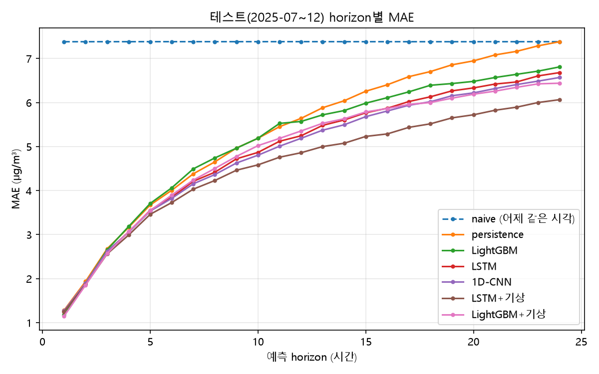
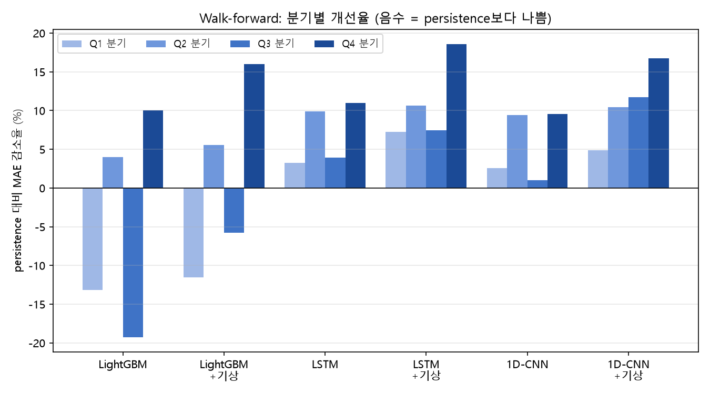
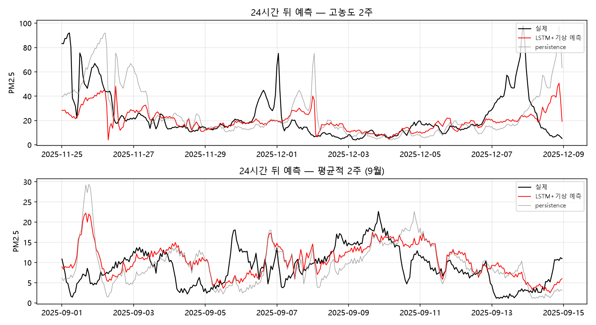
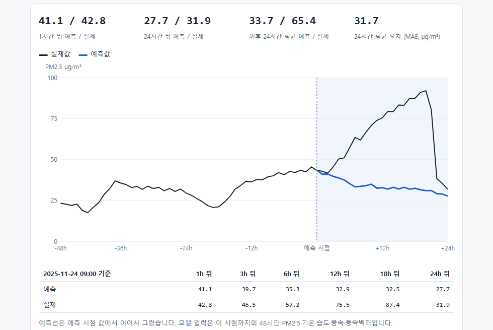
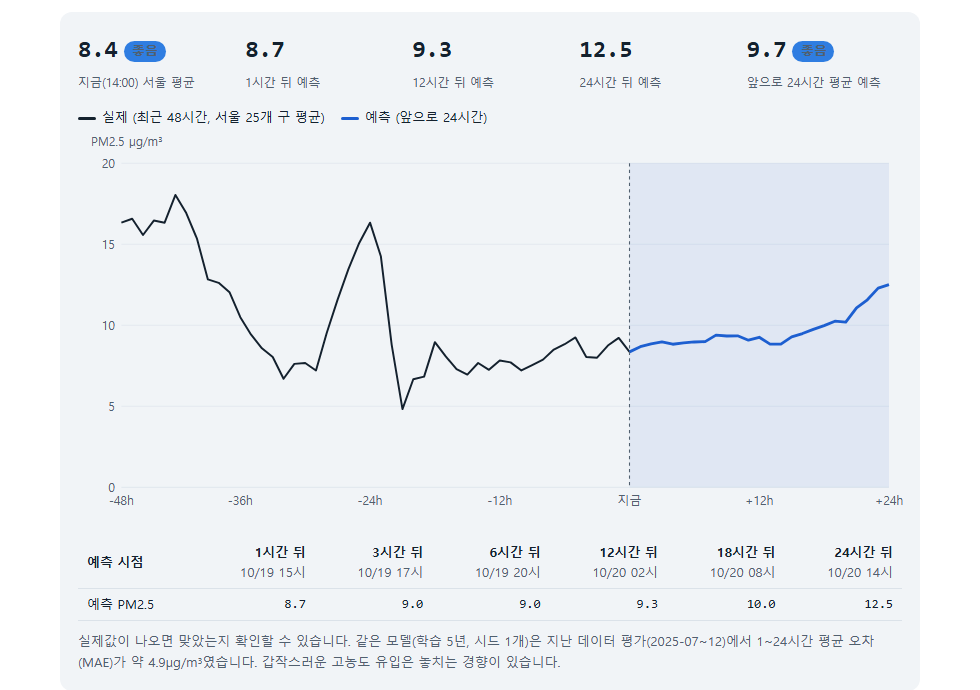

# 서울 PM2.5 시계열 예측

서울 25개 자치구 측정소 평균 PM2.5를 **1~24시간 뒤까지** 예측하는 프로젝트입니다.
공공데이터 정제부터 baseline 대비 모델 비교, 기상 변수 효과 검증, 고농도 실패 분석, ONNX 변환과 API 서빙까지 한 사이클을 다룹니다.

> 이전 프로젝트 [cnn-multi-framework](https://github.com/Gugaeun/cnn-multi-framework)(이미지 분류)에 이어, 같은 파이프라인(학습 → ONNX → 서빙)을 시계열 도메인에 적용했습니다.

## 결과 요약

테스트 구간 2025-07~12, 1~24시간 뒤 평균 MAE(µg/m³). LSTM·CNN은 시드 3개를 평균낸 앙상블 예측입니다.

| 모델 | MAE | naive 대비 | 다음날 평균 MAE |
|---|---|---|---|
| naive (어제 같은 시각) | 7.38 | – | 5.88 |
| persistence (직전 값) | 5.32 | −28% | 4.72 |
| ARIMA(2,0,1) | 5.59* | – | – |
| LightGBM | 5.13 | −31% | 4.25 |
| LSTM | 4.94 | −33% | 4.08 |
| 1D-CNN | 4.87 | −34% | 4.07 |
| 1D-CNN + 기상 변수 | 4.55 | −38% | 3.46 |
| LSTM + 기상 변수 | 4.56 | −38% | 3.53 |

\* ARIMA는 계산이 느려 3시간 간격 시점만 평가했고, 같은 시점의 persistence는 5.32입니다(ARIMA가 더 나쁨). 다음날 평균은 23시에 낸 24시간 예측의 평균을 실제 다음날 평균과 비교한 MAE입니다(183일). 본 결과는 기본 설정입니다. 설정을 검증 구간에서 골라 다시 학습해도(`src/13_tuning_check.py`) 테스트 MAE는 LightGBM(PM2.5만) 5.13 → 5.11, LightGBM(+기상) 4.90 → 4.86, LSTM+기상 4.56 → 4.50, 1D-CNN+기상 4.55 → 4.59로 −1.4%~+0.9% 변하는 데 그쳐 순위는 같았습니다(검증 구간에서는 1~5% 좋아짐). LSTM·CNN은 시드 3개 앙상블, LightGBM은 단일 모델입니다(앙상블 효과는 작았음: LSTM 시드별 평균 4.95, 앙상블 4.94).



*예측 시간(horizon)별 MAE. 1시간 뒤는 모든 모델이 비슷하고 멀어질수록 LSTM·1D-CNN(+기상)이 낮습니다.*

- **기상 변수 효과**: 기온·습도·풍속·풍속벡터를 함께 넣으면 PM2.5만 쓴 모델보다 LSTM은 약 6.6%, LightGBM은 약 4.4% 오차가 줄었습니다. 개선은 예측 시간이 길수록 큽니다. 변수 하나씩의 효과(1~2%)는 시드 간 차이와 비슷해서 단정하지 않습니다.
- **분기별 재확인(walk-forward)**: 2025년 네 분기를 각각 테스트로 두고 확인하면, LSTM·1D-CNN은 모든 분기에서 persistence보다 낮았고(평균 +5.6~11.0%), 기상 변수를 넣으면 매번 더 낮아졌습니다. LightGBM은 분기에 따라 persistence보다 나빴습니다(−4.6%~+1.1%).
- **장기 데이터·학습 곡선(2018~2026-09)**: 학습 때 쓰지 않은 2026-01~09(고농도 723시간)로 평가해도 결론이 유지됩니다. persistence 대비 감소율은 LSTM+기상 12.3%(95% 구간 7.8~16.5), 1D-CNN+기상 9.2%(4.8~13.6)이고 LightGBM(PM2.5만)은 −2.0%(−8.3~4.2)로 persistence와 구분되지 않습니다(CPU, 시드 3개, 학습 2024 1년. 구간은 하루 단위 부트스트랩 95%). 학습 기간만 1·3·5·7년(항상 2024년 말까지)과 5년(코로나 2020~21 제외)으로 바꿔 GPU로 시드 5개 앙상블을 학습하면(2026 평가, 1D-CNN+기상) 감소율이 10.9% → 13.6% → 15.1% → 14.3%(코로나 제외 14.3%)로 5년까지 좋아지다 멈춥니다. 코로나 시기를 빼도 같습니다. LightGBM+기상은 4.6% → 14.1% → 15.2% → 14.4%로 3년부터 신경망과 비슷해지며, 신경망과 LightGBM+기상의 우열은 학습 연수·평가 구간에 따라 달라 일관되지 않습니다(2025 하반기에는 신경망이 약 4% 앞섬). 고농도 놓침은 7년을 학습해도 그대로입니다(24시간 뒤 나쁨 구간 편향 −21.5 → −19.0, persistence −13.6). 데이터 부족보다 입력 정보 부족으로 보입니다(추정). GPU와 CPU 차이 확인(`src/17_cpu_check.py`, 1D-CNN+기상 시드 5개): 2026 감소율은 학습 1년에서 CPU 9.5% 대 GPU 10.9%, 5년에서 15.1% 대 15.1%이고 2025 하반기는 1년 14.6% 대 14.4%, 5년 16.5% 대 18.2%로 차이가 최대 1.8%p입니다. 학습 연수에 따른 변화(1년 → 5년)보다 작고 방향은 같습니다(어느 쪽이 체계적으로 낫다고 할 수는 없음). (`src/14_build_long_dataset.py`, `src/15_longer_data.py`, `src/16_learning_curve.py`, `results/longer_data.csv`, `results/learning_curve.csv`)
- **NumPy GRU**(`src/19_numpy_gru.py`, `results/numpy_gru.md`): GRU의 forward와 BPTT backward를 NumPy만으로 구현하고 중앙 차분 gradient check로 검증했습니다(파라미터별 상대 오차 최대 1.5e-8). 같은 모델을 윈도우 24시간, MSE, 시드 1개로 짧게 학습하면 테스트 MAE 5.09(persistence 5.32, 4.3% 낮음)입니다. PyTorch 실험과 조건이 달라(윈도우·손실·시드) 숫자를 나란히 비교할 수 없고, 목적은 구현의 정확성 확인입니다.


*분기별 재확인(walk-forward). 음수는 persistence보다 나쁨.*

- **고농도 구간 실패**: 농도가 높을수록 과소예측이 커집니다. 24시간 뒤 "나쁨(36~75µg/m³)" 구간에서 평균 약 24µg/m³ 낮게 예측합니다.


*24시간 뒤 예측과 실제값. 고농도 정점을 놓칩니다.*

- **고농도 탐지(나쁨 이상, 35 초과, 테스트 181시간)**: MAE가 줄어도 경보 성능은 persistence보다 나아지지 않았습니다. 6시간 뒤 재현율은 persistence 0.64, LSTM 0.53, 1D-CNN 0.50, 기상 변수 포함 모델 0.35~0.40이고, 24시간 뒤에는 모든 모델이 거의 놓칩니다(재현율 0.00~0.09). 순위 지표(AP)도 모델 0.19~0.21, persistence 0.21로 차이가 없습니다. (`src/11_event_metrics.py`, `results/event_metrics.md`)
- **고농도 개선 시도(손실 함수)**: 정답이 35를 넘는 샘플의 손실을 3배로 하면(1D-CNN+기상) 6시간 뒤 재현율이 0.40 → 0.61로 persistence 수준까지 오르고 24시간 뒤 나쁨 구간 편향도 −22.7 → −16.7로 줄지만, MAE는 4.55 → 4.74로 나빠지고 24시간 뒤 정밀도는 0.53 → 0.23으로 떨어집니다. 분위수(0.7) 손실은 MAE를 5.72까지 잃습니다. 순위 지표(AP)가 거의 그대로라 손실 함수만으로 해결되는 문제가 아닌 것으로 보입니다(추정). 서빙 모델에는 적용하지 않았습니다. (`src/12_event_loss.py`, `results/event_loss.md`)

자세한 표와 그래프는 `results/`와 `report/index.html`(결과 리포트 페이지)에 있습니다.

## 데이터

- **출처**: 서울 열린데이터광장 [서울시 대기오염물질 측정정보 (OA-23044)](https://data.seoul.go.kr/dataList/OA-23044/S/1/datasetView.do), 공공누리 1유형(출처표시).
- **실시간 데모의 출처**: 한국환경공단 에어코리아 [대기오염정보 OpenAPI](https://www.data.go.kr/data/15073861/openapi.do)(공공데이터포털). 이용 조건은 해당 서비스 페이지를 따릅니다(정확한 이용허락범위는 이 문서를 쓰는 시점에 직접 확인하지 못했으니, 공개 전에 서비스 페이지에서 확인하세요). 서울 25개 구 평균은 이 프로젝트에서 계산한 값이고 에어코리아의 공식 수치가 아닙니다.
- **기간**: 본 실험은 2024-01-01 ~ 2025-12-31, 시간 단위 17,544행. 장기 확인 실험에는 같은 전처리로 만든 2018~2023, 2026-01~09를 이어 붙인 `data/processed/seoul_hourly_long.csv`(2018-01-01 ~ 2026-09-30, 76,680시간)를 씁니다. 원본(`data/raw_long`)은 저장소에 포함하지 않습니다. 서울 열린데이터광장 파일내려받기 표에서 `air_monitor_2018~2023` 연도별 zip(2018~2021은 묶음 파일 포함)과 `air_monitor_202601.csv`~`202609.csv`를 받아 `data/raw_long/`에 두고 `src/01_preprocess.py`와 `src/14_build_long_dataset.py`를 실행하면 같은 결과가 만들어집니다. 원본 CSV(약 660MB)는 저장소에 포함하지 않고, 전처리 결과 `data/processed/seoul_hourly.csv`(약 2MB)만 포함합니다.
- **처리 규칙**
  1. 25개 구 측정소(코드 101~125)만 사용, 성격을 알 수 없는 측정소 15개는 제외
  2. 측정기 상태 0(정상)만 사용
  3. 센서 오류값 제거 (풍속 -999.9, 기온 -65.4 등)
  4. 풍향은 산술평균하지 않고 `wind_u`, `wind_v` 벡터로 변환한 뒤 평균
  5. 서울 평균은 정상 측정된 구 측정소 값의 평균

### 데이터의 한계 (결과를 읽을 때 알아야 할 것)
- **확정 전 자료입니다.** 서울시 안내에 따르면 최종 확정 자료는 에어코리아에서 확인해야 합니다.
- 항목 코드 11~14번(풍향, 풍속, 기온, 습도)은 공식 코드표에 없어서 **값의 계절 패턴으로 확인**했습니다.
- 본 실험의 기간은 2년뿐입니다(학습 1년). 이를 보완하려고 2018~2026 자료로 학습 기간을 늘려 확인했습니다(위 학습 곡선). 테스트 구간(2025-07~12)은 여름·가을 위주라 고농도(75µg/m³ 초과) 표본이 21시간뿐입니다.

## 평가 설계

- **시간순 분할**: 학습 2024 전체 / 검증 2025-01~06 / 테스트 2025-07~12. 예측 시작 시점을 기준으로 나누고, 정답(미래 값)이 학습 구간을 넘는 샘플은 제외해 누수를 막았습니다. 정규화는 학습 구간 통계만 사용합니다.
- **예측 목표**: 1~24시간 뒤 PM2.5를 동시에 예측. 다음 날 일평균은 그 예측을 평균해서 구합니다.
- **지표**: MAE, RMSE. 보고는 baseline 대비 오차 감소율 중심입니다.
- **baseline**: naive(어제 같은 시각), persistence(직전 값), ARIMA(2,0,1), LightGBM(horizon별 모델)
- **walk-forward**: 2025년 분기별 4 fold, 이전 전체로 학습(확장 윈도우), 하이퍼파라미터는 분기마다 다시 맞추지 않음

## 폴더 구조

```
├── data/processed/seoul_hourly.csv   전처리 완료 데이터
├── src/
│   ├── 01_preprocess.py       전처리
│   ├── data_split.py          분할·지표 공통 모듈
│   ├── 02_baselines.py        naive / persistence / ARIMA / LightGBM
│   ├── 04_pytorch.py          LSTM·1D-CNN, 기상 변수 ablation
│   ├── 05_analysis.py         그래프·표·고농도 실패 분석
│   ├── 06_onnx_benchmark.py   모델 저장, ONNX 변환
│   ├── 07_walk_forward.py     분기별 walk-forward 평가
│   ├── 08_live_model.py       실시간용 PM2.5 전용 모델 학습·ONNX 변환
│   ├── airkorea.py            에어코리아 OpenAPI 수집, 서울 25개 구 평균
│   ├── 09_live_check.py       실시간 예측 기록을 실제값과 비교(사후 검증)
│   ├── 10_live_collect.py     실시간 예측을 매시간 자동 기록
│   ├── 11_event_metrics.py    고농도(나쁨 이상) 탐지 지표
│   ├── 12_event_loss.py       손실 함수별 고농도 탐지 비교
│   ├── 13_tuning_check.py     하이퍼파라미터 튜닝 확인
│   ├── 14_build_long_dataset.py  2022~2026 장기 데이터 이어 붙이기·검사
│   ├── 15_longer_data.py      2026 새 테스트 구간, 학습 3년 비교 (CPU)
│   ├── 16_learning_curve.py   학습 1·3·5·7년·코로나 제외 곡선 (GPU)
│   ├── 17_cpu_check.py        학습 곡선 일부를 CPU 시드 5개로 재확인
│   ├── 18_load_test.py        API 반복·동시 요청 부하 테스트
│   ├── 19_numpy_gru.py        NumPy GRU 직접 구현 + gradient check
│   └── 20_serving_models_5y.py  서빙용 모델을 학습 5년으로 재학습·ONNX 변환
├── tests/                     누수 방지·수집 로직·API 자동 테스트
├── api/                       FastAPI 서빙 (ONNX Runtime), 예측 데모 화면
├── models/                    학습된 모델 + ONNX (서빙 기본은 *_y5 = 학습 5년)
├── report/                    결과 리포트 웹 페이지
├── docs/captures/             데모 화면 캡처
└── results/                   실험 결과, 그래프
```

## 실행 방법

Python 3.11. 기본은 CPU이고 결과 표는 CPU 기준으로 재현됩니다. 학습 곡선(`16_learning_curve.py`)만 GPU(환경변수 `PM25_DEVICE=cuda`, 시드 5개)로 돌렸고, GPU 결과는 비트 단위로 같지 않아 CPU 표와 소수점이 조금 다릅니다. 모든 실험은 시드를 고정했고, NN은 시드 3개(학습 곡선은 5개)를 반복합니다.

```
py -3.11 -m venv .venv
.venv\Scripts\python -m pip install -r requirements.txt
.venv\Scripts\python -m pip install torch --index-url https://download.pytorch.org/whl/cpu
```

```
.venv\Scripts\python src\02_baselines.py          # baseline
.venv\Scripts\python src\04_pytorch.py --only all # LSTM·CNN, ablation (약 30분)
.venv\Scripts\python src\05_analysis.py           # 그래프·표
.venv\Scripts\python src\06_onnx_benchmark.py     # ONNX 변환
.venv\Scripts\python src\07_walk_forward.py       # walk-forward (약 25분)
.venv\Scripts\python src\11_event_metrics.py      # 고농도 탐지 지표
.venv\Scripts\python src\12_event_loss.py         # 손실 함수 실험 (약 8분)
.venv\Scripts\python src\14_build_long_dataset.py # 장기 데이터 이어 붙이기 (원본 전처리 후)
.venv\Scripts\python src\15_longer_data.py        # 2026 평가·학습 3년 비교 (약 15분)
.venv\Scripts\python src\16_learning_curve.py   # 학습 곡선 (GPU, 환경변수 PM25_DEVICE=cuda)
.venv\Scripts\python src\18_load_test.py       # API 부하 테스트 (약 20초)
.venv\Scripts\python src\19_numpy_gru.py        # NumPy GRU gradient check + 짧은 학습 (약 15초)
.venv\Scripts\python src\20_serving_models_5y.py  # 서빙 모델 5년 학습 재학습 (GPU, 약 5분)
.venv\Scripts\python -m pytest tests -q           # 누수 방지·수집·API·장기 데이터 테스트
```

`requirements.txt`는 직접 설치한 패키지의 검증된 버전이고, 전체 고정 목록은 `requirements-lock.txt`입니다.

## API 서빙과 데모

```
.venv\Scripts\python -m uvicorn api.main:app --port 8000
```

- `http://127.0.0.1:8000` — 예측 데모. 시점을 고르면 그때까지 48시간 값으로 1~24시간 뒤를 예측하고 실제값과 겹쳐 보여줍니다. **실시간 예측이 아니라 지난 데이터(2025-07 이후)를 현재처럼 넣어 본 재현입니다.**
- `http://127.0.0.1:8000/live` — 실시간 예측. 에어코리아(한국환경공단 OpenAPI)에서 서울 25개 구의 최근 48시간 PM2.5를 받아 앞으로 24시간을 예측합니다. 인증키는 환경변수 `AIRKOREA_KEY`로 설정합니다. 에어코리아에는 기상 변수가 없어 PM2.5만 쓰는 모델을 사용하며, 값은 확정 전 자료입니다. 예측은 `results/live_log.jsonl`에 기록되고 `src/09_live_check.py`로 나중에 실제값과 비교합니다.

| 지난 데이터 재현 데모 | 실시간 예측 |
|---|---|
|  |  |

*왼쪽은 2025-11-24 09시 기준 재현(실제는 오르는데 예측은 내려간 사례), 오른쪽은 에어코리아 실시간 값으로 만든 예측입니다.*

- **서빙 모델은 학습 5년(2020~2024)**: 학습 곡선에서 학습 기간을 늘리면 좋아진 결과(2026 평가 1D-CNN+기상 10.9% → 15.1%)에 따라 API·데모·실시간용 모델을 5년 학습으로 다시 만들었습니다(`src/20_serving_models_5y.py`, 시드 0 단일 모델, 파일 이름 뒤 `_y5`, 기존 1년 학습 모델은 `_y5` 없는 이름으로 남아 있음). 학습은 2024-12-31까지라 데모가 재현하는 2025-07 이후는 학습에 쓰지 않았습니다. 같은 모델 구조·같은 평가에서 1~24시간 평균 MAE는 2025-07~12 기준 1D-CNN+기상 4.79 → 4.49, LSTM+기상 4.57 → 4.47, 1D-CNN(PM2.5만, 실시간용) 5.00 → 4.88이고 2026-01~09 기준으로도 모두 낮아졌습니다(`results/serving_y5.md`). 위 결과 요약 표의 숫자는 시드 3개 앙상블이고 서빙 모델은 시드 1개라 숫자가 다릅니다. PyTorch와 ONNX 출력 차이는 최대 2e-5µg/m³입니다. 실시간 예측의 사후 검증 1건(MAE 약 2.1)은 이전 1년 학습 모델로 한 것이고 5년 학습 모델은 아직 검증 기록이 없습니다(`live_log.jsonl`의 `model` 필드로 구분).
- **서빙 모델은 학습 5년(2020~2024)**: 학습 곡선에서 학습 기간을 늘리면 좋아진 결과(2026 평가 1D-CNN+기상 10.9% → 15.1%)에 따라 API·데모·실시간용 모델을 5년 학습으로 다시 만들었습니다(`src/20_serving_models_5y.py`, 시드 0 단일 모델, 파일 이름 뒤 `_y5`, 기존 1년 학습 모델은 `_y5` 없는 이름으로 남아 있음). 학습은 2024-12-31까지라 데모가 재현하는 2025-07 이후는 학습에 쓰지 않았습니다. 같은 모델 구조·같은 평가에서 1~24시간 평균 MAE는 2025-07~12 기준 1D-CNN+기상 4.79 → 4.49, LSTM+기상 4.57 → 4.47, 1D-CNN(PM2.5만, 실시간용) 5.00 → 4.88이고 2026-01~09 기준으로도 모두 낮아졌습니다(`results/serving_y5.md`). 위 결과 요약 표의 숫자는 시드 3개 앙상블이고 서빙 모델은 시드 1개라 숫자가 다릅니다. PyTorch와 ONNX 출력 차이는 최대 2e-5µg/m³입니다. 실시간 예측의 사후 검증 1건(MAE 약 2.1)은 이전 1년 학습 모델로 한 것이고 5년 학습 모델은 아직 검증 기록이 없습니다(`live_log.jsonl`의 `model` 필드로 구분).
- **서빙 모델은 학습 5년(2020~2024)**: 학습 곡선에서 학습 기간을 늘리면 좋아진 결과(2026 평가 1D-CNN+기상 10.9% → 15.1%)에 따라 API·데모·실시간용 모델을 5년 학습으로 다시 만들었습니다(`src/20_serving_models_5y.py`, 시드 0 단일 모델, 파일 이름 뒤 `_y5`, 기존 1년 학습 모델은 `_y5` 없는 이름으로 남아 있음). 학습은 2024-12-31까지라 데모가 재현하는 2025-07 이후는 학습에 쓰지 않았습니다. 같은 모델 구조·같은 평가에서 1~24시간 평균 MAE는 2025-07~12 기준 1D-CNN+기상 4.79 → 4.49, LSTM+기상 4.57 → 4.47, 1D-CNN(PM2.5만, 실시간용) 5.00 → 4.88이고 2026-01~09 기준으로도 모두 낮아졌습니다(`results/serving_y5.md`). 위 결과 요약 표의 숫자는 시드 3개 앙상블이고 서빙 모델은 시드 1개라 숫자가 다릅니다. PyTorch와 ONNX 출력 차이는 최대 2e-5µg/m³입니다. 실시간 예측의 사후 검증 1건(MAE 약 2.1)은 이전 1년 학습 모델로 한 것이고 5년 학습 모델은 아직 검증 기록이 없습니다(`live_log.jsonl`의 `model` 필드로 구분).
- **서빙 모델은 학습 5년(2020~2024)**: 학습 곡선에서 학습 기간을 늘리면 좋아진 결과(2026 평가 1D-CNN+기상 10.9% → 15.1%)에 따라 API·데모·실시간용 모델을 5년 학습으로 다시 만들었습니다(`src/20_serving_models_5y.py`, 시드 0 단일 모델, 파일 이름 뒤 `_y5`, 기존 1년 학습 모델은 `_y5` 없는 이름으로 남아 있음). 학습은 2024-12-31까지라 데모가 재현하는 2025-07 이후는 학습에 쓰지 않았습니다. 같은 모델 구조·같은 평가에서 1~24시간 평균 MAE는 2025-07~12 기준 1D-CNN+기상 4.79 → 4.49, LSTM+기상 4.57 → 4.47, 1D-CNN(PM2.5만, 실시간용) 5.00 → 4.88이고 2026-01~09 기준으로도 모두 낮아졌습니다(`results/serving_y5.md`). 위 결과 요약 표의 숫자는 시드 3개 앙상블이고 서빙 모델은 시드 1개라 숫자가 다릅니다. PyTorch와 ONNX 출력 차이는 최대 2e-5µg/m³입니다. 실시간 예측의 사후 검증 1건(MAE 약 2.1)은 이전 1년 학습 모델로 한 것이고 5년 학습 모델은 아직 검증 기록이 없습니다(`live_log.jsonl`의 `model` 필드로 구분).
- **서빙 모델은 학습 5년(2020~2024)**: 학습 곡선에서 학습 기간을 늘리면 좋아진 결과(2026 평가 1D-CNN+기상 10.9% → 15.1%)에 따라 API·데모·실시간용 모델을 5년 학습으로 다시 만들었습니다(`src/20_serving_models_5y.py`, 시드 0 단일 모델, 파일 이름 뒤 `_y5`, 기존 1년 학습 모델은 `_y5` 없는 이름으로 남아 있음). 학습은 2024-12-31까지라 데모가 재현하는 2025-07 이후는 학습에 쓰지 않았습니다. 같은 모델 구조·같은 평가에서 1~24시간 평균 MAE는 2025-07~12 기준 1D-CNN+기상 4.79 → 4.49, LSTM+기상 4.57 → 4.47, 1D-CNN(PM2.5만, 실시간용) 5.00 → 4.88이고 2026-01~09 기준으로도 모두 낮아졌습니다(`results/serving_y5.md`). 위 결과 요약 표의 숫자는 시드 3개 앙상블이고 서빙 모델은 시드 1개라 숫자가 다릅니다. PyTorch와 ONNX 출력 차이는 최대 2e-5µg/m³입니다. 실시간 예측의 사후 검증 1건(MAE 약 2.1)은 이전 1년 학습 모델로 한 것이고 5년 학습 모델은 아직 검증 기록이 없습니다(`live_log.jsonl`의 `model` 필드로 구분).
- **서빙 모델은 학습 5년(2020~2024)**: 학습 곡선에서 학습 기간을 늘리면 좋아진 결과(2026 평가 1D-CNN+기상 10.9% → 15.1%)에 따라 API·데모·실시간용 모델을 5년 학습으로 다시 만들었습니다(`src/20_serving_models_5y.py`, 시드 0 단일 모델, 파일 이름 뒤 `_y5`, 기존 1년 학습 모델은 `_y5` 없는 이름으로 남아 있음). 학습은 2024-12-31까지라 데모가 재현하는 2025-07 이후는 학습에 쓰지 않았습니다. 같은 모델 구조·같은 평가에서 1~24시간 평균 MAE는 2025-07~12 기준 1D-CNN+기상 4.79 → 4.49, LSTM+기상 4.57 → 4.47, 1D-CNN(PM2.5만, 실시간용) 5.00 → 4.88이고 2026-01~09 기준으로도 모두 낮아졌습니다(`results/serving_y5.md`). 위 결과 요약 표의 숫자는 시드 3개 앙상블이고 서빙 모델은 시드 1개라 숫자가 다릅니다. PyTorch와 ONNX 출력 차이는 최대 2e-5µg/m³입니다. 실시간 예측의 사후 검증 1건(MAE 약 2.1)은 이전 1년 학습 모델로 한 것이고 5년 학습 모델은 아직 검증 기록이 없습니다(`live_log.jsonl`의 `model` 필드로 구분).
- **서빙 모델은 학습 5년(2020~2024)**: 학습 곡선에서 학습 기간을 늘리면 좋아진 결과(2026 평가 1D-CNN+기상 10.9% → 15.1%)에 따라 API·데모·실시간용 모델을 5년 학습으로 다시 만들었습니다(`src/20_serving_models_5y.py`, 시드 0 단일 모델, 파일 이름 뒤 `_y5`, 기존 1년 학습 모델은 `_y5` 없는 이름으로 남아 있음). 학습은 2024-12-31까지라 데모가 재현하는 2025-07 이후는 학습에 쓰지 않았습니다. 같은 모델 구조·같은 평가에서 1~24시간 평균 MAE는 2025-07~12 기준 1D-CNN+기상 4.79 → 4.49, LSTM+기상 4.57 → 4.47, 1D-CNN(PM2.5만, 실시간용) 5.00 → 4.88이고 2026-01~09 기준으로도 모두 낮아졌습니다(`results/serving_y5.md`). 위 결과 요약 표의 숫자는 시드 3개 앙상블이고 서빙 모델은 시드 1개라 숫자가 다릅니다. PyTorch와 ONNX 출력 차이는 최대 2e-5µg/m³입니다. 실시간 예측의 사후 검증 1건(MAE 약 2.1)은 이전 1년 학습 모델로 한 것이고 5년 학습 모델은 아직 검증 기록이 없습니다(`live_log.jsonl`의 `model` 필드로 구분).
- **서빙 모델은 학습 5년(2020~2024)**: 학습 곡선에서 학습 기간을 늘리면 좋아진 결과(2026 평가 1D-CNN+기상 10.9% → 15.1%)에 따라 API·데모·실시간용 모델을 5년 학습으로 다시 만들었습니다(`src/20_serving_models_5y.py`, 시드 0 단일 모델, 파일 이름 뒤 `_y5`, 기존 1년 학습 모델은 `_y5` 없는 이름으로 남아 있음). 학습은 2024-12-31까지라 데모가 재현하는 2025-07 이후는 학습에 쓰지 않았습니다. 같은 모델 구조·같은 평가에서 1~24시간 평균 MAE는 2025-07~12 기준 1D-CNN+기상 4.79 → 4.49, LSTM+기상 4.57 → 4.47, 1D-CNN(PM2.5만, 실시간용) 5.00 → 4.88이고 2026-01~09 기준으로도 모두 낮아졌습니다(`results/serving_y5.md`). 위 결과 요약 표의 숫자는 시드 3개 앙상블이고 서빙 모델은 시드 1개라 숫자가 다릅니다. PyTorch와 ONNX 출력 차이는 최대 2e-5µg/m³입니다. 실시간 예측의 사후 검증 1건(MAE 약 2.1)은 이전 1년 학습 모델로 한 것이고 5년 학습 모델은 아직 검증 기록이 없습니다(`live_log.jsonl`의 `model` 필드로 구분).
- **서빙 모델은 학습 5년(2020~2024)**: 학습 곡선에서 학습 기간을 늘리면 좋아진 결과(2026 평가 1D-CNN+기상 10.9% → 15.1%)에 따라 API·데모·실시간용 모델을 5년 학습으로 다시 만들었습니다(`src/20_serving_models_5y.py`, 시드 0 단일 모델, 파일 이름 뒤 `_y5`, 기존 1년 학습 모델은 `_y5` 없는 이름으로 남아 있음). 학습은 2024-12-31까지라 데모가 재현하는 2025-07 이후는 학습에 쓰지 않았습니다. 같은 모델 구조·같은 평가에서 1~24시간 평균 MAE는 2025-07~12 기준 1D-CNN+기상 4.79 → 4.49, LSTM+기상 4.57 → 4.47, 1D-CNN(PM2.5만, 실시간용) 5.00 → 4.88이고 2026-01~09 기준으로도 모두 낮아졌습니다(`results/serving_y5.md`). 위 결과 요약 표의 숫자는 시드 3개 앙상블이고 서빙 모델은 시드 1개라 숫자가 다릅니다. PyTorch와 ONNX 출력 차이는 최대 2e-5µg/m³입니다. 실시간 예측의 사후 검증 1건(MAE 약 2.1)은 이전 1년 학습 모델로 한 것이고 5년 학습 모델은 아직 검증 기록이 없습니다(`live_log.jsonl`의 `model` 필드로 구분).
- **서빙 모델은 학습 5년(2020~2024)**: 학습 곡선에서 학습 기간을 늘리면 좋아진 결과(2026 평가 1D-CNN+기상 10.9% → 15.1%)에 따라 API·데모·실시간용 모델을 5년 학습으로 다시 만들었습니다(`src/20_serving_models_5y.py`, 시드 0 단일 모델, 파일 이름 뒤 `_y5`, 기존 1년 학습 모델은 `_y5` 없는 이름으로 남아 있음). 학습은 2024-12-31까지라 데모가 재현하는 2025-07 이후는 학습에 쓰지 않았습니다. 같은 모델 구조·같은 평가에서 1~24시간 평균 MAE는 2025-07~12 기준 1D-CNN+기상 4.79 → 4.49, LSTM+기상 4.57 → 4.47, 1D-CNN(PM2.5만, 실시간용) 5.00 → 4.88이고 2026-01~09 기준으로도 모두 낮아졌습니다(`results/serving_y5.md`). 위 결과 요약 표의 숫자는 시드 3개 앙상블이고 서빙 모델은 시드 1개라 숫자가 다릅니다. PyTorch와 ONNX 출력 차이는 최대 2e-5µg/m³입니다. 실시간 예측의 사후 검증 1건(MAE 약 2.1)은 이전 1년 학습 모델로 한 것이고 5년 학습 모델은 아직 검증 기록이 없습니다(`live_log.jsonl`의 `model` 필드로 구분).
- **서빙 모델은 학습 5년(2020~2024)**: 학습 곡선에서 학습 기간을 늘리면 좋아진 결과(2026 평가 1D-CNN+기상 10.9% → 15.1%)에 따라 API·데모·실시간용 모델을 5년 학습으로 다시 만들었습니다(`src/20_serving_models_5y.py`, 시드 0 단일 모델, 파일 이름 뒤 `_y5`, 기존 1년 학습 모델은 `_y5` 없는 이름으로 남아 있음). 학습은 2024-12-31까지라 데모가 재현하는 2025-07 이후는 학습에 쓰지 않았습니다. 같은 모델 구조·같은 평가에서 1~24시간 평균 MAE는 2025-07~12 기준 1D-CNN+기상 4.79 → 4.49, LSTM+기상 4.57 → 4.47, 1D-CNN(PM2.5만, 실시간용) 5.00 → 4.88이고 2026-01~09 기준으로도 모두 낮아졌습니다(`results/serving_y5.md`). 위 결과 요약 표의 숫자는 시드 3개 앙상블이고 서빙 모델은 시드 1개라 숫자가 다릅니다. PyTorch와 ONNX 출력 차이는 최대 2e-5µg/m³입니다. 실시간 예측의 사후 검증 1건(MAE 약 2.1)은 이전 1년 학습 모델로 한 것이고 5년 학습 모델은 아직 검증 기록이 없습니다(`live_log.jsonl`의 `model` 필드로 구분).
- **서빙 모델은 학습 5년(2020~2024)**: 학습 곡선에서 학습 기간을 늘리면 좋아진 결과(2026 평가 1D-CNN+기상 10.9% → 15.1%)에 따라 API·데모·실시간용 모델을 5년 학습으로 다시 만들었습니다(`src/20_serving_models_5y.py`, 시드 0 단일 모델, 파일 이름 뒤 `_y5`, 기존 1년 학습 모델은 `_y5` 없는 이름으로 남아 있음). 학습은 2024-12-31까지라 데모가 재현하는 2025-07 이후는 학습에 쓰지 않았습니다. 같은 모델 구조·같은 평가에서 1~24시간 평균 MAE는 2025-07~12 기준 1D-CNN+기상 4.79 → 4.49, LSTM+기상 4.57 → 4.47, 1D-CNN(PM2.5만, 실시간용) 5.00 → 4.88이고 2026-01~09 기준으로도 모두 낮아졌습니다(`results/serving_y5.md`). 위 결과 요약 표의 숫자는 시드 3개 앙상블이고 서빙 모델은 시드 1개라 숫자가 다릅니다. PyTorch와 ONNX 출력 차이는 최대 2e-5µg/m³입니다. 실시간 예측의 사후 검증 1건(MAE 약 2.1)은 이전 1년 학습 모델로 한 것이고 5년 학습 모델은 아직 검증 기록이 없습니다(`live_log.jsonl`의 `model` 필드로 구분).
- **서빙 모델은 학습 5년(2020~2024)**: 학습 곡선에서 학습 기간을 늘리면 좋아진 결과(2026 평가 1D-CNN+기상 10.9% → 15.1%)에 따라 API·데모·실시간용 모델을 5년 학습으로 다시 만들었습니다(`src/20_serving_models_5y.py`, 시드 0 단일 모델, 파일 이름 뒤 `_y5`, 기존 1년 학습 모델은 `_y5` 없는 이름으로 남아 있음). 학습은 2024-12-31까지라 데모가 재현하는 2025-07 이후는 학습에 쓰지 않았습니다. 같은 모델 구조·같은 평가에서 1~24시간 평균 MAE는 2025-07~12 기준 1D-CNN+기상 4.79 → 4.49, LSTM+기상 4.57 → 4.47, 1D-CNN(PM2.5만, 실시간용) 5.00 → 4.88이고 2026-01~09 기준으로도 모두 낮아졌습니다(`results/serving_y5.md`). 위 결과 요약 표의 숫자는 시드 3개 앙상블이고 서빙 모델은 시드 1개라 숫자가 다릅니다. PyTorch와 ONNX 출력 차이는 최대 2e-5µg/m³입니다. 실시간 예측의 사후 검증 1건(MAE 약 2.1)은 이전 1년 학습 모델로 한 것이고 5년 학습 모델은 아직 검증 기록이 없습니다(`live_log.jsonl`의 `model` 필드로 구분).
- **서빙 모델은 학습 5년(2020~2024)**: 학습 곡선에서 학습 기간을 늘리면 좋아진 결과(2026 평가 1D-CNN+기상 10.9% → 15.1%)에 따라 API·데모·실시간용 모델을 5년 학습으로 다시 만들었습니다(`src/20_serving_models_5y.py`, 시드 0 단일 모델, 파일 이름 뒤 `_y5`, 기존 1년 학습 모델은 `_y5` 없는 이름으로 남아 있음). 학습은 2024-12-31까지라 데모가 재현하는 2025-07 이후는 학습에 쓰지 않았습니다. 같은 모델 구조·같은 평가에서 1~24시간 평균 MAE는 2025-07~12 기준 1D-CNN+기상 4.79 → 4.49, LSTM+기상 4.57 → 4.47, 1D-CNN(PM2.5만, 실시간용) 5.00 → 4.88이고 2026-01~09 기준으로도 모두 낮아졌습니다(`results/serving_y5.md`). 위 결과 요약 표의 숫자는 시드 3개 앙상블이고 서빙 모델은 시드 1개라 숫자가 다릅니다. PyTorch와 ONNX 출력 차이는 최대 2e-5µg/m³입니다. 실시간 예측의 사후 검증 1건(MAE 약 2.1)은 이전 1년 학습 모델로 한 것이고 5년 학습 모델은 아직 검증 기록이 없습니다(`live_log.jsonl`의 `model` 필드로 구분).
- **서빙 모델은 학습 5년(2020~2024)**: 학습 곡선에서 학습 기간을 늘리면 좋아진 결과(2026 평가 1D-CNN+기상 10.9% → 15.1%)에 따라 API·데모·실시간용 모델을 5년 학습으로 다시 만들었습니다(`src/20_serving_models_5y.py`, 시드 0 단일 모델, 파일 이름 뒤 `_y5`, 기존 1년 학습 모델은 `_y5` 없는 이름으로 남아 있음). 학습은 2024-12-31까지라 데모가 재현하는 2025-07 이후는 학습에 쓰지 않았습니다. 같은 모델 구조·같은 평가에서 1~24시간 평균 MAE는 2025-07~12 기준 1D-CNN+기상 4.79 → 4.49, LSTM+기상 4.57 → 4.47, 1D-CNN(PM2.5만, 실시간용) 5.00 → 4.88이고 2026-01~09 기준으로도 모두 낮아졌습니다(`results/serving_y5.md`). 위 결과 요약 표의 숫자는 시드 3개 앙상블이고 서빙 모델은 시드 1개라 숫자가 다릅니다. PyTorch와 ONNX 출력 차이는 최대 2e-5µg/m³입니다. 실시간 예측의 사후 검증 1건(MAE 약 2.1)은 이전 1년 학습 모델로 한 것이고 5년 학습 모델은 아직 검증 기록이 없습니다(`live_log.jsonl`의 `model` 필드로 구분).
- **서빙 모델은 학습 5년(2020~2024)**: 학습 곡선에서 학습 기간을 늘리면 좋아진 결과(2026 평가 1D-CNN+기상 10.9% → 15.1%)에 따라 API·데모·실시간용 모델을 5년 학습으로 다시 만들었습니다(`src/20_serving_models_5y.py`, 시드 0 단일 모델, 파일 이름 뒤 `_y5`, 기존 1년 학습 모델은 `_y5` 없는 이름으로 남아 있음). 학습은 2024-12-31까지라 데모가 재현하는 2025-07 이후는 학습에 쓰지 않았습니다. 같은 모델 구조·같은 평가에서 1~24시간 평균 MAE는 2025-07~12 기준 1D-CNN+기상 4.79 → 4.49, LSTM+기상 4.57 → 4.47, 1D-CNN(PM2.5만, 실시간용) 5.00 → 4.88이고 2026-01~09 기준으로도 모두 낮아졌습니다(`results/serving_y5.md`). 위 결과 요약 표의 숫자는 시드 3개 앙상블이고 서빙 모델은 시드 1개라 숫자가 다릅니다. PyTorch와 ONNX 출력 차이는 최대 2e-5µg/m³입니다. 실시간 예측의 사후 검증 1건(MAE 약 2.1)은 이전 1년 학습 모델로 한 것이고 5년 학습 모델은 아직 검증 기록이 없습니다(`live_log.jsonl`의 `model` 필드로 구분).
- **서빙 모델은 학습 5년(2020~2024)**: 학습 곡선에서 학습 기간을 늘리면 좋아진 결과(2026 평가 1D-CNN+기상 10.9% → 15.1%)에 따라 API·데모·실시간용 모델을 5년 학습으로 다시 만들었습니다(`src/20_serving_models_5y.py`, 시드 0 단일 모델, 파일 이름 뒤 `_y5`, 기존 1년 학습 모델은 `_y5` 없는 이름으로 남아 있음). 학습은 2024-12-31까지라 데모가 재현하는 2025-07 이후는 학습에 쓰지 않았습니다. 같은 모델 구조·같은 평가에서 1~24시간 평균 MAE는 2025-07~12 기준 1D-CNN+기상 4.79 → 4.49, LSTM+기상 4.57 → 4.47, 1D-CNN(PM2.5만, 실시간용) 5.00 → 4.88이고 2026-01~09 기준으로도 모두 낮아졌습니다(`results/serving_y5.md`). 위 결과 요약 표의 숫자는 시드 3개 앙상블이고 서빙 모델은 시드 1개라 숫자가 다릅니다. PyTorch와 ONNX 출력 차이는 최대 2e-5µg/m³입니다. 실시간 예측의 사후 검증 1건(MAE 약 2.1)은 이전 1년 학습 모델로 한 것이고 5년 학습 모델은 아직 검증 기록이 없습니다(`live_log.jsonl`의 `model` 필드로 구분).
- **서빙 모델은 학습 5년(2020~2024)**: 학습 곡선에서 학습 기간을 늘리면 좋아진 결과(2026 평가 1D-CNN+기상 10.9% → 15.1%)에 따라 API·데모·실시간용 모델을 5년 학습으로 다시 만들었습니다(`src/20_serving_models_5y.py`, 시드 0 단일 모델, 파일 이름 뒤 `_y5`, 기존 1년 학습 모델은 `_y5` 없는 이름으로 남아 있음). 학습은 2024-12-31까지라 데모가 재현하는 2025-07 이후는 학습에 쓰지 않았습니다. 같은 모델 구조·같은 평가에서 1~24시간 평균 MAE는 2025-07~12 기준 1D-CNN+기상 4.79 → 4.49, LSTM+기상 4.57 → 4.47, 1D-CNN(PM2.5만, 실시간용) 5.00 → 4.88이고 2026-01~09 기준으로도 모두 낮아졌습니다(`results/serving_y5.md`). 위 결과 요약 표의 숫자는 시드 3개 앙상블이고 서빙 모델은 시드 1개라 숫자가 다릅니다. PyTorch와 ONNX 출력 차이는 최대 2e-5µg/m³입니다. 실시간 예측의 사후 검증 1건(MAE 약 2.1)은 이전 1년 학습 모델로 한 것이고 5년 학습 모델은 아직 검증 기록이 없습니다(`live_log.jsonl`의 `model` 필드로 구분).
- **서빙 모델은 학습 5년(2020~2024)**: 학습 곡선에서 학습 기간을 늘리면 좋아진 결과(2026 평가 1D-CNN+기상 10.9% → 15.1%)에 따라 API·데모·실시간용 모델을 5년 학습으로 다시 만들었습니다(`src/20_serving_models_5y.py`, 시드 0 단일 모델, 파일 이름 뒤 `_y5`, 기존 1년 학습 모델은 `_y5` 없는 이름으로 남아 있음). 학습은 2024-12-31까지라 데모가 재현하는 2025-07 이후는 학습에 쓰지 않았습니다. 같은 모델 구조·같은 평가에서 1~24시간 평균 MAE는 2025-07~12 기준 1D-CNN+기상 4.79 → 4.49, LSTM+기상 4.57 → 4.47, 1D-CNN(PM2.5만, 실시간용) 5.00 → 4.88이고 2026-01~09 기준으로도 모두 낮아졌습니다(`results/serving_y5.md`). 위 결과 요약 표의 숫자는 시드 3개 앙상블이고 서빙 모델은 시드 1개라 숫자가 다릅니다. PyTorch와 ONNX 출력 차이는 최대 2e-5µg/m³입니다. 실시간 예측의 사후 검증 1건(MAE 약 2.1)은 이전 1년 학습 모델로 한 것이고 5년 학습 모델은 아직 검증 기록이 없습니다(`live_log.jsonl`의 `model` 필드로 구분).
- **서빙 모델은 학습 5년(2020~2024)**: 학습 곡선에서 학습 기간을 늘리면 좋아진 결과(2026 평가 1D-CNN+기상 10.9% → 15.1%)에 따라 API·데모·실시간용 모델을 5년 학습으로 다시 만들었습니다(`src/20_serving_models_5y.py`, 시드 0 단일 모델, 파일 이름 뒤 `_y5`, 기존 1년 학습 모델은 `_y5` 없는 이름으로 남아 있음). 학습은 2024-12-31까지라 데모가 재현하는 2025-07 이후는 학습에 쓰지 않았습니다. 같은 모델 구조·같은 평가에서 1~24시간 평균 MAE는 2025-07~12 기준 1D-CNN+기상 4.79 → 4.49, LSTM+기상 4.57 → 4.47, 1D-CNN(PM2.5만, 실시간용) 5.00 → 4.88이고 2026-01~09 기준으로도 모두 낮아졌습니다(`results/serving_y5.md`). 위 결과 요약 표의 숫자는 시드 3개 앙상블이고 서빙 모델은 시드 1개라 숫자가 다릅니다. PyTorch와 ONNX 출력 차이는 최대 2e-5µg/m³입니다. 실시간 예측의 사후 검증 1건(MAE 약 2.1)은 이전 1년 학습 모델로 한 것이고 5년 학습 모델은 아직 검증 기록이 없습니다(`live_log.jsonl`의 `model` 필드로 구분).
- **서빙 모델은 학습 5년(2020~2024)**: 학습 곡선에서 학습 기간을 늘리면 좋아진 결과(2026 평가 1D-CNN+기상 10.9% → 15.1%)에 따라 API·데모·실시간용 모델을 5년 학습으로 다시 만들었습니다(`src/20_serving_models_5y.py`, 시드 0 단일 모델, 파일 이름 뒤 `_y5`, 기존 1년 학습 모델은 `_y5` 없는 이름으로 남아 있음). 학습은 2024-12-31까지라 데모가 재현하는 2025-07 이후는 학습에 쓰지 않았습니다. 같은 모델 구조·같은 평가에서 1~24시간 평균 MAE는 2025-07~12 기준 1D-CNN+기상 4.79 → 4.49, LSTM+기상 4.57 → 4.47, 1D-CNN(PM2.5만, 실시간용) 5.00 → 4.88이고 2026-01~09 기준으로도 모두 낮아졌습니다(`results/serving_y5.md`). 위 결과 요약 표의 숫자는 시드 3개 앙상블이고 서빙 모델은 시드 1개라 숫자가 다릅니다. PyTorch와 ONNX 출력 차이는 최대 2e-5µg/m³입니다. 실시간 예측의 사후 검증 1건(MAE 약 2.1)은 이전 1년 학습 모델로 한 것이고 5년 학습 모델은 아직 검증 기록이 없습니다(`live_log.jsonl`의 `model` 필드로 구분).
- **서빙 모델은 학습 5년(2020~2024)**: 학습 곡선에서 학습 기간을 늘리면 좋아진 결과(2026 평가 1D-CNN+기상 10.9% → 15.1%)에 따라 API·데모·실시간용 모델을 5년 학습으로 다시 만들었습니다(`src/20_serving_models_5y.py`, 시드 0 단일 모델, 파일 이름 뒤 `_y5`, 기존 1년 학습 모델은 `_y5` 없는 이름으로 남아 있음). 학습은 2024-12-31까지라 데모가 재현하는 2025-07 이후는 학습에 쓰지 않았습니다. 같은 모델 구조·같은 평가에서 1~24시간 평균 MAE는 2025-07~12 기준 1D-CNN+기상 4.79 → 4.49, LSTM+기상 4.57 → 4.47, 1D-CNN(PM2.5만, 실시간용) 5.00 → 4.88이고 2026-01~09 기준으로도 모두 낮아졌습니다(`results/serving_y5.md`). 위 결과 요약 표의 숫자는 시드 3개 앙상블이고 서빙 모델은 시드 1개라 숫자가 다릅니다. PyTorch와 ONNX 출력 차이는 최대 2e-5µg/m³입니다. 실시간 예측의 사후 검증 1건(MAE 약 2.1)은 이전 1년 학습 모델로 한 것이고 5년 학습 모델은 아직 검증 기록이 없습니다(`live_log.jsonl`의 `model` 필드로 구분).
- **서빙 모델은 학습 5년(2020~2024)**: 학습 곡선에서 학습 기간을 늘리면 좋아진 결과(2026 평가 1D-CNN+기상 10.9% → 15.1%)에 따라 API·데모·실시간용 모델을 5년 학습으로 다시 만들었습니다(`src/20_serving_models_5y.py`, 시드 0 단일 모델, 파일 이름 뒤 `_y5`, 기존 1년 학습 모델은 `_y5` 없는 이름으로 남아 있음). 학습은 2024-12-31까지라 데모가 재현하는 2025-07 이후는 학습에 쓰지 않았습니다. 같은 모델 구조·같은 평가에서 1~24시간 평균 MAE는 2025-07~12 기준 1D-CNN+기상 4.79 → 4.49, LSTM+기상 4.57 → 4.47, 1D-CNN(PM2.5만, 실시간용) 5.00 → 4.88이고 2026-01~09 기준으로도 모두 낮아졌습니다(`results/serving_y5.md`). 위 결과 요약 표의 숫자는 시드 3개 앙상블이고 서빙 모델은 시드 1개라 숫자가 다릅니다. PyTorch와 ONNX 출력 차이는 최대 2e-5µg/m³입니다. 실시간 예측의 사후 검증 1건(MAE 약 2.1)은 이전 1년 학습 모델로 한 것이고 5년 학습 모델은 아직 검증 기록이 없습니다(`live_log.jsonl`의 `model` 필드로 구분).
- **서빙 모델은 학습 5년(2020~2024)**: 학습 곡선에서 학습 기간을 늘리면 좋아진 결과(2026 평가 1D-CNN+기상 10.9% → 15.1%)에 따라 API·데모·실시간용 모델을 5년 학습으로 다시 만들었습니다(`src/20_serving_models_5y.py`, 시드 0 단일 모델, 파일 이름 뒤 `_y5`, 기존 1년 학습 모델은 `_y5` 없는 이름으로 남아 있음). 학습은 2024-12-31까지라 데모가 재현하는 2025-07 이후는 학습에 쓰지 않았습니다. 같은 모델 구조·같은 평가에서 1~24시간 평균 MAE는 2025-07~12 기준 1D-CNN+기상 4.79 → 4.49, LSTM+기상 4.57 → 4.47, 1D-CNN(PM2.5만, 실시간용) 5.00 → 4.88이고 2026-01~09 기준으로도 모두 낮아졌습니다(`results/serving_y5.md`). 위 결과 요약 표의 숫자는 시드 3개 앙상블이고 서빙 모델은 시드 1개라 숫자가 다릅니다. PyTorch와 ONNX 출력 차이는 최대 2e-5µg/m³입니다. 실시간 예측의 사후 검증 1건(MAE 약 2.1)은 이전 1년 학습 모델로 한 것이고 5년 학습 모델은 아직 검증 기록이 없습니다(`live_log.jsonl`의 `model` 필드로 구분).
- **서빙 모델은 학습 5년(2020~2024)**: 학습 곡선에서 학습 기간을 늘리면 좋아진 결과(2026 평가 1D-CNN+기상 10.9% → 15.1%)에 따라 API·데모·실시간용 모델을 5년 학습으로 다시 만들었습니다(`src/20_serving_models_5y.py`, 시드 0 단일 모델, 파일 이름 뒤 `_y5`, 기존 1년 학습 모델은 `_y5` 없는 이름으로 남아 있음). 학습은 2024-12-31까지라 데모가 재현하는 2025-07 이후는 학습에 쓰지 않았습니다. 같은 모델 구조·같은 평가에서 1~24시간 평균 MAE는 2025-07~12 기준 1D-CNN+기상 4.79 → 4.49, LSTM+기상 4.57 → 4.47, 1D-CNN(PM2.5만, 실시간용) 5.00 → 4.88이고 2026-01~09 기준으로도 모두 낮아졌습니다(`results/serving_y5.md`). 위 결과 요약 표의 숫자는 시드 3개 앙상블이고 서빙 모델은 시드 1개라 숫자가 다릅니다. PyTorch와 ONNX 출력 차이는 최대 2e-5µg/m³입니다. 실시간 예측의 사후 검증 1건(MAE 약 2.1)은 이전 1년 학습 모델로 한 것이고 5년 학습 모델은 아직 검증 기록이 없습니다(`live_log.jsonl`의 `model` 필드로 구분).
- **서빙 모델은 학습 5년(2020~2024)**: 학습 곡선에서 학습 기간을 늘리면 좋아진 결과(2026 평가 1D-CNN+기상 10.9% → 15.1%)에 따라 API·데모·실시간용 모델을 5년 학습으로 다시 만들었습니다(`src/20_serving_models_5y.py`, 시드 0 단일 모델, 파일 이름 뒤 `_y5`, 기존 1년 학습 모델은 `_y5` 없는 이름으로 남아 있음). 학습은 2024-12-31까지라 데모가 재현하는 2025-07 이후는 학습에 쓰지 않았습니다. 같은 모델 구조·같은 평가에서 1~24시간 평균 MAE는 2025-07~12 기준 1D-CNN+기상 4.79 → 4.49, LSTM+기상 4.57 → 4.47, 1D-CNN(PM2.5만, 실시간용) 5.00 → 4.88이고 2026-01~09 기준으로도 모두 낮아졌습니다(`results/serving_y5.md`). 위 결과 요약 표의 숫자는 시드 3개 앙상블이고 서빙 모델은 시드 1개라 숫자가 다릅니다. PyTorch와 ONNX 출력 차이는 최대 2e-5µg/m³입니다. 실시간 예측의 사후 검증 1건(MAE 약 2.1)은 이전 1년 학습 모델로 한 것이고 5년 학습 모델은 아직 검증 기록이 없습니다(`live_log.jsonl`의 `model` 필드로 구분).
- **서빙 모델은 학습 5년(2020~2024)**: 학습 곡선에서 학습 기간을 늘리면 좋아진 결과(2026 평가 1D-CNN+기상 10.9% → 15.1%)에 따라 API·데모·실시간용 모델을 5년 학습으로 다시 만들었습니다(`src/20_serving_models_5y.py`, 시드 0 단일 모델, 파일 이름 뒤 `_y5`, 기존 1년 학습 모델은 `_y5` 없는 이름으로 남아 있음). 학습은 2024-12-31까지라 데모가 재현하는 2025-07 이후는 학습에 쓰지 않았습니다. 같은 모델 구조·같은 평가에서 1~24시간 평균 MAE는 2025-07~12 기준 1D-CNN+기상 4.79 → 4.49, LSTM+기상 4.57 → 4.47, 1D-CNN(PM2.5만, 실시간용) 5.00 → 4.88이고 2026-01~09 기준으로도 모두 낮아졌습니다(`results/serving_y5.md`). 위 결과 요약 표의 숫자는 시드 3개 앙상블이고 서빙 모델은 시드 1개라 숫자가 다릅니다. PyTorch와 ONNX 출력 차이는 최대 2e-5µg/m³입니다. 실시간 예측의 사후 검증 1건(MAE 약 2.1)은 이전 1년 학습 모델로 한 것이고 5년 학습 모델은 아직 검증 기록이 없습니다(`live_log.jsonl`의 `model` 필드로 구분).
- **서빙 모델은 학습 5년(2020~2024)**: 학습 곡선에서 학습 기간을 늘리면 좋아진 결과(2026 평가 1D-CNN+기상 10.9% → 15.1%)에 따라 API·데모·실시간용 모델을 5년 학습으로 다시 만들었습니다(`src/20_serving_models_5y.py`, 시드 0 단일 모델, 파일 이름 뒤 `_y5`, 기존 1년 학습 모델은 `_y5` 없는 이름으로 남아 있음). 학습은 2024-12-31까지라 데모가 재현하는 2025-07 이후는 학습에 쓰지 않았습니다. 같은 모델 구조·같은 평가에서 1~24시간 평균 MAE는 2025-07~12 기준 1D-CNN+기상 4.79 → 4.49, LSTM+기상 4.57 → 4.47, 1D-CNN(PM2.5만, 실시간용) 5.00 → 4.88이고 2026-01~09 기준으로도 모두 낮아졌습니다(`results/serving_y5.md`). 위 결과 요약 표의 숫자는 시드 3개 앙상블이고 서빙 모델은 시드 1개라 숫자가 다릅니다. PyTorch와 ONNX 출력 차이는 최대 2e-5µg/m³입니다. 실시간 예측의 사후 검증 1건(MAE 약 2.1)은 이전 1년 학습 모델로 한 것이고 5년 학습 모델은 아직 검증 기록이 없습니다(`live_log.jsonl`의 `model` 필드로 구분).
- **서빙 모델은 학습 5년(2020~2024)**: 학습 곡선에서 학습 기간을 늘리면 좋아진 결과(2026 평가 1D-CNN+기상 10.9% → 15.1%)에 따라 API·데모·실시간용 모델을 5년 학습으로 다시 만들었습니다(`src/20_serving_models_5y.py`, 시드 0 단일 모델, 파일 이름 뒤 `_y5`, 기존 1년 학습 모델은 `_y5` 없는 이름으로 남아 있음). 학습은 2024-12-31까지라 데모가 재현하는 2025-07 이후는 학습에 쓰지 않았습니다. 같은 모델 구조·같은 평가에서 1~24시간 평균 MAE는 2025-07~12 기준 1D-CNN+기상 4.79 → 4.49, LSTM+기상 4.57 → 4.47, 1D-CNN(PM2.5만, 실시간용) 5.00 → 4.88이고 2026-01~09 기준으로도 모두 낮아졌습니다(`results/serving_y5.md`). 위 결과 요약 표의 숫자는 시드 3개 앙상블이고 서빙 모델은 시드 1개라 숫자가 다릅니다. PyTorch와 ONNX 출력 차이는 최대 2e-5µg/m³입니다. 실시간 예측의 사후 검증 1건(MAE 약 2.1)은 이전 1년 학습 모델로 한 것이고 5년 학습 모델은 아직 검증 기록이 없습니다(`live_log.jsonl`의 `model` 필드로 구분).
- **서빙 모델은 학습 5년(2020~2024)**: 학습 곡선에서 학습 기간을 늘리면 좋아진 결과(2026 평가 1D-CNN+기상 10.9% → 15.1%)에 따라 API·데모·실시간용 모델을 5년 학습으로 다시 만들었습니다(`src/20_serving_models_5y.py`, 시드 0 단일 모델, 파일 이름 뒤 `_y5`, 기존 1년 학습 모델은 `_y5` 없는 이름으로 남아 있음). 학습은 2024-12-31까지라 데모가 재현하는 2025-07 이후는 학습에 쓰지 않았습니다. 같은 모델 구조·같은 평가에서 1~24시간 평균 MAE는 2025-07~12 기준 1D-CNN+기상 4.79 → 4.49, LSTM+기상 4.57 → 4.47, 1D-CNN(PM2.5만, 실시간용) 5.00 → 4.88이고 2026-01~09 기준으로도 모두 낮아졌습니다(`results/serving_y5.md`). 위 결과 요약 표의 숫자는 시드 3개 앙상블이고 서빙 모델은 시드 1개라 숫자가 다릅니다. PyTorch와 ONNX 출력 차이는 최대 2e-5µg/m³입니다. 실시간 예측의 사후 검증 1건(MAE 약 2.1)은 이전 1년 학습 모델로 한 것이고 5년 학습 모델은 아직 검증 기록이 없습니다(`live_log.jsonl`의 `model` 필드로 구분).
- **서빙 모델은 학습 5년(2020~2024)**: 학습 곡선에서 학습 기간을 늘리면 좋아진 결과(2026 평가 1D-CNN+기상 10.9% → 15.1%)에 따라 API·데모·실시간용 모델을 5년 학습으로 다시 만들었습니다(`src/20_serving_models_5y.py`, 시드 0 단일 모델, 파일 이름 뒤 `_y5`, 기존 1년 학습 모델은 `_y5` 없는 이름으로 남아 있음). 학습은 2024-12-31까지라 데모가 재현하는 2025-07 이후는 학습에 쓰지 않았습니다. 같은 모델 구조·같은 평가에서 1~24시간 평균 MAE는 2025-07~12 기준 1D-CNN+기상 4.79 → 4.49, LSTM+기상 4.57 → 4.47, 1D-CNN(PM2.5만, 실시간용) 5.00 → 4.88이고 2026-01~09 기준으로도 모두 낮아졌습니다(`results/serving_y5.md`). 위 결과 요약 표의 숫자는 시드 3개 앙상블이고 서빙 모델은 시드 1개라 숫자가 다릅니다. PyTorch와 ONNX 출력 차이는 최대 2e-5µg/m³입니다. 실시간 예측의 사후 검증 1건(MAE 약 2.1)은 이전 1년 학습 모델로 한 것이고 5년 학습 모델은 아직 검증 기록이 없습니다(`live_log.jsonl`의 `model` 필드로 구분).
- **서빙 모델은 학습 5년(2020~2024)**: 학습 곡선에서 학습 기간을 늘리면 좋아진 결과(2026 평가 1D-CNN+기상 10.9% → 15.1%)에 따라 API·데모·실시간용 모델을 5년 학습으로 다시 만들었습니다(`src/20_serving_models_5y.py`, 시드 0 단일 모델, 파일 이름 뒤 `_y5`, 기존 1년 학습 모델은 `_y5` 없는 이름으로 남아 있음). 학습은 2024-12-31까지라 데모가 재현하는 2025-07 이후는 학습에 쓰지 않았습니다. 같은 모델 구조·같은 평가에서 1~24시간 평균 MAE는 2025-07~12 기준 1D-CNN+기상 4.79 → 4.49, LSTM+기상 4.57 → 4.47, 1D-CNN(PM2.5만, 실시간용) 5.00 → 4.88이고 2026-01~09 기준으로도 모두 낮아졌습니다(`results/serving_y5.md`). 위 결과 요약 표의 숫자는 시드 3개 앙상블이고 서빙 모델은 시드 1개라 숫자가 다릅니다. PyTorch와 ONNX 출력 차이는 최대 2e-5µg/m³입니다. 실시간 예측의 사후 검증 1건(MAE 약 2.1)은 이전 1년 학습 모델로 한 것이고 5년 학습 모델은 아직 검증 기록이 없습니다(`live_log.jsonl`의 `model` 필드로 구분).
- **서빙 모델은 학습 5년(2020~2024)**: 학습 곡선에서 학습 기간을 늘리면 좋아진 결과(2026 평가 1D-CNN+기상 10.9% → 15.1%)에 따라 API·데모·실시간용 모델을 5년 학습으로 다시 만들었습니다(`src/20_serving_models_5y.py`, 시드 0 단일 모델, 파일 이름 뒤 `_y5`, 기존 1년 학습 모델은 `_y5` 없는 이름으로 남아 있음). 학습은 2024-12-31까지라 데모가 재현하는 2025-07 이후는 학습에 쓰지 않았습니다. 같은 모델 구조·같은 평가에서 1~24시간 평균 MAE는 2025-07~12 기준 1D-CNN+기상 4.79 → 4.49, LSTM+기상 4.57 → 4.47, 1D-CNN(PM2.5만, 실시간용) 5.00 → 4.88이고 2026-01~09 기준으로도 모두 낮아졌습니다(`results/serving_y5.md`). 위 결과 요약 표의 숫자는 시드 3개 앙상블이고 서빙 모델은 시드 1개라 숫자가 다릅니다. PyTorch와 ONNX 출력 차이는 최대 2e-5µg/m³입니다. 실시간 예측의 사후 검증 1건(MAE 약 2.1)은 이전 1년 학습 모델로 한 것이고 5년 학습 모델은 아직 검증 기록이 없습니다(`live_log.jsonl`의 `model` 필드로 구분).
- **서빙 모델은 학습 5년(2020~2024)**: 학습 곡선에서 학습 기간을 늘리면 좋아진 결과(2026 평가 1D-CNN+기상 10.9% → 15.1%)에 따라 API·데모·실시간용 모델을 5년 학습으로 다시 만들었습니다(`src/20_serving_models_5y.py`, 시드 0 단일 모델, 파일 이름 뒤 `_y5`, 기존 1년 학습 모델은 `_y5` 없는 이름으로 남아 있음). 학습은 2024-12-31까지라 데모가 재현하는 2025-07 이후는 학습에 쓰지 않았습니다. 같은 모델 구조·같은 평가에서 1~24시간 평균 MAE는 2025-07~12 기준 1D-CNN+기상 4.79 → 4.49, LSTM+기상 4.57 → 4.47, 1D-CNN(PM2.5만, 실시간용) 5.00 → 4.88이고 2026-01~09 기준으로도 모두 낮아졌습니다(`results/serving_y5.md`). 위 결과 요약 표의 숫자는 시드 3개 앙상블이고 서빙 모델은 시드 1개라 숫자가 다릅니다. PyTorch와 ONNX 출력 차이는 최대 2e-5µg/m³입니다. 실시간 예측의 사후 검증 1건(MAE 약 2.1)은 이전 1년 학습 모델로 한 것이고 5년 학습 모델은 아직 검증 기록이 없습니다(`live_log.jsonl`의 `model` 필드로 구분).
- **서빙 모델은 학습 5년(2020~2024)**: 학습 곡선에서 학습 기간을 늘리면 좋아진 결과(2026 평가 1D-CNN+기상 10.9% → 15.1%)에 따라 API·데모·실시간용 모델을 5년 학습으로 다시 만들었습니다(`src/20_serving_models_5y.py`, 시드 0 단일 모델, 파일 이름 뒤 `_y5`, 기존 1년 학습 모델은 `_y5` 없는 이름으로 남아 있음). 학습은 2024-12-31까지라 데모가 재현하는 2025-07 이후는 학습에 쓰지 않았습니다. 같은 모델 구조·같은 평가에서 1~24시간 평균 MAE는 2025-07~12 기준 1D-CNN+기상 4.79 → 4.49, LSTM+기상 4.57 → 4.47, 1D-CNN(PM2.5만, 실시간용) 5.00 → 4.88이고 2026-01~09 기준으로도 모두 낮아졌습니다(`results/serving_y5.md`). 위 결과 요약 표의 숫자는 시드 3개 앙상블이고 서빙 모델은 시드 1개라 숫자가 다릅니다. PyTorch와 ONNX 출력 차이는 최대 2e-5µg/m³입니다. 실시간 예측의 사후 검증 1건(MAE 약 2.1)은 이전 1년 학습 모델로 한 것이고 5년 학습 모델은 아직 검증 기록이 없습니다(`live_log.jsonl`의 `model` 필드로 구분).
- **서빙 모델은 학습 5년(2020~2024)**: 학습 곡선에서 학습 기간을 늘리면 좋아진 결과(2026 평가 1D-CNN+기상 10.9% → 15.1%)에 따라 API·데모·실시간용 모델을 5년 학습으로 다시 만들었습니다(`src/20_serving_models_5y.py`, 시드 0 단일 모델, 파일 이름 뒤 `_y5`, 기존 1년 학습 모델은 `_y5` 없는 이름으로 남아 있음). 학습은 2024-12-31까지라 데모가 재현하는 2025-07 이후는 학습에 쓰지 않았습니다. 같은 모델 구조·같은 평가에서 1~24시간 평균 MAE는 2025-07~12 기준 1D-CNN+기상 4.79 → 4.49, LSTM+기상 4.57 → 4.47, 1D-CNN(PM2.5만, 실시간용) 5.00 → 4.88이고 2026-01~09 기준으로도 모두 낮아졌습니다(`results/serving_y5.md`). 위 결과 요약 표의 숫자는 시드 3개 앙상블이고 서빙 모델은 시드 1개라 숫자가 다릅니다. PyTorch와 ONNX 출력 차이는 최대 2e-5µg/m³입니다. 실시간 예측의 사후 검증 1건(MAE 약 2.1)은 이전 1년 학습 모델로 한 것이고 5년 학습 모델은 아직 검증 기록이 없습니다(`live_log.jsonl`의 `model` 필드로 구분).
- **서빙 모델은 학습 5년(2020~2024)**: 학습 곡선에서 학습 기간을 늘리면 좋아진 결과(2026 평가 1D-CNN+기상 10.9% → 15.1%)에 따라 API·데모·실시간용 모델을 5년 학습으로 다시 만들었습니다(`src/20_serving_models_5y.py`, 시드 0 단일 모델, 파일 이름 뒤 `_y5`, 기존 1년 학습 모델은 `_y5` 없는 이름으로 남아 있음). 학습은 2024-12-31까지라 데모가 재현하는 2025-07 이후는 학습에 쓰지 않았습니다. 같은 모델 구조·같은 평가에서 1~24시간 평균 MAE는 2025-07~12 기준 1D-CNN+기상 4.79 → 4.49, LSTM+기상 4.57 → 4.47, 1D-CNN(PM2.5만, 실시간용) 5.00 → 4.88이고 2026-01~09 기준으로도 모두 낮아졌습니다(`results/serving_y5.md`). 위 결과 요약 표의 숫자는 시드 3개 앙상블이고 서빙 모델은 시드 1개라 숫자가 다릅니다. PyTorch와 ONNX 출력 차이는 최대 2e-5µg/m³입니다. 실시간 예측의 사후 검증 1건(MAE 약 2.1)은 이전 1년 학습 모델로 한 것이고 5년 학습 모델은 아직 검증 기록이 없습니다(`live_log.jsonl`의 `model` 필드로 구분).
- **서빙 모델은 학습 5년(2020~2024)**: 학습 곡선에서 학습 기간을 늘리면 좋아진 결과(2026 평가 1D-CNN+기상 10.9% → 15.1%)에 따라 API·데모·실시간용 모델을 5년 학습으로 다시 만들었습니다(`src/20_serving_models_5y.py`, 시드 0 단일 모델, 파일 이름 뒤 `_y5`, 기존 1년 학습 모델은 `_y5` 없는 이름으로 남아 있음). 학습은 2024-12-31까지라 데모가 재현하는 2025-07 이후는 학습에 쓰지 않았습니다. 같은 모델 구조·같은 평가에서 1~24시간 평균 MAE는 2025-07~12 기준 1D-CNN+기상 4.79 → 4.49, LSTM+기상 4.57 → 4.47, 1D-CNN(PM2.5만, 실시간용) 5.00 → 4.88이고 2026-01~09 기준으로도 모두 낮아졌습니다(`results/serving_y5.md`). 위 결과 요약 표의 숫자는 시드 3개 앙상블이고 서빙 모델은 시드 1개라 숫자가 다릅니다. PyTorch와 ONNX 출력 차이는 최대 2e-5µg/m³입니다. 실시간 예측의 사후 검증 1건(MAE 약 2.1)은 이전 1년 학습 모델로 한 것이고 5년 학습 모델은 아직 검증 기록이 없습니다(`live_log.jsonl`의 `model` 필드로 구분).
- **서빙 모델은 학습 5년(2020~2024)**: 학습 곡선에서 학습 기간을 늘리면 좋아진 결과(2026 평가 1D-CNN+기상 10.9% → 15.1%)에 따라 API·데모·실시간용 모델을 5년 학습으로 다시 만들었습니다(`src/20_serving_models_5y.py`, 시드 0 단일 모델, 파일 이름 뒤 `_y5`, 기존 1년 학습 모델은 `_y5` 없는 이름으로 남아 있음). 학습은 2024-12-31까지라 데모가 재현하는 2025-07 이후는 학습에 쓰지 않았습니다. 같은 모델 구조·같은 평가에서 1~24시간 평균 MAE는 2025-07~12 기준 1D-CNN+기상 4.79 → 4.49, LSTM+기상 4.57 → 4.47, 1D-CNN(PM2.5만, 실시간용) 5.00 → 4.88이고 2026-01~09 기준으로도 모두 낮아졌습니다(`results/serving_y5.md`). 위 결과 요약 표의 숫자는 시드 3개 앙상블이고 서빙 모델은 시드 1개라 숫자가 다릅니다. PyTorch와 ONNX 출력 차이는 최대 2e-5µg/m³입니다. 실시간 예측의 사후 검증 1건(MAE 약 2.1)은 이전 1년 학습 모델로 한 것이고 5년 학습 모델은 아직 검증 기록이 없습니다(`live_log.jsonl`의 `model` 필드로 구분).
- **서빙 모델은 학습 5년(2020~2024)**: 학습 곡선에서 학습 기간을 늘리면 좋아진 결과(2026 평가 1D-CNN+기상 10.9% → 15.1%)에 따라 API·데모·실시간용 모델을 5년 학습으로 다시 만들었습니다(`src/20_serving_models_5y.py`, 시드 0 단일 모델, 파일 이름 뒤 `_y5`, 기존 1년 학습 모델은 `_y5` 없는 이름으로 남아 있음). 학습은 2024-12-31까지라 데모가 재현하는 2025-07 이후는 학습에 쓰지 않았습니다. 같은 모델 구조·같은 평가에서 1~24시간 평균 MAE는 2025-07~12 기준 1D-CNN+기상 4.79 → 4.49, LSTM+기상 4.57 → 4.47, 1D-CNN(PM2.5만, 실시간용) 5.00 → 4.88이고 2026-01~09 기준으로도 모두 낮아졌습니다(`results/serving_y5.md`). 위 결과 요약 표의 숫자는 시드 3개 앙상블이고 서빙 모델은 시드 1개라 숫자가 다릅니다. PyTorch와 ONNX 출력 차이는 최대 2e-5µg/m³입니다. 실시간 예측의 사후 검증 1건(MAE 약 2.1)은 이전 1년 학습 모델로 한 것이고 5년 학습 모델은 아직 검증 기록이 없습니다(`live_log.jsonl`의 `model` 필드로 구분).
- **서빙 모델은 학습 5년(2020~2024)**: 학습 곡선에서 학습 기간을 늘리면 좋아진 결과(2026 평가 1D-CNN+기상 10.9% → 15.1%)에 따라 API·데모·실시간용 모델을 5년 학습으로 다시 만들었습니다(`src/20_serving_models_5y.py`, 시드 0 단일 모델, 파일 이름 뒤 `_y5`, 기존 1년 학습 모델은 `_y5` 없는 이름으로 남아 있음). 학습은 2024-12-31까지라 데모가 재현하는 2025-07 이후는 학습에 쓰지 않았습니다. 같은 모델 구조·같은 평가에서 1~24시간 평균 MAE는 2025-07~12 기준 1D-CNN+기상 4.79 → 4.49, LSTM+기상 4.57 → 4.47, 1D-CNN(PM2.5만, 실시간용) 5.00 → 4.88이고 2026-01~09 기준으로도 모두 낮아졌습니다(`results/serving_y5.md`). 위 결과 요약 표의 숫자는 시드 3개 앙상블이고 서빙 모델은 시드 1개라 숫자가 다릅니다. PyTorch와 ONNX 출력 차이는 최대 2e-5µg/m³입니다. 실시간 예측의 사후 검증 1건(MAE 약 2.1)은 이전 1년 학습 모델로 한 것이고 5년 학습 모델은 아직 검증 기록이 없습니다(`live_log.jsonl`의 `model` 필드로 구분).
- **서빙 모델은 학습 5년(2020~2024)**: 학습 곡선에서 학습 기간을 늘리면 좋아진 결과(2026 평가 1D-CNN+기상 10.9% → 15.1%)에 따라 API·데모·실시간용 모델을 5년 학습으로 다시 만들었습니다(`src/20_serving_models_5y.py`, 시드 0 단일 모델, 파일 이름 뒤 `_y5`, 기존 1년 학습 모델은 `_y5` 없는 이름으로 남아 있음). 학습은 2024-12-31까지라 데모가 재현하는 2025-07 이후는 학습에 쓰지 않았습니다. 같은 모델 구조·같은 평가에서 1~24시간 평균 MAE는 2025-07~12 기준 1D-CNN+기상 4.79 → 4.49, LSTM+기상 4.57 → 4.47, 1D-CNN(PM2.5만, 실시간용) 5.00 → 4.88이고 2026-01~09 기준으로도 모두 낮아졌습니다(`results/serving_y5.md`). 위 결과 요약 표의 숫자는 시드 3개 앙상블이고 서빙 모델은 시드 1개라 숫자가 다릅니다. PyTorch와 ONNX 출력 차이는 최대 2e-5µg/m³입니다. 실시간 예측의 사후 검증 1건(MAE 약 2.1)은 이전 1년 학습 모델로 한 것이고 5년 학습 모델은 아직 검증 기록이 없습니다(`live_log.jsonl`의 `model` 필드로 구분).
- **서빙 모델은 학습 5년(2020~2024)**: 학습 곡선에서 학습 기간을 늘리면 좋아진 결과(2026 평가 1D-CNN+기상 10.9% → 15.1%)에 따라 API·데모·실시간용 모델을 5년 학습으로 다시 만들었습니다(`src/20_serving_models_5y.py`, 시드 0 단일 모델, 파일 이름 뒤 `_y5`, 기존 1년 학습 모델은 `_y5` 없는 이름으로 남아 있음). 학습은 2024-12-31까지라 데모가 재현하는 2025-07 이후는 학습에 쓰지 않았습니다. 같은 모델 구조·같은 평가에서 1~24시간 평균 MAE는 2025-07~12 기준 1D-CNN+기상 4.79 → 4.49, LSTM+기상 4.57 → 4.47, 1D-CNN(PM2.5만, 실시간용) 5.00 → 4.88이고 2026-01~09 기준으로도 모두 낮아졌습니다(`results/serving_y5.md`). 위 결과 요약 표의 숫자는 시드 3개 앙상블이고 서빙 모델은 시드 1개라 숫자가 다릅니다. PyTorch와 ONNX 출력 차이는 최대 2e-5µg/m³입니다. 실시간 예측의 사후 검증 1건(MAE 약 2.1)은 이전 1년 학습 모델로 한 것이고 5년 학습 모델은 아직 검증 기록이 없습니다(`live_log.jsonl`의 `model` 필드로 구분).
- **서빙 모델은 학습 5년(2020~2024)**: 학습 곡선에서 학습 기간을 늘리면 좋아진 결과(2026 평가 1D-CNN+기상 10.9% → 15.1%)에 따라 API·데모·실시간용 모델을 5년 학습으로 다시 만들었습니다(`src/20_serving_models_5y.py`, 시드 0 단일 모델, 파일 이름 뒤 `_y5`, 기존 1년 학습 모델은 `_y5` 없는 이름으로 남아 있음). 학습은 2024-12-31까지라 데모가 재현하는 2025-07 이후는 학습에 쓰지 않았습니다. 같은 모델 구조·같은 평가에서 1~24시간 평균 MAE는 2025-07~12 기준 1D-CNN+기상 4.79 → 4.49, LSTM+기상 4.57 → 4.47, 1D-CNN(PM2.5만, 실시간용) 5.00 → 4.88이고 2026-01~09 기준으로도 모두 낮아졌습니다(`results/serving_y5.md`). 위 결과 요약 표의 숫자는 시드 3개 앙상블이고 서빙 모델은 시드 1개라 숫자가 다릅니다. PyTorch와 ONNX 출력 차이는 최대 2e-5µg/m³입니다. 실시간 예측의 사후 검증 1건(MAE 약 2.1)은 이전 1년 학습 모델로 한 것이고 5년 학습 모델은 아직 검증 기록이 없습니다(`live_log.jsonl`의 `model` 필드로 구분).
- **서빙 모델은 학습 5년(2020~2024)**: 학습 곡선에서 학습 기간을 늘리면 좋아진 결과(2026 평가 1D-CNN+기상 10.9% → 15.1%)에 따라 API·데모·실시간용 모델을 5년 학습으로 다시 만들었습니다(`src/20_serving_models_5y.py`, 시드 0 단일 모델, 파일 이름 뒤 `_y5`, 기존 1년 학습 모델은 `_y5` 없는 이름으로 남아 있음). 학습은 2024-12-31까지라 데모가 재현하는 2025-07 이후는 학습에 쓰지 않았습니다. 같은 모델 구조·같은 평가에서 1~24시간 평균 MAE는 2025-07~12 기준 1D-CNN+기상 4.79 → 4.49, LSTM+기상 4.57 → 4.47, 1D-CNN(PM2.5만, 실시간용) 5.00 → 4.88이고 2026-01~09 기준으로도 모두 낮아졌습니다(`results/serving_y5.md`). 위 결과 요약 표의 숫자는 시드 3개 앙상블이고 서빙 모델은 시드 1개라 숫자가 다릅니다. PyTorch와 ONNX 출력 차이는 최대 2e-5µg/m³입니다. 실시간 예측의 사후 검증 1건(MAE 약 2.1)은 이전 1년 학습 모델로 한 것이고 5년 학습 모델은 아직 검증 기록이 없습니다(`live_log.jsonl`의 `model` 필드로 구분).
- **서빙 모델은 학습 5년(2020~2024)**: 학습 곡선에서 학습 기간을 늘리면 좋아진 결과(2026 평가 1D-CNN+기상 10.9% → 15.1%)에 따라 API·데모·실시간용 모델을 5년 학습으로 다시 만들었습니다(`src/20_serving_models_5y.py`, 시드 0 단일 모델, 파일 이름 뒤 `_y5`, 기존 1년 학습 모델은 `_y5` 없는 이름으로 남아 있음). 학습은 2024-12-31까지라 데모가 재현하는 2025-07 이후는 학습에 쓰지 않았습니다. 같은 모델 구조·같은 평가에서 1~24시간 평균 MAE는 2025-07~12 기준 1D-CNN+기상 4.79 → 4.49, LSTM+기상 4.57 → 4.47, 1D-CNN(PM2.5만, 실시간용) 5.00 → 4.88이고 2026-01~09 기준으로도 모두 낮아졌습니다(`results/serving_y5.md`). 위 결과 요약 표의 숫자는 시드 3개 앙상블이고 서빙 모델은 시드 1개라 숫자가 다릅니다. PyTorch와 ONNX 출력 차이는 최대 2e-5µg/m³입니다. 실시간 예측의 사후 검증 1건(MAE 약 2.1)은 이전 1년 학습 모델로 한 것이고 5년 학습 모델은 아직 검증 기록이 없습니다(`live_log.jsonl`의 `model` 필드로 구분).
- **서빙 모델은 학습 5년(2020~2024)**: 학습 곡선에서 학습 기간을 늘리면 좋아진 결과(2026 평가 1D-CNN+기상 10.9% → 15.1%)에 따라 API·데모·실시간용 모델을 5년 학습으로 다시 만들었습니다(`src/20_serving_models_5y.py`, 시드 0 단일 모델, 파일 이름 뒤 `_y5`, 기존 1년 학습 모델은 `_y5` 없는 이름으로 남아 있음). 학습은 2024-12-31까지라 데모가 재현하는 2025-07 이후는 학습에 쓰지 않았습니다. 같은 모델 구조·같은 평가에서 1~24시간 평균 MAE는 2025-07~12 기준 1D-CNN+기상 4.79 → 4.49, LSTM+기상 4.57 → 4.47, 1D-CNN(PM2.5만, 실시간용) 5.00 → 4.88이고 2026-01~09 기준으로도 모두 낮아졌습니다(`results/serving_y5.md`). 위 결과 요약 표의 숫자는 시드 3개 앙상블이고 서빙 모델은 시드 1개라 숫자가 다릅니다. PyTorch와 ONNX 출력 차이는 최대 2e-5µg/m³입니다. 실시간 예측의 사후 검증 1건(MAE 약 2.1)은 이전 1년 학습 모델로 한 것이고 5년 학습 모델은 아직 검증 기록이 없습니다(`live_log.jsonl`의 `model` 필드로 구분).
- **서빙 모델은 학습 5년(2020~2024)**: 학습 곡선에서 학습 기간을 늘리면 좋아진 결과(2026 평가 1D-CNN+기상 10.9% → 15.1%)에 따라 API·데모·실시간용 모델을 5년 학습으로 다시 만들었습니다(`src/20_serving_models_5y.py`, 시드 0 단일 모델, 파일 이름 뒤 `_y5`, 기존 1년 학습 모델은 `_y5` 없는 이름으로 남아 있음). 학습은 2024-12-31까지라 데모가 재현하는 2025-07 이후는 학습에 쓰지 않았습니다. 같은 모델 구조·같은 평가에서 1~24시간 평균 MAE는 2025-07~12 기준 1D-CNN+기상 4.79 → 4.49, LSTM+기상 4.57 → 4.47, 1D-CNN(PM2.5만, 실시간용) 5.00 → 4.88이고 2026-01~09 기준으로도 모두 낮아졌습니다(`results/serving_y5.md`). 위 결과 요약 표의 숫자는 시드 3개 앙상블이고 서빙 모델은 시드 1개라 숫자가 다릅니다. PyTorch와 ONNX 출력 차이는 최대 2e-5µg/m³입니다. 실시간 예측의 사후 검증 1건(MAE 약 2.1)은 이전 1년 학습 모델로 한 것이고 5년 학습 모델은 아직 검증 기록이 없습니다(`live_log.jsonl`의 `model` 필드로 구분).
- **서빙 모델은 학습 5년(2020~2024)**: 학습 곡선에서 학습 기간을 늘리면 좋아진 결과(2026 평가 1D-CNN+기상 10.9% → 15.1%)에 따라 API·데모·실시간용 모델을 5년 학습으로 다시 만들었습니다(`src/20_serving_models_5y.py`, 시드 0 단일 모델, 파일 이름 뒤 `_y5`, 기존 1년 학습 모델은 `_y5` 없는 이름으로 남아 있음). 학습은 2024-12-31까지라 데모가 재현하는 2025-07 이후는 학습에 쓰지 않았습니다. 같은 모델 구조·같은 평가에서 1~24시간 평균 MAE는 2025-07~12 기준 1D-CNN+기상 4.79 → 4.49, LSTM+기상 4.57 → 4.47, 1D-CNN(PM2.5만, 실시간용) 5.00 → 4.88이고 2026-01~09 기준으로도 모두 낮아졌습니다(`results/serving_y5.md`). 위 결과 요약 표의 숫자는 시드 3개 앙상블이고 서빙 모델은 시드 1개라 숫자가 다릅니다. PyTorch와 ONNX 출력 차이는 최대 2e-5µg/m³입니다. 실시간 예측의 사후 검증 1건(MAE 약 2.1)은 이전 1년 학습 모델로 한 것이고 5년 학습 모델은 아직 검증 기록이 없습니다(`live_log.jsonl`의 `model` 필드로 구분).
- **서빙 모델은 학습 5년(2020~2024)**: 학습 곡선에서 학습 기간을 늘리면 좋아진 결과(2026 평가 1D-CNN+기상 10.9% → 15.1%)에 따라 API·데모·실시간용 모델을 5년 학습으로 다시 만들었습니다(`src/20_serving_models_5y.py`, 시드 0 단일 모델, 파일 이름 뒤 `_y5`, 기존 1년 학습 모델은 `_y5` 없는 이름으로 남아 있음). 학습은 2024-12-31까지라 데모가 재현하는 2025-07 이후는 학습에 쓰지 않았습니다. 같은 모델 구조·같은 평가에서 1~24시간 평균 MAE는 2025-07~12 기준 1D-CNN+기상 4.79 → 4.49, LSTM+기상 4.57 → 4.47, 1D-CNN(PM2.5만, 실시간용) 5.00 → 4.88이고 2026-01~09 기준으로도 모두 낮아졌습니다(`results/serving_y5.md`). 위 결과 요약 표의 숫자는 시드 3개 앙상블이고 서빙 모델은 시드 1개라 숫자가 다릅니다. PyTorch와 ONNX 출력 차이는 최대 2e-5µg/m³입니다. 실시간 예측의 사후 검증 1건(MAE 약 2.1)은 이전 1년 학습 모델로 한 것이고 5년 학습 모델은 아직 검증 기록이 없습니다(`live_log.jsonl`의 `model` 필드로 구분).
- **서빙 모델은 학습 5년(2020~2024)**: 학습 곡선에서 학습 기간을 늘리면 좋아진 결과(2026 평가 1D-CNN+기상 10.9% → 15.1%)에 따라 API·데모·실시간용 모델을 5년 학습으로 다시 만들었습니다(`src/20_serving_models_5y.py`, 시드 0 단일 모델, 파일 이름 뒤 `_y5`, 기존 1년 학습 모델은 `_y5` 없는 이름으로 남아 있음). 학습은 2024-12-31까지라 데모가 재현하는 2025-07 이후는 학습에 쓰지 않았습니다. 같은 모델 구조·같은 평가에서 1~24시간 평균 MAE는 2025-07~12 기준 1D-CNN+기상 4.79 → 4.49, LSTM+기상 4.57 → 4.47, 1D-CNN(PM2.5만, 실시간용) 5.00 → 4.88이고 2026-01~09 기준으로도 모두 낮아졌습니다(`results/serving_y5.md`). 위 결과 요약 표의 숫자는 시드 3개 앙상블이고 서빙 모델은 시드 1개라 숫자가 다릅니다. PyTorch와 ONNX 출력 차이는 최대 2e-5µg/m³입니다. 실시간 예측의 사후 검증 1건(MAE 약 2.1)은 이전 1년 학습 모델로 한 것이고 5년 학습 모델은 아직 검증 기록이 없습니다(`live_log.jsonl`의 `model` 필드로 구분).
- **서빙 모델은 학습 5년(2020~2024)**: 학습 곡선에서 학습 기간을 늘리면 좋아진 결과(2026 평가 1D-CNN+기상 10.9% → 15.1%)에 따라 API·데모·실시간용 모델을 5년 학습으로 다시 만들었습니다(`src/20_serving_models_5y.py`, 시드 0 단일 모델, 파일 이름 뒤 `_y5`, 기존 1년 학습 모델은 `_y5` 없는 이름으로 남아 있음). 학습은 2024-12-31까지라 데모가 재현하는 2025-07 이후는 학습에 쓰지 않았습니다. 같은 모델 구조·같은 평가에서 1~24시간 평균 MAE는 2025-07~12 기준 1D-CNN+기상 4.79 → 4.49, LSTM+기상 4.57 → 4.47, 1D-CNN(PM2.5만, 실시간용) 5.00 → 4.88이고 2026-01~09 기준으로도 모두 낮아졌습니다(`results/serving_y5.md`). 위 결과 요약 표의 숫자는 시드 3개 앙상블이고 서빙 모델은 시드 1개라 숫자가 다릅니다. PyTorch와 ONNX 출력 차이는 최대 2e-5µg/m³입니다. 실시간 예측의 사후 검증 1건(MAE 약 2.1)은 이전 1년 학습 모델로 한 것이고 5년 학습 모델은 아직 검증 기록이 없습니다(`live_log.jsonl`의 `model` 필드로 구분).
- **서빙 모델은 학습 5년(2020~2024)**: 학습 곡선에서 학습 기간을 늘리면 좋아진 결과(2026 평가 1D-CNN+기상 10.9% → 15.1%)에 따라 API·데모·실시간용 모델을 5년 학습으로 다시 만들었습니다(`src/20_serving_models_5y.py`, 시드 0 단일 모델, 파일 이름 뒤 `_y5`, 기존 1년 학습 모델은 `_y5` 없는 이름으로 남아 있음). 학습은 2024-12-31까지라 데모가 재현하는 2025-07 이후는 학습에 쓰지 않았습니다. 같은 모델 구조·같은 평가에서 1~24시간 평균 MAE는 2025-07~12 기준 1D-CNN+기상 4.79 → 4.49, LSTM+기상 4.57 → 4.47, 1D-CNN(PM2.5만, 실시간용) 5.00 → 4.88이고 2026-01~09 기준으로도 모두 낮아졌습니다(`results/serving_y5.md`). 위 결과 요약 표의 숫자는 시드 3개 앙상블이고 서빙 모델은 시드 1개라 숫자가 다릅니다. PyTorch와 ONNX 출력 차이는 최대 2e-5µg/m³입니다. 실시간 예측의 사후 검증 1건(MAE 약 2.1)은 이전 1년 학습 모델로 한 것이고 5년 학습 모델은 아직 검증 기록이 없습니다(`live_log.jsonl`의 `model` 필드로 구분).
- **서빙 모델은 학습 5년(2020~2024)**: 학습 곡선에서 학습 기간을 늘리면 좋아진 결과(2026 평가 1D-CNN+기상 10.9% → 15.1%)에 따라 API·데모·실시간용 모델을 5년 학습으로 다시 만들었습니다(`src/20_serving_models_5y.py`, 시드 0 단일 모델, 파일 이름 뒤 `_y5`, 기존 1년 학습 모델은 `_y5` 없는 이름으로 남아 있음). 학습은 2024-12-31까지라 데모가 재현하는 2025-07 이후는 학습에 쓰지 않았습니다. 같은 모델 구조·같은 평가에서 1~24시간 평균 MAE는 2025-07~12 기준 1D-CNN+기상 4.79 → 4.49, LSTM+기상 4.57 → 4.47, 1D-CNN(PM2.5만, 실시간용) 5.00 → 4.88이고 2026-01~09 기준으로도 모두 낮아졌습니다(`results/serving_y5.md`). 위 결과 요약 표의 숫자는 시드 3개 앙상블이고 서빙 모델은 시드 1개라 숫자가 다릅니다. PyTorch와 ONNX 출력 차이는 최대 2e-5µg/m³입니다. 실시간 예측의 사후 검증 1건(MAE 약 2.1)은 이전 1년 학습 모델로 한 것이고 5년 학습 모델은 아직 검증 기록이 없습니다(`live_log.jsonl`의 `model` 필드로 구분).
- **서빙 모델은 학습 5년(2020~2024)**: 학습 곡선에서 학습 기간을 늘리면 좋아진 결과(2026 평가 1D-CNN+기상 10.9% → 15.1%)에 따라 API·데모·실시간용 모델을 5년 학습으로 다시 만들었습니다(`src/20_serving_models_5y.py`, 시드 0 단일 모델, 파일 이름 뒤 `_y5`, 기존 1년 학습 모델은 `_y5` 없는 이름으로 남아 있음). 학습은 2024-12-31까지라 데모가 재현하는 2025-07 이후는 학습에 쓰지 않았습니다. 같은 모델 구조·같은 평가에서 1~24시간 평균 MAE는 2025-07~12 기준 1D-CNN+기상 4.79 → 4.49, LSTM+기상 4.57 → 4.47, 1D-CNN(PM2.5만, 실시간용) 5.00 → 4.88이고 2026-01~09 기준으로도 모두 낮아졌습니다(`results/serving_y5.md`). 위 결과 요약 표의 숫자는 시드 3개 앙상블이고 서빙 모델은 시드 1개라 숫자가 다릅니다. PyTorch와 ONNX 출력 차이는 최대 2e-5µg/m³입니다. 실시간 예측의 사후 검증 1건(MAE 약 2.1)은 이전 1년 학습 모델로 한 것이고 5년 학습 모델은 아직 검증 기록이 없습니다(`live_log.jsonl`의 `model` 필드로 구분).
- **서빙 모델은 학습 5년(2020~2024)**: 학습 곡선에서 학습 기간을 늘리면 좋아진 결과(2026 평가 1D-CNN+기상 10.9% → 15.1%)에 따라 API·데모·실시간용 모델을 5년 학습으로 다시 만들었습니다(`src/20_serving_models_5y.py`, 시드 0 단일 모델, 파일 이름 뒤 `_y5`, 기존 1년 학습 모델은 `_y5` 없는 이름으로 남아 있음). 학습은 2024-12-31까지라 데모가 재현하는 2025-07 이후는 학습에 쓰지 않았습니다. 같은 모델 구조·같은 평가에서 1~24시간 평균 MAE는 2025-07~12 기준 1D-CNN+기상 4.79 → 4.49, LSTM+기상 4.57 → 4.47, 1D-CNN(PM2.5만, 실시간용) 5.00 → 4.88이고 2026-01~09 기준으로도 모두 낮아졌습니다(`results/serving_y5.md`). 위 결과 요약 표의 숫자는 시드 3개 앙상블이고 서빙 모델은 시드 1개라 숫자가 다릅니다. PyTorch와 ONNX 출력 차이는 최대 2e-5µg/m³입니다. 실시간 예측의 사후 검증 1건(MAE 약 2.1)은 이전 1년 학습 모델로 한 것이고 5년 학습 모델은 아직 검증 기록이 없습니다(`live_log.jsonl`의 `model` 필드로 구분).
- **서빙 모델은 학습 5년(2020~2024)**: 학습 곡선에서 학습 기간을 늘리면 좋아진 결과(2026 평가 1D-CNN+기상 10.9% → 15.1%)에 따라 API·데모·실시간용 모델을 5년 학습으로 다시 만들었습니다(`src/20_serving_models_5y.py`, 시드 0 단일 모델, 파일 이름 뒤 `_y5`, 기존 1년 학습 모델은 `_y5` 없는 이름으로 남아 있음). 학습은 2024-12-31까지라 데모가 재현하는 2025-07 이후는 학습에 쓰지 않았습니다. 같은 모델 구조·같은 평가에서 1~24시간 평균 MAE는 2025-07~12 기준 1D-CNN+기상 4.79 → 4.49, LSTM+기상 4.57 → 4.47, 1D-CNN(PM2.5만, 실시간용) 5.00 → 4.88이고 2026-01~09 기준으로도 모두 낮아졌습니다(`results/serving_y5.md`). 위 결과 요약 표의 숫자는 시드 3개 앙상블이고 서빙 모델은 시드 1개라 숫자가 다릅니다. PyTorch와 ONNX 출력 차이는 최대 2e-5µg/m³입니다. 실시간 예측의 사후 검증 1건(MAE 약 2.1)은 이전 1년 학습 모델로 한 것이고 5년 학습 모델은 아직 검증 기록이 없습니다(`live_log.jsonl`의 `model` 필드로 구분).
- **서빙 모델은 학습 5년(2020~2024)**: 학습 곡선에서 학습 기간을 늘리면 좋아진 결과(2026 평가 1D-CNN+기상 10.9% → 15.1%)에 따라 API·데모·실시간용 모델을 5년 학습으로 다시 만들었습니다(`src/20_serving_models_5y.py`, 시드 0 단일 모델, 파일 이름 뒤 `_y5`, 기존 1년 학습 모델은 `_y5` 없는 이름으로 남아 있음). 학습은 2024-12-31까지라 데모가 재현하는 2025-07 이후는 학습에 쓰지 않았습니다. 같은 모델 구조·같은 평가에서 1~24시간 평균 MAE는 2025-07~12 기준 1D-CNN+기상 4.79 → 4.49, LSTM+기상 4.57 → 4.47, 1D-CNN(PM2.5만, 실시간용) 5.00 → 4.88이고 2026-01~09 기준으로도 모두 낮아졌습니다(`results/serving_y5.md`). 위 결과 요약 표의 숫자는 시드 3개 앙상블이고 서빙 모델은 시드 1개라 숫자가 다릅니다. PyTorch와 ONNX 출력 차이는 최대 2e-5µg/m³입니다. 실시간 예측의 사후 검증 1건(MAE 약 2.1)은 이전 1년 학습 모델로 한 것이고 5년 학습 모델은 아직 검증 기록이 없습니다(`live_log.jsonl`의 `model` 필드로 구분).
- **서빙 모델은 학습 5년(2020~2024)**: 학습 곡선에서 학습 기간을 늘리면 좋아진 결과(2026 평가 1D-CNN+기상 10.9% → 15.1%)에 따라 API·데모·실시간용 모델을 5년 학습으로 다시 만들었습니다(`src/20_serving_models_5y.py`, 시드 0 단일 모델, 파일 이름 뒤 `_y5`, 기존 1년 학습 모델은 `_y5` 없는 이름으로 남아 있음). 학습은 2024-12-31까지라 데모가 재현하는 2025-07 이후는 학습에 쓰지 않았습니다. 같은 모델 구조·같은 평가에서 1~24시간 평균 MAE는 2025-07~12 기준 1D-CNN+기상 4.79 → 4.49, LSTM+기상 4.57 → 4.47, 1D-CNN(PM2.5만, 실시간용) 5.00 → 4.88이고 2026-01~09 기준으로도 모두 낮아졌습니다(`results/serving_y5.md`). 위 결과 요약 표의 숫자는 시드 3개 앙상블이고 서빙 모델은 시드 1개라 숫자가 다릅니다. PyTorch와 ONNX 출력 차이는 최대 2e-5µg/m³입니다. 실시간 예측의 사후 검증 1건(MAE 약 2.1)은 이전 1년 학습 모델로 한 것이고 5년 학습 모델은 아직 검증 기록이 없습니다(`live_log.jsonl`의 `model` 필드로 구분).
- **서빙 모델은 학습 5년(2020~2024)**: 학습 곡선에서 학습 기간을 늘리면 좋아진 결과(2026 평가 1D-CNN+기상 10.9% → 15.1%)에 따라 API·데모·실시간용 모델을 5년 학습으로 다시 만들었습니다(`src/20_serving_models_5y.py`, 시드 0 단일 모델, 파일 이름 뒤 `_y5`, 기존 1년 학습 모델은 `_y5` 없는 이름으로 남아 있음). 학습은 2024-12-31까지라 데모가 재현하는 2025-07 이후는 학습에 쓰지 않았습니다. 같은 모델 구조·같은 평가에서 1~24시간 평균 MAE는 2025-07~12 기준 1D-CNN+기상 4.79 → 4.49, LSTM+기상 4.57 → 4.47, 1D-CNN(PM2.5만, 실시간용) 5.00 → 4.88이고 2026-01~09 기준으로도 모두 낮아졌습니다(`results/serving_y5.md`). 위 결과 요약 표의 숫자는 시드 3개 앙상블이고 서빙 모델은 시드 1개라 숫자가 다릅니다. PyTorch와 ONNX 출력 차이는 최대 2e-5µg/m³입니다. 실시간 예측의 사후 검증 1건(MAE 약 2.1)은 이전 1년 학습 모델로 한 것이고 5년 학습 모델은 아직 검증 기록이 없습니다(`live_log.jsonl`의 `model` 필드로 구분).
- **서빙 모델은 학습 5년(2020~2024)**: 학습 곡선에서 학습 기간을 늘리면 좋아진 결과(2026 평가 1D-CNN+기상 10.9% → 15.1%)에 따라 API·데모·실시간용 모델을 5년 학습으로 다시 만들었습니다(`src/20_serving_models_5y.py`, 시드 0 단일 모델, 파일 이름 뒤 `_y5`, 기존 1년 학습 모델은 `_y5` 없는 이름으로 남아 있음). 학습은 2024-12-31까지라 데모가 재현하는 2025-07 이후는 학습에 쓰지 않았습니다. 같은 모델 구조·같은 평가에서 1~24시간 평균 MAE는 2025-07~12 기준 1D-CNN+기상 4.79 → 4.49, LSTM+기상 4.57 → 4.47, 1D-CNN(PM2.5만, 실시간용) 5.00 → 4.88이고 2026-01~09 기준으로도 모두 낮아졌습니다(`results/serving_y5.md`). 위 결과 요약 표의 숫자는 시드 3개 앙상블이고 서빙 모델은 시드 1개라 숫자가 다릅니다. PyTorch와 ONNX 출력 차이는 최대 2e-5µg/m³입니다. 실시간 예측의 사후 검증 1건(MAE 약 2.1)은 이전 1년 학습 모델로 한 것이고 5년 학습 모델은 아직 검증 기록이 없습니다(`live_log.jsonl`의 `model` 필드로 구분).
- **서빙 모델은 학습 5년(2020~2024)**: 학습 곡선에서 학습 기간을 늘리면 좋아진 결과(2026 평가 1D-CNN+기상 10.9% → 15.1%)에 따라 API·데모·실시간용 모델을 5년 학습으로 다시 만들었습니다(`src/20_serving_models_5y.py`, 시드 0 단일 모델, 파일 이름 뒤 `_y5`, 기존 1년 학습 모델은 `_y5` 없는 이름으로 남아 있음). 학습은 2024-12-31까지라 데모가 재현하는 2025-07 이후는 학습에 쓰지 않았습니다. 같은 모델 구조·같은 평가에서 1~24시간 평균 MAE는 2025-07~12 기준 1D-CNN+기상 4.79 → 4.49, LSTM+기상 4.57 → 4.47, 1D-CNN(PM2.5만, 실시간용) 5.00 → 4.88이고 2026-01~09 기준으로도 모두 낮아졌습니다(`results/serving_y5.md`). 위 결과 요약 표의 숫자는 시드 3개 앙상블이고 서빙 모델은 시드 1개라 숫자가 다릅니다. PyTorch와 ONNX 출력 차이는 최대 2e-5µg/m³입니다. 실시간 예측의 사후 검증 1건(MAE 약 2.1)은 이전 1년 학습 모델로 한 것이고 5년 학습 모델은 아직 검증 기록이 없습니다(`live_log.jsonl`의 `model` 필드로 구분).
- **서빙 모델은 학습 5년(2020~2024)**: 학습 곡선에서 학습 기간을 늘리면 좋아진 결과(2026 평가 1D-CNN+기상 10.9% → 15.1%)에 따라 API·데모·실시간용 모델을 5년 학습으로 다시 만들었습니다(`src/20_serving_models_5y.py`, 시드 0 단일 모델, 파일 이름 뒤 `_y5`, 기존 1년 학습 모델은 `_y5` 없는 이름으로 남아 있음). 학습은 2024-12-31까지라 데모가 재현하는 2025-07 이후는 학습에 쓰지 않았습니다. 같은 모델 구조·같은 평가에서 1~24시간 평균 MAE는 2025-07~12 기준 1D-CNN+기상 4.79 → 4.49, LSTM+기상 4.57 → 4.47, 1D-CNN(PM2.5만, 실시간용) 5.00 → 4.88이고 2026-01~09 기준으로도 모두 낮아졌습니다(`results/serving_y5.md`). 위 결과 요약 표의 숫자는 시드 3개 앙상블이고 서빙 모델은 시드 1개라 숫자가 다릅니다. PyTorch와 ONNX 출력 차이는 최대 2e-5µg/m³입니다. 실시간 예측의 사후 검증 1건(MAE 약 2.1)은 이전 1년 학습 모델로 한 것이고 5년 학습 모델은 아직 검증 기록이 없습니다(`live_log.jsonl`의 `model` 필드로 구분).
- **서빙 모델은 학습 5년(2020~2024)**: 학습 곡선에서 학습 기간을 늘리면 좋아진 결과(2026 평가 1D-CNN+기상 10.9% → 15.1%)에 따라 API·데모·실시간용 모델을 5년 학습으로 다시 만들었습니다(`src/20_serving_models_5y.py`, 시드 0 단일 모델, 파일 이름 뒤 `_y5`, 기존 1년 학습 모델은 `_y5` 없는 이름으로 남아 있음). 학습은 2024-12-31까지라 데모가 재현하는 2025-07 이후는 학습에 쓰지 않았습니다. 같은 모델 구조·같은 평가에서 1~24시간 평균 MAE는 2025-07~12 기준 1D-CNN+기상 4.79 → 4.49, LSTM+기상 4.57 → 4.47, 1D-CNN(PM2.5만, 실시간용) 5.00 → 4.88이고 2026-01~09 기준으로도 모두 낮아졌습니다(`results/serving_y5.md`). 위 결과 요약 표의 숫자는 시드 3개 앙상블이고 서빙 모델은 시드 1개라 숫자가 다릅니다. PyTorch와 ONNX 출력 차이는 최대 2e-5µg/m³입니다. 실시간 예측의 사후 검증 1건(MAE 약 2.1)은 이전 1년 학습 모델로 한 것이고 5년 학습 모델은 아직 검증 기록이 없습니다(`live_log.jsonl`의 `model` 필드로 구분).
- **서빙 모델은 학습 5년(2020~2024)**: 학습 곡선에서 학습 기간을 늘리면 좋아진 결과(2026 평가 1D-CNN+기상 10.9% → 15.1%)에 따라 API·데모·실시간용 모델을 5년 학습으로 다시 만들었습니다(`src/20_serving_models_5y.py`, 시드 0 단일 모델, 파일 이름 뒤 `_y5`, 기존 1년 학습 모델은 `_y5` 없는 이름으로 남아 있음). 학습은 2024-12-31까지라 데모가 재현하는 2025-07 이후는 학습에 쓰지 않았습니다. 같은 모델 구조·같은 평가에서 1~24시간 평균 MAE는 2025-07~12 기준 1D-CNN+기상 4.79 → 4.49, LSTM+기상 4.57 → 4.47, 1D-CNN(PM2.5만, 실시간용) 5.00 → 4.88이고 2026-01~09 기준으로도 모두 낮아졌습니다(`results/serving_y5.md`). 위 결과 요약 표의 숫자는 시드 3개 앙상블이고 서빙 모델은 시드 1개라 숫자가 다릅니다. PyTorch와 ONNX 출력 차이는 최대 2e-5µg/m³입니다. 실시간 예측의 사후 검증 1건(MAE 약 2.1)은 이전 1년 학습 모델로 한 것이고 5년 학습 모델은 아직 검증 기록이 없습니다(`live_log.jsonl`의 `model` 필드로 구분).
- **서빙 모델은 학습 5년(2020~2024)**: 학습 곡선에서 학습 기간을 늘리면 좋아진 결과(2026 평가 1D-CNN+기상 10.9% → 15.1%)에 따라 API·데모·실시간용 모델을 5년 학습으로 다시 만들었습니다(`src/20_serving_models_5y.py`, 시드 0 단일 모델, 파일 이름 뒤 `_y5`, 기존 1년 학습 모델은 `_y5` 없는 이름으로 남아 있음). 학습은 2024-12-31까지라 데모가 재현하는 2025-07 이후는 학습에 쓰지 않았습니다. 같은 모델 구조·같은 평가에서 1~24시간 평균 MAE는 2025-07~12 기준 1D-CNN+기상 4.79 → 4.49, LSTM+기상 4.57 → 4.47, 1D-CNN(PM2.5만, 실시간용) 5.00 → 4.88이고 2026-01~09 기준으로도 모두 낮아졌습니다(`results/serving_y5.md`). 위 결과 요약 표의 숫자는 시드 3개 앙상블이고 서빙 모델은 시드 1개라 숫자가 다릅니다. PyTorch와 ONNX 출력 차이는 최대 2e-5µg/m³입니다. 실시간 예측의 사후 검증 1건(MAE 약 2.1)은 이전 1년 학습 모델로 한 것이고 5년 학습 모델은 아직 검증 기록이 없습니다(`live_log.jsonl`의 `model` 필드로 구분).
- **서빙 모델은 학습 5년(2020~2024)**: 학습 곡선에서 학습 기간을 늘리면 좋아진 결과(2026 평가 1D-CNN+기상 10.9% → 15.1%)에 따라 API·데모·실시간용 모델을 5년 학습으로 다시 만들었습니다(`src/20_serving_models_5y.py`, 시드 0 단일 모델, 파일 이름 뒤 `_y5`, 기존 1년 학습 모델은 `_y5` 없는 이름으로 남아 있음). 학습은 2024-12-31까지라 데모가 재현하는 2025-07 이후는 학습에 쓰지 않았습니다. 같은 모델 구조·같은 평가에서 1~24시간 평균 MAE는 2025-07~12 기준 1D-CNN+기상 4.79 → 4.49, LSTM+기상 4.57 → 4.47, 1D-CNN(PM2.5만, 실시간용) 5.00 → 4.88이고 2026-01~09 기준으로도 모두 낮아졌습니다(`results/serving_y5.md`). 위 결과 요약 표의 숫자는 시드 3개 앙상블이고 서빙 모델은 시드 1개라 숫자가 다릅니다. PyTorch와 ONNX 출력 차이는 최대 2e-5µg/m³입니다. 실시간 예측의 사후 검증 1건(MAE 약 2.1)은 이전 1년 학습 모델로 한 것이고 5년 학습 모델은 아직 검증 기록이 없습니다(`live_log.jsonl`의 `model` 필드로 구분).
- **서빙 모델은 학습 5년(2020~2024)**: 학습 곡선에서 학습 기간을 늘리면 좋아진 결과(2026 평가 1D-CNN+기상 10.9% → 15.1%)에 따라 API·데모·실시간용 모델을 5년 학습으로 다시 만들었습니다(`src/20_serving_models_5y.py`, 시드 0 단일 모델, 파일 이름 뒤 `_y5`, 기존 1년 학습 모델은 `_y5` 없는 이름으로 남아 있음). 학습은 2024-12-31까지라 데모가 재현하는 2025-07 이후는 학습에 쓰지 않았습니다. 같은 모델 구조·같은 평가에서 1~24시간 평균 MAE는 2025-07~12 기준 1D-CNN+기상 4.79 → 4.49, LSTM+기상 4.57 → 4.47, 1D-CNN(PM2.5만, 실시간용) 5.00 → 4.88이고 2026-01~09 기준으로도 모두 낮아졌습니다(`results/serving_y5.md`). 위 결과 요약 표의 숫자는 시드 3개 앙상블이고 서빙 모델은 시드 1개라 숫자가 다릅니다. PyTorch와 ONNX 출력 차이는 최대 2e-5µg/m³입니다. 실시간 예측의 사후 검증 1건(MAE 약 2.1)은 이전 1년 학습 모델로 한 것이고 5년 학습 모델은 아직 검증 기록이 없습니다(`live_log.jsonl`의 `model` 필드로 구분).
- **서빙 모델은 학습 5년(2020~2024)**: 학습 곡선에서 학습 기간을 늘리면 좋아진 결과(2026 평가 1D-CNN+기상 10.9% → 15.1%)에 따라 API·데모·실시간용 모델을 5년 학습으로 다시 만들었습니다(`src/20_serving_models_5y.py`, 시드 0 단일 모델, 파일 이름 뒤 `_y5`, 기존 1년 학습 모델은 `_y5` 없는 이름으로 남아 있음). 학습은 2024-12-31까지라 데모가 재현하는 2025-07 이후는 학습에 쓰지 않았습니다. 같은 모델 구조·같은 평가에서 1~24시간 평균 MAE는 2025-07~12 기준 1D-CNN+기상 4.79 → 4.49, LSTM+기상 4.57 → 4.47, 1D-CNN(PM2.5만, 실시간용) 5.00 → 4.88이고 2026-01~09 기준으로도 모두 낮아졌습니다(`results/serving_y5.md`). 위 결과 요약 표의 숫자는 시드 3개 앙상블이고 서빙 모델은 시드 1개라 숫자가 다릅니다. PyTorch와 ONNX 출력 차이는 최대 2e-5µg/m³입니다. 실시간 예측의 사후 검증 1건(MAE 약 2.1)은 이전 1년 학습 모델로 한 것이고 5년 학습 모델은 아직 검증 기록이 없습니다(`live_log.jsonl`의 `model` 필드로 구분).
- **서빙 모델은 학습 5년(2020~2024)**: 학습 곡선에서 학습 기간을 늘리면 좋아진 결과(2026 평가 1D-CNN+기상 10.9% → 15.1%)에 따라 API·데모·실시간용 모델을 5년 학습으로 다시 만들었습니다(`src/20_serving_models_5y.py`, 시드 0 단일 모델, 파일 이름 뒤 `_y5`, 기존 1년 학습 모델은 `_y5` 없는 이름으로 남아 있음). 학습은 2024-12-31까지라 데모가 재현하는 2025-07 이후는 학습에 쓰지 않았습니다. 같은 모델 구조·같은 평가에서 1~24시간 평균 MAE는 2025-07~12 기준 1D-CNN+기상 4.79 → 4.49, LSTM+기상 4.57 → 4.47, 1D-CNN(PM2.5만, 실시간용) 5.00 → 4.88이고 2026-01~09 기준으로도 모두 낮아졌습니다(`results/serving_y5.md`). 위 결과 요약 표의 숫자는 시드 3개 앙상블이고 서빙 모델은 시드 1개라 숫자가 다릅니다. PyTorch와 ONNX 출력 차이는 최대 2e-5µg/m³입니다. 실시간 예측의 사후 검증 1건(MAE 약 2.1)은 이전 1년 학습 모델로 한 것이고 5년 학습 모델은 아직 검증 기록이 없습니다(`live_log.jsonl`의 `model` 필드로 구분).
- **서빙 모델은 학습 5년(2020~2024)**: 학습 곡선에서 학습 기간을 늘리면 좋아진 결과(2026 평가 1D-CNN+기상 10.9% → 15.1%)에 따라 API·데모·실시간용 모델을 5년 학습으로 다시 만들었습니다(`src/20_serving_models_5y.py`, 시드 0 단일 모델, 파일 이름 뒤 `_y5`, 기존 1년 학습 모델은 `_y5` 없는 이름으로 남아 있음). 학습은 2024-12-31까지라 데모가 재현하는 2025-07 이후는 학습에 쓰지 않았습니다. 같은 모델 구조·같은 평가에서 1~24시간 평균 MAE는 2025-07~12 기준 1D-CNN+기상 4.79 → 4.49, LSTM+기상 4.57 → 4.47, 1D-CNN(PM2.5만, 실시간용) 5.00 → 4.88이고 2026-01~09 기준으로도 모두 낮아졌습니다(`results/serving_y5.md`). 위 결과 요약 표의 숫자는 시드 3개 앙상블이고 서빙 모델은 시드 1개라 숫자가 다릅니다. PyTorch와 ONNX 출력 차이는 최대 2e-5µg/m³입니다. 실시간 예측의 사후 검증 1건(MAE 약 2.1)은 이전 1년 학습 모델로 한 것이고 5년 학습 모델은 아직 검증 기록이 없습니다(`live_log.jsonl`의 `model` 필드로 구분).
- **서빙 모델은 학습 5년(2020~2024)**: 학습 곡선에서 학습 기간을 늘리면 좋아진 결과(2026 평가 1D-CNN+기상 10.9% → 15.1%)에 따라 API·데모·실시간용 모델을 5년 학습으로 다시 만들었습니다(`src/20_serving_models_5y.py`, 시드 0 단일 모델, 파일 이름 뒤 `_y5`, 기존 1년 학습 모델은 `_y5` 없는 이름으로 남아 있음). 학습은 2024-12-31까지라 데모가 재현하는 2025-07 이후는 학습에 쓰지 않았습니다. 같은 모델 구조·같은 평가에서 1~24시간 평균 MAE는 2025-07~12 기준 1D-CNN+기상 4.79 → 4.49, LSTM+기상 4.57 → 4.47, 1D-CNN(PM2.5만, 실시간용) 5.00 → 4.88이고 2026-01~09 기준으로도 모두 낮아졌습니다(`results/serving_y5.md`). 위 결과 요약 표의 숫자는 시드 3개 앙상블이고 서빙 모델은 시드 1개라 숫자가 다릅니다. PyTorch와 ONNX 출력 차이는 최대 2e-5µg/m³입니다. 실시간 예측의 사후 검증 1건(MAE 약 2.1)은 이전 1년 학습 모델로 한 것이고 5년 학습 모델은 아직 검증 기록이 없습니다(`live_log.jsonl`의 `model` 필드로 구분).
- **서빙 모델은 학습 5년(2020~2024)**: 학습 곡선에서 학습 기간을 늘리면 좋아진 결과(2026 평가 1D-CNN+기상 10.9% → 15.1%)에 따라 API·데모·실시간용 모델을 5년 학습으로 다시 만들었습니다(`src/20_serving_models_5y.py`, 시드 0 단일 모델, 파일 이름 뒤 `_y5`, 기존 1년 학습 모델은 `_y5` 없는 이름으로 남아 있음). 학습은 2024-12-31까지라 데모가 재현하는 2025-07 이후는 학습에 쓰지 않았습니다. 같은 모델 구조·같은 평가에서 1~24시간 평균 MAE는 2025-07~12 기준 1D-CNN+기상 4.79 → 4.49, LSTM+기상 4.57 → 4.47, 1D-CNN(PM2.5만, 실시간용) 5.00 → 4.88이고 2026-01~09 기준으로도 모두 낮아졌습니다(`results/serving_y5.md`). 위 결과 요약 표의 숫자는 시드 3개 앙상블이고 서빙 모델은 시드 1개라 숫자가 다릅니다. PyTorch와 ONNX 출력 차이는 최대 2e-5µg/m³입니다. 실시간 예측의 사후 검증 1건(MAE 약 2.1)은 이전 1년 학습 모델로 한 것이고 5년 학습 모델은 아직 검증 기록이 없습니다(`live_log.jsonl`의 `model` 필드로 구분).
- **서빙 모델은 학습 5년(2020~2024)**: 학습 곡선에서 학습 기간을 늘리면 좋아진 결과(2026 평가 1D-CNN+기상 10.9% → 15.1%)에 따라 API·데모·실시간용 모델을 5년 학습으로 다시 만들었습니다(`src/20_serving_models_5y.py`, 시드 0 단일 모델, 파일 이름 뒤 `_y5`, 기존 1년 학습 모델은 `_y5` 없는 이름으로 남아 있음). 학습은 2024-12-31까지라 데모가 재현하는 2025-07 이후는 학습에 쓰지 않았습니다. 같은 모델 구조·같은 평가에서 1~24시간 평균 MAE는 2025-07~12 기준 1D-CNN+기상 4.79 → 4.49, LSTM+기상 4.57 → 4.47, 1D-CNN(PM2.5만, 실시간용) 5.00 → 4.88이고 2026-01~09 기준으로도 모두 낮아졌습니다(`results/serving_y5.md`). 위 결과 요약 표의 숫자는 시드 3개 앙상블이고 서빙 모델은 시드 1개라 숫자가 다릅니다. PyTorch와 ONNX 출력 차이는 최대 2e-5µg/m³입니다. 실시간 예측의 사후 검증 1건(MAE 약 2.1)은 이전 1년 학습 모델로 한 것이고 5년 학습 모델은 아직 검증 기록이 없습니다(`live_log.jsonl`의 `model` 필드로 구분).
- **서빙 모델은 학습 5년(2020~2024)**: 학습 곡선에서 학습 기간을 늘리면 좋아진 결과(2026 평가 1D-CNN+기상 10.9% → 15.1%)에 따라 API·데모·실시간용 모델을 5년 학습으로 다시 만들었습니다(`src/20_serving_models_5y.py`, 시드 0 단일 모델, 파일 이름 뒤 `_y5`, 기존 1년 학습 모델은 `_y5` 없는 이름으로 남아 있음). 학습은 2024-12-31까지라 데모가 재현하는 2025-07 이후는 학습에 쓰지 않았습니다. 같은 모델 구조·같은 평가에서 1~24시간 평균 MAE는 2025-07~12 기준 1D-CNN+기상 4.79 → 4.49, LSTM+기상 4.57 → 4.47, 1D-CNN(PM2.5만, 실시간용) 5.00 → 4.88이고 2026-01~09 기준으로도 모두 낮아졌습니다(`results/serving_y5.md`). 위 결과 요약 표의 숫자는 시드 3개 앙상블이고 서빙 모델은 시드 1개라 숫자가 다릅니다. PyTorch와 ONNX 출력 차이는 최대 2e-5µg/m³입니다. 실시간 예측의 사후 검증 1건(MAE 약 2.1)은 이전 1년 학습 모델로 한 것이고 5년 학습 모델은 아직 검증 기록이 없습니다(`live_log.jsonl`의 `model` 필드로 구분).
- **서빙 모델은 학습 5년(2020~2024)**: 학습 곡선에서 학습 기간을 늘리면 좋아진 결과(2026 평가 1D-CNN+기상 10.9% → 15.1%)에 따라 API·데모·실시간용 모델을 5년 학습으로 다시 만들었습니다(`src/20_serving_models_5y.py`, 시드 0 단일 모델, 파일 이름 뒤 `_y5`, 기존 1년 학습 모델은 `_y5` 없는 이름으로 남아 있음). 학습은 2024-12-31까지라 데모가 재현하는 2025-07 이후는 학습에 쓰지 않았습니다. 같은 모델 구조·같은 평가에서 1~24시간 평균 MAE는 2025-07~12 기준 1D-CNN+기상 4.79 → 4.49, LSTM+기상 4.57 → 4.47, 1D-CNN(PM2.5만, 실시간용) 5.00 → 4.88이고 2026-01~09 기준으로도 모두 낮아졌습니다(`results/serving_y5.md`). 위 결과 요약 표의 숫자는 시드 3개 앙상블이고 서빙 모델은 시드 1개라 숫자가 다릅니다. PyTorch와 ONNX 출력 차이는 최대 2e-5µg/m³입니다. 실시간 예측의 사후 검증 1건(MAE 약 2.1)은 이전 1년 학습 모델로 한 것이고 5년 학습 모델은 아직 검증 기록이 없습니다(`live_log.jsonl`의 `model` 필드로 구분).
- **서빙 모델은 학습 5년(2020~2024)**: 학습 곡선에서 학습 기간을 늘리면 좋아진 결과(2026 평가 1D-CNN+기상 10.9% → 15.1%)에 따라 API·데모·실시간용 모델을 5년 학습으로 다시 만들었습니다(`src/20_serving_models_5y.py`, 시드 0 단일 모델, 파일 이름 뒤 `_y5`, 기존 1년 학습 모델은 `_y5` 없는 이름으로 남아 있음). 학습은 2024-12-31까지라 데모가 재현하는 2025-07 이후는 학습에 쓰지 않았습니다. 같은 모델 구조·같은 평가에서 1~24시간 평균 MAE는 2025-07~12 기준 1D-CNN+기상 4.79 → 4.49, LSTM+기상 4.57 → 4.47, 1D-CNN(PM2.5만, 실시간용) 5.00 → 4.88이고 2026-01~09 기준으로도 모두 낮아졌습니다(`results/serving_y5.md`). 위 결과 요약 표의 숫자는 시드 3개 앙상블이고 서빙 모델은 시드 1개라 숫자가 다릅니다. PyTorch와 ONNX 출력 차이는 최대 2e-5µg/m³입니다. 실시간 예측의 사후 검증 1건(MAE 약 2.1)은 이전 1년 학습 모델로 한 것이고 5년 학습 모델은 아직 검증 기록이 없습니다(`live_log.jsonl`의 `model` 필드로 구분).
- **서빙 모델은 학습 5년(2020~2024)**: 학습 곡선에서 학습 기간을 늘리면 좋아진 결과(2026 평가 1D-CNN+기상 10.9% → 15.1%)에 따라 API·데모·실시간용 모델을 5년 학습으로 다시 만들었습니다(`src/20_serving_models_5y.py`, 시드 0 단일 모델, 파일 이름 뒤 `_y5`, 기존 1년 학습 모델은 `_y5` 없는 이름으로 남아 있음). 학습은 2024-12-31까지라 데모가 재현하는 2025-07 이후는 학습에 쓰지 않았습니다. 같은 모델 구조·같은 평가에서 1~24시간 평균 MAE는 2025-07~12 기준 1D-CNN+기상 4.79 → 4.49, LSTM+기상 4.57 → 4.47, 1D-CNN(PM2.5만, 실시간용) 5.00 → 4.88이고 2026-01~09 기준으로도 모두 낮아졌습니다(`results/serving_y5.md`). 위 결과 요약 표의 숫자는 시드 3개 앙상블이고 서빙 모델은 시드 1개라 숫자가 다릅니다. PyTorch와 ONNX 출력 차이는 최대 2e-5µg/m³입니다. 실시간 예측의 사후 검증 1건(MAE 약 2.1)은 이전 1년 학습 모델로 한 것이고 5년 학습 모델은 아직 검증 기록이 없습니다(`live_log.jsonl`의 `model` 필드로 구분).
- **서빙 모델은 학습 5년(2020~2024)**: 학습 곡선에서 학습 기간을 늘리면 좋아진 결과(2026 평가 1D-CNN+기상 10.9% → 15.1%)에 따라 API·데모·실시간용 모델을 5년 학습으로 다시 만들었습니다(`src/20_serving_models_5y.py`, 시드 0 단일 모델, 파일 이름 뒤 `_y5`, 기존 1년 학습 모델은 `_y5` 없는 이름으로 남아 있음). 학습은 2024-12-31까지라 데모가 재현하는 2025-07 이후는 학습에 쓰지 않았습니다. 같은 모델 구조·같은 평가에서 1~24시간 평균 MAE는 2025-07~12 기준 1D-CNN+기상 4.79 → 4.49, LSTM+기상 4.57 → 4.47, 1D-CNN(PM2.5만, 실시간용) 5.00 → 4.88이고 2026-01~09 기준으로도 모두 낮아졌습니다(`results/serving_y5.md`). 위 결과 요약 표의 숫자는 시드 3개 앙상블이고 서빙 모델은 시드 1개라 숫자가 다릅니다. PyTorch와 ONNX 출력 차이는 최대 2e-5µg/m³입니다. 실시간 예측의 사후 검증 1건(MAE 약 2.1)은 이전 1년 학습 모델로 한 것이고 5년 학습 모델은 아직 검증 기록이 없습니다(`live_log.jsonl`의 `model` 필드로 구분).
- **서빙 모델은 학습 5년(2020~2024)**: 학습 곡선에서 학습 기간을 늘리면 좋아진 결과(2026 평가 1D-CNN+기상 10.9% → 15.1%)에 따라 API·데모·실시간용 모델을 5년 학습으로 다시 만들었습니다(`src/20_serving_models_5y.py`, 시드 0 단일 모델, 파일 이름 뒤 `_y5`, 기존 1년 학습 모델은 `_y5` 없는 이름으로 남아 있음). 학습은 2024-12-31까지라 데모가 재현하는 2025-07 이후는 학습에 쓰지 않았습니다. 같은 모델 구조·같은 평가에서 1~24시간 평균 MAE는 2025-07~12 기준 1D-CNN+기상 4.79 → 4.49, LSTM+기상 4.57 → 4.47, 1D-CNN(PM2.5만, 실시간용) 5.00 → 4.88이고 2026-01~09 기준으로도 모두 낮아졌습니다(`results/serving_y5.md`). 위 결과 요약 표의 숫자는 시드 3개 앙상블이고 서빙 모델은 시드 1개라 숫자가 다릅니다. PyTorch와 ONNX 출력 차이는 최대 2e-5µg/m³입니다. 실시간 예측의 사후 검증 1건(MAE 약 2.1)은 이전 1년 학습 모델로 한 것이고 5년 학습 모델은 아직 검증 기록이 없습니다(`live_log.jsonl`의 `model` 필드로 구분).
- **서빙 모델은 학습 5년(2020~2024)**: 학습 곡선에서 학습 기간을 늘리면 좋아진 결과(2026 평가 1D-CNN+기상 10.9% → 15.1%)에 따라 API·데모·실시간용 모델을 5년 학습으로 다시 만들었습니다(`src/20_serving_models_5y.py`, 시드 0 단일 모델, 파일 이름 뒤 `_y5`, 기존 1년 학습 모델은 `_y5` 없는 이름으로 남아 있음). 학습은 2024-12-31까지라 데모가 재현하는 2025-07 이후는 학습에 쓰지 않았습니다. 같은 모델 구조·같은 평가에서 1~24시간 평균 MAE는 2025-07~12 기준 1D-CNN+기상 4.79 → 4.49, LSTM+기상 4.57 → 4.47, 1D-CNN(PM2.5만, 실시간용) 5.00 → 4.88이고 2026-01~09 기준으로도 모두 낮아졌습니다(`results/serving_y5.md`). 위 결과 요약 표의 숫자는 시드 3개 앙상블이고 서빙 모델은 시드 1개라 숫자가 다릅니다. PyTorch와 ONNX 출력 차이는 최대 2e-5µg/m³입니다. 실시간 예측의 사후 검증 1건(MAE 약 2.1)은 이전 1년 학습 모델로 한 것이고 5년 학습 모델은 아직 검증 기록이 없습니다(`live_log.jsonl`의 `model` 필드로 구분).
- **서빙 모델은 학습 5년(2020~2024)**: 학습 곡선에서 학습 기간을 늘리면 좋아진 결과(2026 평가 1D-CNN+기상 10.9% → 15.1%)에 따라 API·데모·실시간용 모델을 5년 학습으로 다시 만들었습니다(`src/20_serving_models_5y.py`, 시드 0 단일 모델, 파일 이름 뒤 `_y5`, 기존 1년 학습 모델은 `_y5` 없는 이름으로 남아 있음). 학습은 2024-12-31까지라 데모가 재현하는 2025-07 이후는 학습에 쓰지 않았습니다. 같은 모델 구조·같은 평가에서 1~24시간 평균 MAE는 2025-07~12 기준 1D-CNN+기상 4.79 → 4.49, LSTM+기상 4.57 → 4.47, 1D-CNN(PM2.5만, 실시간용) 5.00 → 4.88이고 2026-01~09 기준으로도 모두 낮아졌습니다(`results/serving_y5.md`). 위 결과 요약 표의 숫자는 시드 3개 앙상블이고 서빙 모델은 시드 1개라 숫자가 다릅니다. PyTorch와 ONNX 출력 차이는 최대 2e-5µg/m³입니다. 실시간 예측의 사후 검증 1건(MAE 약 2.1)은 이전 1년 학습 모델로 한 것이고 5년 학습 모델은 아직 검증 기록이 없습니다(`live_log.jsonl`의 `model` 필드로 구분).
- **서빙 모델은 학습 5년(2020~2024)**: 학습 곡선에서 학습 기간을 늘리면 좋아진 결과(2026 평가 1D-CNN+기상 10.9% → 15.1%)에 따라 API·데모·실시간용 모델을 5년 학습으로 다시 만들었습니다(`src/20_serving_models_5y.py`, 시드 0 단일 모델, 파일 이름 뒤 `_y5`, 기존 1년 학습 모델은 `_y5` 없는 이름으로 남아 있음). 학습은 2024-12-31까지라 데모가 재현하는 2025-07 이후는 학습에 쓰지 않았습니다. 같은 모델 구조·같은 평가에서 1~24시간 평균 MAE는 2025-07~12 기준 1D-CNN+기상 4.79 → 4.49, LSTM+기상 4.57 → 4.47, 1D-CNN(PM2.5만, 실시간용) 5.00 → 4.88이고 2026-01~09 기준으로도 모두 낮아졌습니다(`results/serving_y5.md`). 위 결과 요약 표의 숫자는 시드 3개 앙상블이고 서빙 모델은 시드 1개라 숫자가 다릅니다. PyTorch와 ONNX 출력 차이는 최대 2e-5µg/m³입니다. 실시간 예측의 사후 검증 1건(MAE 약 2.1)은 이전 1년 학습 모델로 한 것이고 5년 학습 모델은 아직 검증 기록이 없습니다(`live_log.jsonl`의 `model` 필드로 구분).
- **서빙 모델은 학습 5년(2020~2024)**: 학습 곡선에서 학습 기간을 늘리면 좋아진 결과(2026 평가 1D-CNN+기상 10.9% → 15.1%)에 따라 API·데모·실시간용 모델을 5년 학습으로 다시 만들었습니다(`src/20_serving_models_5y.py`, 시드 0 단일 모델, 파일 이름 뒤 `_y5`, 기존 1년 학습 모델은 `_y5` 없는 이름으로 남아 있음). 학습은 2024-12-31까지라 데모가 재현하는 2025-07 이후는 학습에 쓰지 않았습니다. 같은 모델 구조·같은 평가에서 1~24시간 평균 MAE는 2025-07~12 기준 1D-CNN+기상 4.79 → 4.49, LSTM+기상 4.57 → 4.47, 1D-CNN(PM2.5만, 실시간용) 5.00 → 4.88이고 2026-01~09 기준으로도 모두 낮아졌습니다(`results/serving_y5.md`). 위 결과 요약 표의 숫자는 시드 3개 앙상블이고 서빙 모델은 시드 1개라 숫자가 다릅니다. PyTorch와 ONNX 출력 차이는 최대 2e-5µg/m³입니다. 실시간 예측의 사후 검증 1건(MAE 약 2.1)은 이전 1년 학습 모델로 한 것이고 5년 학습 모델은 아직 검증 기록이 없습니다(`live_log.jsonl`의 `model` 필드로 구분).
- **서빙 모델은 학습 5년(2020~2024)**: 학습 곡선에서 학습 기간을 늘리면 좋아진 결과(2026 평가 1D-CNN+기상 10.9% → 15.1%)에 따라 API·데모·실시간용 모델을 5년 학습으로 다시 만들었습니다(`src/20_serving_models_5y.py`, 시드 0 단일 모델, 파일 이름 뒤 `_y5`, 기존 1년 학습 모델은 `_y5` 없는 이름으로 남아 있음). 학습은 2024-12-31까지라 데모가 재현하는 2025-07 이후는 학습에 쓰지 않았습니다. 같은 모델 구조·같은 평가에서 1~24시간 평균 MAE는 2025-07~12 기준 1D-CNN+기상 4.79 → 4.49, LSTM+기상 4.57 → 4.47, 1D-CNN(PM2.5만, 실시간용) 5.00 → 4.88이고 2026-01~09 기준으로도 모두 낮아졌습니다(`results/serving_y5.md`). 위 결과 요약 표의 숫자는 시드 3개 앙상블이고 서빙 모델은 시드 1개라 숫자가 다릅니다. PyTorch와 ONNX 출력 차이는 최대 2e-5µg/m³입니다. 실시간 예측의 사후 검증 1건(MAE 약 2.1)은 이전 1년 학습 모델로 한 것이고 5년 학습 모델은 아직 검증 기록이 없습니다(`live_log.jsonl`의 `model` 필드로 구분).
- **서빙 모델은 학습 5년(2020~2024)**: 학습 곡선에서 학습 기간을 늘리면 좋아진 결과(2026 평가 1D-CNN+기상 10.9% → 15.1%)에 따라 API·데모·실시간용 모델을 5년 학습으로 다시 만들었습니다(`src/20_serving_models_5y.py`, 시드 0 단일 모델, 파일 이름 뒤 `_y5`, 기존 1년 학습 모델은 `_y5` 없는 이름으로 남아 있음). 학습은 2024-12-31까지라 데모가 재현하는 2025-07 이후는 학습에 쓰지 않았습니다. 같은 모델 구조·같은 평가에서 1~24시간 평균 MAE는 2025-07~12 기준 1D-CNN+기상 4.79 → 4.49, LSTM+기상 4.57 → 4.47, 1D-CNN(PM2.5만, 실시간용) 5.00 → 4.88이고 2026-01~09 기준으로도 모두 낮아졌습니다(`results/serving_y5.md`). 위 결과 요약 표의 숫자는 시드 3개 앙상블이고 서빙 모델은 시드 1개라 숫자가 다릅니다. PyTorch와 ONNX 출력 차이는 최대 2e-5µg/m³입니다. 실시간 예측의 사후 검증 1건(MAE 약 2.1)은 이전 1년 학습 모델로 한 것이고 5년 학습 모델은 아직 검증 기록이 없습니다(`live_log.jsonl`의 `model` 필드로 구분).
- **서빙 모델은 학습 5년(2020~2024)**: 학습 곡선에서 학습 기간을 늘리면 좋아진 결과(2026 평가 1D-CNN+기상 10.9% → 15.1%)에 따라 API·데모·실시간용 모델을 5년 학습으로 다시 만들었습니다(`src/20_serving_models_5y.py`, 시드 0 단일 모델, 파일 이름 뒤 `_y5`, 기존 1년 학습 모델은 `_y5` 없는 이름으로 남아 있음). 학습은 2024-12-31까지라 데모가 재현하는 2025-07 이후는 학습에 쓰지 않았습니다. 같은 모델 구조·같은 평가에서 1~24시간 평균 MAE는 2025-07~12 기준 1D-CNN+기상 4.79 → 4.49, LSTM+기상 4.57 → 4.47, 1D-CNN(PM2.5만, 실시간용) 5.00 → 4.88이고 2026-01~09 기준으로도 모두 낮아졌습니다(`results/serving_y5.md`). 위 결과 요약 표의 숫자는 시드 3개 앙상블이고 서빙 모델은 시드 1개라 숫자가 다릅니다. PyTorch와 ONNX 출력 차이는 최대 2e-5µg/m³입니다. 실시간 예측의 사후 검증 1건(MAE 약 2.1)은 이전 1년 학습 모델로 한 것이고 5년 학습 모델은 아직 검증 기록이 없습니다(`live_log.jsonl`의 `model` 필드로 구분).
- **서빙 모델은 학습 5년(2020~2024)**: 학습 곡선에서 학습 기간을 늘리면 좋아진 결과(2026 평가 1D-CNN+기상 10.9% → 15.1%)에 따라 API·데모·실시간용 모델을 5년 학습으로 다시 만들었습니다(`src/20_serving_models_5y.py`, 시드 0 단일 모델, 파일 이름 뒤 `_y5`, 기존 1년 학습 모델은 `_y5` 없는 이름으로 남아 있음). 학습은 2024-12-31까지라 데모가 재현하는 2025-07 이후는 학습에 쓰지 않았습니다. 같은 모델 구조·같은 평가에서 1~24시간 평균 MAE는 2025-07~12 기준 1D-CNN+기상 4.79 → 4.49, LSTM+기상 4.57 → 4.47, 1D-CNN(PM2.5만, 실시간용) 5.00 → 4.88이고 2026-01~09 기준으로도 모두 낮아졌습니다(`results/serving_y5.md`). 위 결과 요약 표의 숫자는 시드 3개 앙상블이고 서빙 모델은 시드 1개라 숫자가 다릅니다. PyTorch와 ONNX 출력 차이는 최대 2e-5µg/m³입니다. 실시간 예측의 사후 검증 1건(MAE 약 2.1)은 이전 1년 학습 모델로 한 것이고 5년 학습 모델은 아직 검증 기록이 없습니다(`live_log.jsonl`의 `model` 필드로 구분).
- **서빙 모델은 학습 5년(2020~2024)**: 학습 곡선에서 학습 기간을 늘리면 좋아진 결과(2026 평가 1D-CNN+기상 10.9% → 15.1%)에 따라 API·데모·실시간용 모델을 5년 학습으로 다시 만들었습니다(`src/20_serving_models_5y.py`, 시드 0 단일 모델, 파일 이름 뒤 `_y5`, 기존 1년 학습 모델은 `_y5` 없는 이름으로 남아 있음). 학습은 2024-12-31까지라 데모가 재현하는 2025-07 이후는 학습에 쓰지 않았습니다. 같은 모델 구조·같은 평가에서 1~24시간 평균 MAE는 2025-07~12 기준 1D-CNN+기상 4.79 → 4.49, LSTM+기상 4.57 → 4.47, 1D-CNN(PM2.5만, 실시간용) 5.00 → 4.88이고 2026-01~09 기준으로도 모두 낮아졌습니다(`results/serving_y5.md`). 위 결과 요약 표의 숫자는 시드 3개 앙상블이고 서빙 모델은 시드 1개라 숫자가 다릅니다. PyTorch와 ONNX 출력 차이는 최대 2e-5µg/m³입니다. 실시간 예측의 사후 검증 1건(MAE 약 2.1)은 이전 1년 학습 모델로 한 것이고 5년 학습 모델은 아직 검증 기록이 없습니다(`live_log.jsonl`의 `model` 필드로 구분).
- **서빙 모델은 학습 5년(2020~2024)**: 학습 곡선에서 학습 기간을 늘리면 좋아진 결과(2026 평가 1D-CNN+기상 10.9% → 15.1%)에 따라 API·데모·실시간용 모델을 5년 학습으로 다시 만들었습니다(`src/20_serving_models_5y.py`, 시드 0 단일 모델, 파일 이름 뒤 `_y5`, 기존 1년 학습 모델은 `_y5` 없는 이름으로 남아 있음). 학습은 2024-12-31까지라 데모가 재현하는 2025-07 이후는 학습에 쓰지 않았습니다. 같은 모델 구조·같은 평가에서 1~24시간 평균 MAE는 2025-07~12 기준 1D-CNN+기상 4.79 → 4.49, LSTM+기상 4.57 → 4.47, 1D-CNN(PM2.5만, 실시간용) 5.00 → 4.88이고 2026-01~09 기준으로도 모두 낮아졌습니다(`results/serving_y5.md`). 위 결과 요약 표의 숫자는 시드 3개 앙상블이고 서빙 모델은 시드 1개라 숫자가 다릅니다. PyTorch와 ONNX 출력 차이는 최대 2e-5µg/m³입니다. 실시간 예측의 사후 검증 1건(MAE 약 2.1)은 이전 1년 학습 모델로 한 것이고 5년 학습 모델은 아직 검증 기록이 없습니다(`live_log.jsonl`의 `model` 필드로 구분).
- **서빙 모델은 학습 5년(2020~2024)**: 학습 곡선에서 학습 기간을 늘리면 좋아진 결과(2026 평가 1D-CNN+기상 10.9% → 15.1%)에 따라 API·데모·실시간용 모델을 5년 학습으로 다시 만들었습니다(`src/20_serving_models_5y.py`, 시드 0 단일 모델, 파일 이름 뒤 `_y5`, 기존 1년 학습 모델은 `_y5` 없는 이름으로 남아 있음). 학습은 2024-12-31까지라 데모가 재현하는 2025-07 이후는 학습에 쓰지 않았습니다. 같은 모델 구조·같은 평가에서 1~24시간 평균 MAE는 2025-07~12 기준 1D-CNN+기상 4.79 → 4.49, LSTM+기상 4.57 → 4.47, 1D-CNN(PM2.5만, 실시간용) 5.00 → 4.88이고 2026-01~09 기준으로도 모두 낮아졌습니다(`results/serving_y5.md`). 위 결과 요약 표의 숫자는 시드 3개 앙상블이고 서빙 모델은 시드 1개라 숫자가 다릅니다. PyTorch와 ONNX 출력 차이는 최대 2e-5µg/m³입니다. 실시간 예측의 사후 검증 1건(MAE 약 2.1)은 이전 1년 학습 모델로 한 것이고 5년 학습 모델은 아직 검증 기록이 없습니다(`live_log.jsonl`의 `model` 필드로 구분).
- **서빙 모델은 학습 5년(2020~2024)**: 학습 곡선에서 학습 기간을 늘리면 좋아진 결과(2026 평가 1D-CNN+기상 10.9% → 15.1%)에 따라 API·데모·실시간용 모델을 5년 학습으로 다시 만들었습니다(`src/20_serving_models_5y.py`, 시드 0 단일 모델, 파일 이름 뒤 `_y5`, 기존 1년 학습 모델은 `_y5` 없는 이름으로 남아 있음). 학습은 2024-12-31까지라 데모가 재현하는 2025-07 이후는 학습에 쓰지 않았습니다. 같은 모델 구조·같은 평가에서 1~24시간 평균 MAE는 2025-07~12 기준 1D-CNN+기상 4.79 → 4.49, LSTM+기상 4.57 → 4.47, 1D-CNN(PM2.5만, 실시간용) 5.00 → 4.88이고 2026-01~09 기준으로도 모두 낮아졌습니다(`results/serving_y5.md`). 위 결과 요약 표의 숫자는 시드 3개 앙상블이고 서빙 모델은 시드 1개라 숫자가 다릅니다. PyTorch와 ONNX 출력 차이는 최대 2e-5µg/m³입니다. 실시간 예측의 사후 검증 1건(MAE 약 2.1)은 이전 1년 학습 모델로 한 것이고 5년 학습 모델은 아직 검증 기록이 없습니다(`live_log.jsonl`의 `model` 필드로 구분).
- **서빙 모델은 학습 5년(2020~2024)**: 학습 곡선에서 학습 기간을 늘리면 좋아진 결과(2026 평가 1D-CNN+기상 10.9% → 15.1%)에 따라 API·데모·실시간용 모델을 5년 학습으로 다시 만들었습니다(`src/20_serving_models_5y.py`, 시드 0 단일 모델, 파일 이름 뒤 `_y5`, 기존 1년 학습 모델은 `_y5` 없는 이름으로 남아 있음). 학습은 2024-12-31까지라 데모가 재현하는 2025-07 이후는 학습에 쓰지 않았습니다. 같은 모델 구조·같은 평가에서 1~24시간 평균 MAE는 2025-07~12 기준 1D-CNN+기상 4.79 → 4.49, LSTM+기상 4.57 → 4.47, 1D-CNN(PM2.5만, 실시간용) 5.00 → 4.88이고 2026-01~09 기준으로도 모두 낮아졌습니다(`results/serving_y5.md`). 위 결과 요약 표의 숫자는 시드 3개 앙상블이고 서빙 모델은 시드 1개라 숫자가 다릅니다. PyTorch와 ONNX 출력 차이는 최대 2e-5µg/m³입니다. 실시간 예측의 사후 검증 1건(MAE 약 2.1)은 이전 1년 학습 모델로 한 것이고 5년 학습 모델은 아직 검증 기록이 없습니다(`live_log.jsonl`의 `model` 필드로 구분).
- **서빙 모델은 학습 5년(2020~2024)**: 학습 곡선에서 학습 기간을 늘리면 좋아진 결과(2026 평가 1D-CNN+기상 10.9% → 15.1%)에 따라 API·데모·실시간용 모델을 5년 학습으로 다시 만들었습니다(`src/20_serving_models_5y.py`, 시드 0 단일 모델, 파일 이름 뒤 `_y5`, 기존 1년 학습 모델은 `_y5` 없는 이름으로 남아 있음). 학습은 2024-12-31까지라 데모가 재현하는 2025-07 이후는 학습에 쓰지 않았습니다. 같은 모델 구조·같은 평가에서 1~24시간 평균 MAE는 2025-07~12 기준 1D-CNN+기상 4.79 → 4.49, LSTM+기상 4.57 → 4.47, 1D-CNN(PM2.5만, 실시간용) 5.00 → 4.88이고 2026-01~09 기준으로도 모두 낮아졌습니다(`results/serving_y5.md`). 위 결과 요약 표의 숫자는 시드 3개 앙상블이고 서빙 모델은 시드 1개라 숫자가 다릅니다. PyTorch와 ONNX 출력 차이는 최대 2e-5µg/m³입니다. 실시간 예측의 사후 검증 1건(MAE 약 2.1)은 이전 1년 학습 모델로 한 것이고 5년 학습 모델은 아직 검증 기록이 없습니다(`live_log.jsonl`의 `model` 필드로 구분).
- **서빙 모델은 학습 5년(2020~2024)**: 학습 곡선에서 학습 기간을 늘리면 좋아진 결과(2026 평가 1D-CNN+기상 10.9% → 15.1%)에 따라 API·데모·실시간용 모델을 5년 학습으로 다시 만들었습니다(`src/20_serving_models_5y.py`, 시드 0 단일 모델, 파일 이름 뒤 `_y5`, 기존 1년 학습 모델은 `_y5` 없는 이름으로 남아 있음). 학습은 2024-12-31까지라 데모가 재현하는 2025-07 이후는 학습에 쓰지 않았습니다. 같은 모델 구조·같은 평가에서 1~24시간 평균 MAE는 2025-07~12 기준 1D-CNN+기상 4.79 → 4.49, LSTM+기상 4.57 → 4.47, 1D-CNN(PM2.5만, 실시간용) 5.00 → 4.88이고 2026-01~09 기준으로도 모두 낮아졌습니다(`results/serving_y5.md`). 위 결과 요약 표의 숫자는 시드 3개 앙상블이고 서빙 모델은 시드 1개라 숫자가 다릅니다. PyTorch와 ONNX 출력 차이는 최대 2e-5µg/m³입니다. 실시간 예측의 사후 검증 1건(MAE 약 2.1)은 이전 1년 학습 모델로 한 것이고 5년 학습 모델은 아직 검증 기록이 없습니다(`live_log.jsonl`의 `model` 필드로 구분).
- **서빙 모델은 학습 5년(2020~2024)**: 학습 곡선에서 학습 기간을 늘리면 좋아진 결과(2026 평가 1D-CNN+기상 10.9% → 15.1%)에 따라 API·데모·실시간용 모델을 5년 학습으로 다시 만들었습니다(`src/20_serving_models_5y.py`, 시드 0 단일 모델, 파일 이름 뒤 `_y5`, 기존 1년 학습 모델은 `_y5` 없는 이름으로 남아 있음). 학습은 2024-12-31까지라 데모가 재현하는 2025-07 이후는 학습에 쓰지 않았습니다. 같은 모델 구조·같은 평가에서 1~24시간 평균 MAE는 2025-07~12 기준 1D-CNN+기상 4.79 → 4.49, LSTM+기상 4.57 → 4.47, 1D-CNN(PM2.5만, 실시간용) 5.00 → 4.88이고 2026-01~09 기준으로도 모두 낮아졌습니다(`results/serving_y5.md`). 위 결과 요약 표의 숫자는 시드 3개 앙상블이고 서빙 모델은 시드 1개라 숫자가 다릅니다. PyTorch와 ONNX 출력 차이는 최대 2e-5µg/m³입니다. 실시간 예측의 사후 검증 1건(MAE 약 2.1)은 이전 1년 학습 모델로 한 것이고 5년 학습 모델은 아직 검증 기록이 없습니다(`live_log.jsonl`의 `model` 필드로 구분).
- **서빙 모델은 학습 5년(2020~2024)**: 학습 곡선에서 학습 기간을 늘리면 좋아진 결과(2026 평가 1D-CNN+기상 10.9% → 15.1%)에 따라 API·데모·실시간용 모델을 5년 학습으로 다시 만들었습니다(`src/20_serving_models_5y.py`, 시드 0 단일 모델, 파일 이름 뒤 `_y5`, 기존 1년 학습 모델은 `_y5` 없는 이름으로 남아 있음). 학습은 2024-12-31까지라 데모가 재현하는 2025-07 이후는 학습에 쓰지 않았습니다. 같은 모델 구조·같은 평가에서 1~24시간 평균 MAE는 2025-07~12 기준 1D-CNN+기상 4.79 → 4.49, LSTM+기상 4.57 → 4.47, 1D-CNN(PM2.5만, 실시간용) 5.00 → 4.88이고 2026-01~09 기준으로도 모두 낮아졌습니다(`results/serving_y5.md`). 위 결과 요약 표의 숫자는 시드 3개 앙상블이고 서빙 모델은 시드 1개라 숫자가 다릅니다. PyTorch와 ONNX 출력 차이는 최대 2e-5µg/m³입니다. 실시간 예측의 사후 검증 1건(MAE 약 2.1)은 이전 1년 학습 모델로 한 것이고 5년 학습 모델은 아직 검증 기록이 없습니다(`live_log.jsonl`의 `model` 필드로 구분).
- **서빙 모델은 학습 5년(2020~2024)**: 학습 곡선에서 학습 기간을 늘리면 좋아진 결과(2026 평가 1D-CNN+기상 10.9% → 15.1%)에 따라 API·데모·실시간용 모델을 5년 학습으로 다시 만들었습니다(`src/20_serving_models_5y.py`, 시드 0 단일 모델, 파일 이름 뒤 `_y5`, 기존 1년 학습 모델은 `_y5` 없는 이름으로 남아 있음). 학습은 2024-12-31까지라 데모가 재현하는 2025-07 이후는 학습에 쓰지 않았습니다. 같은 모델 구조·같은 평가에서 1~24시간 평균 MAE는 2025-07~12 기준 1D-CNN+기상 4.79 → 4.49, LSTM+기상 4.57 → 4.47, 1D-CNN(PM2.5만, 실시간용) 5.00 → 4.88이고 2026-01~09 기준으로도 모두 낮아졌습니다(`results/serving_y5.md`). 위 결과 요약 표의 숫자는 시드 3개 앙상블이고 서빙 모델은 시드 1개라 숫자가 다릅니다. PyTorch와 ONNX 출력 차이는 최대 2e-5µg/m³입니다. 실시간 예측의 사후 검증 1건(MAE 약 2.1)은 이전 1년 학습 모델로 한 것이고 5년 학습 모델은 아직 검증 기록이 없습니다(`live_log.jsonl`의 `model` 필드로 구분).
- **서빙 모델은 학습 5년(2020~2024)**: 학습 곡선에서 학습 기간을 늘리면 좋아진 결과(2026 평가 1D-CNN+기상 10.9% → 15.1%)에 따라 API·데모·실시간용 모델을 5년 학습으로 다시 만들었습니다(`src/20_serving_models_5y.py`, 시드 0 단일 모델, 파일 이름 뒤 `_y5`, 기존 1년 학습 모델은 `_y5` 없는 이름으로 남아 있음). 학습은 2024-12-31까지라 데모가 재현하는 2025-07 이후는 학습에 쓰지 않았습니다. 같은 모델 구조·같은 평가에서 1~24시간 평균 MAE는 2025-07~12 기준 1D-CNN+기상 4.79 → 4.49, LSTM+기상 4.57 → 4.47, 1D-CNN(PM2.5만, 실시간용) 5.00 → 4.88이고 2026-01~09 기준으로도 모두 낮아졌습니다(`results/serving_y5.md`). 위 결과 요약 표의 숫자는 시드 3개 앙상블이고 서빙 모델은 시드 1개라 숫자가 다릅니다. PyTorch와 ONNX 출력 차이는 최대 2e-5µg/m³입니다. 실시간 예측의 사후 검증 1건(MAE 약 2.1)은 이전 1년 학습 모델로 한 것이고 5년 학습 모델은 아직 검증 기록이 없습니다(`live_log.jsonl`의 `model` 필드로 구분).
- **서빙 모델은 학습 5년(2020~2024)**: 학습 곡선에서 학습 기간을 늘리면 좋아진 결과(2026 평가 1D-CNN+기상 10.9% → 15.1%)에 따라 API·데모·실시간용 모델을 5년 학습으로 다시 만들었습니다(`src/20_serving_models_5y.py`, 시드 0 단일 모델, 파일 이름 뒤 `_y5`, 기존 1년 학습 모델은 `_y5` 없는 이름으로 남아 있음). 학습은 2024-12-31까지라 데모가 재현하는 2025-07 이후는 학습에 쓰지 않았습니다. 같은 모델 구조·같은 평가에서 1~24시간 평균 MAE는 2025-07~12 기준 1D-CNN+기상 4.79 → 4.49, LSTM+기상 4.57 → 4.47, 1D-CNN(PM2.5만, 실시간용) 5.00 → 4.88이고 2026-01~09 기준으로도 모두 낮아졌습니다(`results/serving_y5.md`). 위 결과 요약 표의 숫자는 시드 3개 앙상블이고 서빙 모델은 시드 1개라 숫자가 다릅니다. PyTorch와 ONNX 출력 차이는 최대 2e-5µg/m³입니다. 실시간 예측의 사후 검증 1건(MAE 약 2.1)은 이전 1년 학습 모델로 한 것이고 5년 학습 모델은 아직 검증 기록이 없습니다(`live_log.jsonl`의 `model` 필드로 구분).
- **서빙 모델은 학습 5년(2020~2024)**: 학습 곡선에서 학습 기간을 늘리면 좋아진 결과(2026 평가 1D-CNN+기상 10.9% → 15.1%)에 따라 API·데모·실시간용 모델을 5년 학습으로 다시 만들었습니다(`src/20_serving_models_5y.py`, 시드 0 단일 모델, 파일 이름 뒤 `_y5`, 기존 1년 학습 모델은 `_y5` 없는 이름으로 남아 있음). 학습은 2024-12-31까지라 데모가 재현하는 2025-07 이후는 학습에 쓰지 않았습니다. 같은 모델 구조·같은 평가에서 1~24시간 평균 MAE는 2025-07~12 기준 1D-CNN+기상 4.79 → 4.49, LSTM+기상 4.57 → 4.47, 1D-CNN(PM2.5만, 실시간용) 5.00 → 4.88이고 2026-01~09 기준으로도 모두 낮아졌습니다(`results/serving_y5.md`). 위 결과 요약 표의 숫자는 시드 3개 앙상블이고 서빙 모델은 시드 1개라 숫자가 다릅니다. PyTorch와 ONNX 출력 차이는 최대 2e-5µg/m³입니다. 실시간 예측의 사후 검증 1건(MAE 약 2.1)은 이전 1년 학습 모델로 한 것이고 5년 학습 모델은 아직 검증 기록이 없습니다(`live_log.jsonl`의 `model` 필드로 구분).
- **서빙 모델은 학습 5년(2020~2024)**: 학습 곡선에서 학습 기간을 늘리면 좋아진 결과(2026 평가 1D-CNN+기상 10.9% → 15.1%)에 따라 API·데모·실시간용 모델을 5년 학습으로 다시 만들었습니다(`src/20_serving_models_5y.py`, 시드 0 단일 모델, 파일 이름 뒤 `_y5`, 기존 1년 학습 모델은 `_y5` 없는 이름으로 남아 있음). 학습은 2024-12-31까지라 데모가 재현하는 2025-07 이후는 학습에 쓰지 않았습니다. 같은 모델 구조·같은 평가에서 1~24시간 평균 MAE는 2025-07~12 기준 1D-CNN+기상 4.79 → 4.49, LSTM+기상 4.57 → 4.47, 1D-CNN(PM2.5만, 실시간용) 5.00 → 4.88이고 2026-01~09 기준으로도 모두 낮아졌습니다(`results/serving_y5.md`). 위 결과 요약 표의 숫자는 시드 3개 앙상블이고 서빙 모델은 시드 1개라 숫자가 다릅니다. PyTorch와 ONNX 출력 차이는 최대 2e-5µg/m³입니다. 실시간 예측의 사후 검증 1건(MAE 약 2.1)은 이전 1년 학습 모델로 한 것이고 5년 학습 모델은 아직 검증 기록이 없습니다(`live_log.jsonl`의 `model` 필드로 구분).
- **서빙 모델은 학습 5년(2020~2024)**: 학습 곡선에서 학습 기간을 늘리면 좋아진 결과(2026 평가 1D-CNN+기상 10.9% → 15.1%)에 따라 API·데모·실시간용 모델을 5년 학습으로 다시 만들었습니다(`src/20_serving_models_5y.py`, 시드 0 단일 모델, 파일 이름 뒤 `_y5`, 기존 1년 학습 모델은 `_y5` 없는 이름으로 남아 있음). 학습은 2024-12-31까지라 데모가 재현하는 2025-07 이후는 학습에 쓰지 않았습니다. 같은 모델 구조·같은 평가에서 1~24시간 평균 MAE는 2025-07~12 기준 1D-CNN+기상 4.79 → 4.49, LSTM+기상 4.57 → 4.47, 1D-CNN(PM2.5만, 실시간용) 5.00 → 4.88이고 2026-01~09 기준으로도 모두 낮아졌습니다(`results/serving_y5.md`). 위 결과 요약 표의 숫자는 시드 3개 앙상블이고 서빙 모델은 시드 1개라 숫자가 다릅니다. PyTorch와 ONNX 출력 차이는 최대 2e-5µg/m³입니다. 실시간 예측의 사후 검증 1건(MAE 약 2.1)은 이전 1년 학습 모델로 한 것이고 5년 학습 모델은 아직 검증 기록이 없습니다(`live_log.jsonl`의 `model` 필드로 구분).
- **서빙 모델은 학습 5년(2020~2024)**: 학습 곡선에서 학습 기간을 늘리면 좋아진 결과(2026 평가 1D-CNN+기상 10.9% → 15.1%)에 따라 API·데모·실시간용 모델을 5년 학습으로 다시 만들었습니다(`src/20_serving_models_5y.py`, 시드 0 단일 모델, 파일 이름 뒤 `_y5`, 기존 1년 학습 모델은 `_y5` 없는 이름으로 남아 있음). 학습은 2024-12-31까지라 데모가 재현하는 2025-07 이후는 학습에 쓰지 않았습니다. 같은 모델 구조·같은 평가에서 1~24시간 평균 MAE는 2025-07~12 기준 1D-CNN+기상 4.79 → 4.49, LSTM+기상 4.57 → 4.47, 1D-CNN(PM2.5만, 실시간용) 5.00 → 4.88이고 2026-01~09 기준으로도 모두 낮아졌습니다(`results/serving_y5.md`). 위 결과 요약 표의 숫자는 시드 3개 앙상블이고 서빙 모델은 시드 1개라 숫자가 다릅니다. PyTorch와 ONNX 출력 차이는 최대 2e-5µg/m³입니다. 실시간 예측의 사후 검증 1건(MAE 약 2.1)은 이전 1년 학습 모델로 한 것이고 5년 학습 모델은 아직 검증 기록이 없습니다(`live_log.jsonl`의 `model` 필드로 구분).
- **서빙 모델은 학습 5년(2020~2024)**: 학습 곡선에서 학습 기간을 늘리면 좋아진 결과(2026 평가 1D-CNN+기상 10.9% → 15.1%)에 따라 API·데모·실시간용 모델을 5년 학습으로 다시 만들었습니다(`src/20_serving_models_5y.py`, 시드 0 단일 모델, 파일 이름 뒤 `_y5`, 기존 1년 학습 모델은 `_y5` 없는 이름으로 남아 있음). 학습은 2024-12-31까지라 데모가 재현하는 2025-07 이후는 학습에 쓰지 않았습니다. 같은 모델 구조·같은 평가에서 1~24시간 평균 MAE는 2025-07~12 기준 1D-CNN+기상 4.79 → 4.49, LSTM+기상 4.57 → 4.47, 1D-CNN(PM2.5만, 실시간용) 5.00 → 4.88이고 2026-01~09 기준으로도 모두 낮아졌습니다(`results/serving_y5.md`). 위 결과 요약 표의 숫자는 시드 3개 앙상블이고 서빙 모델은 시드 1개라 숫자가 다릅니다. PyTorch와 ONNX 출력 차이는 최대 2e-5µg/m³입니다. 실시간 예측의 사후 검증 1건(MAE 약 2.1)은 이전 1년 학습 모델로 한 것이고 5년 학습 모델은 아직 검증 기록이 없습니다(`live_log.jsonl`의 `model` 필드로 구분).
- **서빙 모델은 학습 5년(2020~2024)**: 학습 곡선에서 학습 기간을 늘리면 좋아진 결과(2026 평가 1D-CNN+기상 10.9% → 15.1%)에 따라 API·데모·실시간용 모델을 5년 학습으로 다시 만들었습니다(`src/20_serving_models_5y.py`, 시드 0 단일 모델, 파일 이름 뒤 `_y5`, 기존 1년 학습 모델은 `_y5` 없는 이름으로 남아 있음). 학습은 2024-12-31까지라 데모가 재현하는 2025-07 이후는 학습에 쓰지 않았습니다. 같은 모델 구조·같은 평가에서 1~24시간 평균 MAE는 2025-07~12 기준 1D-CNN+기상 4.79 → 4.49, LSTM+기상 4.57 → 4.47, 1D-CNN(PM2.5만, 실시간용) 5.00 → 4.88이고 2026-01~09 기준으로도 모두 낮아졌습니다(`results/serving_y5.md`). 위 결과 요약 표의 숫자는 시드 3개 앙상블이고 서빙 모델은 시드 1개라 숫자가 다릅니다. PyTorch와 ONNX 출력 차이는 최대 2e-5µg/m³입니다. 실시간 예측의 사후 검증 1건(MAE 약 2.1)은 이전 1년 학습 모델로 한 것이고 5년 학습 모델은 아직 검증 기록이 없습니다(`live_log.jsonl`의 `model` 필드로 구분).
- **서빙 모델은 학습 5년(2020~2024)**: 학습 곡선에서 학습 기간을 늘리면 좋아진 결과(2026 평가 1D-CNN+기상 10.9% → 15.1%)에 따라 API·데모·실시간용 모델을 5년 학습으로 다시 만들었습니다(`src/20_serving_models_5y.py`, 시드 0 단일 모델, 파일 이름 뒤 `_y5`, 기존 1년 학습 모델은 `_y5` 없는 이름으로 남아 있음). 학습은 2024-12-31까지라 데모가 재현하는 2025-07 이후는 학습에 쓰지 않았습니다. 같은 모델 구조·같은 평가에서 1~24시간 평균 MAE는 2025-07~12 기준 1D-CNN+기상 4.79 → 4.49, LSTM+기상 4.57 → 4.47, 1D-CNN(PM2.5만, 실시간용) 5.00 → 4.88이고 2026-01~09 기준으로도 모두 낮아졌습니다(`results/serving_y5.md`). 위 결과 요약 표의 숫자는 시드 3개 앙상블이고 서빙 모델은 시드 1개라 숫자가 다릅니다. PyTorch와 ONNX 출력 차이는 최대 2e-5µg/m³입니다. 실시간 예측의 사후 검증 1건(MAE 약 2.1)은 이전 1년 학습 모델로 한 것이고 5년 학습 모델은 아직 검증 기록이 없습니다(`live_log.jsonl`의 `model` 필드로 구분).
- **서빙 모델은 학습 5년(2020~2024)**: 학습 곡선에서 학습 기간을 늘리면 좋아진 결과(2026 평가 1D-CNN+기상 10.9% → 15.1%)에 따라 API·데모·실시간용 모델을 5년 학습으로 다시 만들었습니다(`src/20_serving_models_5y.py`, 시드 0 단일 모델, 파일 이름 뒤 `_y5`, 기존 1년 학습 모델은 `_y5` 없는 이름으로 남아 있음). 학습은 2024-12-31까지라 데모가 재현하는 2025-07 이후는 학습에 쓰지 않았습니다. 같은 모델 구조·같은 평가에서 1~24시간 평균 MAE는 2025-07~12 기준 1D-CNN+기상 4.79 → 4.49, LSTM+기상 4.57 → 4.47, 1D-CNN(PM2.5만, 실시간용) 5.00 → 4.88이고 2026-01~09 기준으로도 모두 낮아졌습니다(`results/serving_y5.md`). 위 결과 요약 표의 숫자는 시드 3개 앙상블이고 서빙 모델은 시드 1개라 숫자가 다릅니다. PyTorch와 ONNX 출력 차이는 최대 2e-5µg/m³입니다. 실시간 예측의 사후 검증 1건(MAE 약 2.1)은 이전 1년 학습 모델로 한 것이고 5년 학습 모델은 아직 검증 기록이 없습니다(`live_log.jsonl`의 `model` 필드로 구분).
- **서빙 모델은 학습 5년(2020~2024)**: 학습 곡선에서 학습 기간을 늘리면 좋아진 결과(2026 평가 1D-CNN+기상 10.9% → 15.1%)에 따라 API·데모·실시간용 모델을 5년 학습으로 다시 만들었습니다(`src/20_serving_models_5y.py`, 시드 0 단일 모델, 파일 이름 뒤 `_y5`, 기존 1년 학습 모델은 `_y5` 없는 이름으로 남아 있음). 학습은 2024-12-31까지라 데모가 재현하는 2025-07 이후는 학습에 쓰지 않았습니다. 같은 모델 구조·같은 평가에서 1~24시간 평균 MAE는 2025-07~12 기준 1D-CNN+기상 4.79 → 4.49, LSTM+기상 4.57 → 4.47, 1D-CNN(PM2.5만, 실시간용) 5.00 → 4.88이고 2026-01~09 기준으로도 모두 낮아졌습니다(`results/serving_y5.md`). 위 결과 요약 표의 숫자는 시드 3개 앙상블이고 서빙 모델은 시드 1개라 숫자가 다릅니다. PyTorch와 ONNX 출력 차이는 최대 2e-5µg/m³입니다. 실시간 예측의 사후 검증 1건(MAE 약 2.1)은 이전 1년 학습 모델로 한 것이고 5년 학습 모델은 아직 검증 기록이 없습니다(`live_log.jsonl`의 `model` 필드로 구분).
- **서빙 모델은 학습 5년(2020~2024)**: 학습 곡선에서 학습 기간을 늘리면 좋아진 결과(2026 평가 1D-CNN+기상 10.9% → 15.1%)에 따라 API·데모·실시간용 모델을 5년 학습으로 다시 만들었습니다(`src/20_serving_models_5y.py`, 시드 0 단일 모델, 파일 이름 뒤 `_y5`, 기존 1년 학습 모델은 `_y5` 없는 이름으로 남아 있음). 학습은 2024-12-31까지라 데모가 재현하는 2025-07 이후는 학습에 쓰지 않았습니다. 같은 모델 구조·같은 평가에서 1~24시간 평균 MAE는 2025-07~12 기준 1D-CNN+기상 4.79 → 4.49, LSTM+기상 4.57 → 4.47, 1D-CNN(PM2.5만, 실시간용) 5.00 → 4.88이고 2026-01~09 기준으로도 모두 낮아졌습니다(`results/serving_y5.md`). 위 결과 요약 표의 숫자는 시드 3개 앙상블이고 서빙 모델은 시드 1개라 숫자가 다릅니다. PyTorch와 ONNX 출력 차이는 최대 2e-5µg/m³입니다. 실시간 예측의 사후 검증 1건(MAE 약 2.1)은 이전 1년 학습 모델로 한 것이고 5년 학습 모델은 아직 검증 기록이 없습니다(`live_log.jsonl`의 `model` 필드로 구분).
- **서빙 모델은 학습 5년(2020~2024)**: 학습 곡선에서 학습 기간을 늘리면 좋아진 결과(2026 평가 1D-CNN+기상 10.9% → 15.1%)에 따라 API·데모·실시간용 모델을 5년 학습으로 다시 만들었습니다(`src/20_serving_models_5y.py`, 시드 0 단일 모델, 파일 이름 뒤 `_y5`, 기존 1년 학습 모델은 `_y5` 없는 이름으로 남아 있음). 학습은 2024-12-31까지라 데모가 재현하는 2025-07 이후는 학습에 쓰지 않았습니다. 같은 모델 구조·같은 평가에서 1~24시간 평균 MAE는 2025-07~12 기준 1D-CNN+기상 4.79 → 4.49, LSTM+기상 4.57 → 4.47, 1D-CNN(PM2.5만, 실시간용) 5.00 → 4.88이고 2026-01~09 기준으로도 모두 낮아졌습니다(`results/serving_y5.md`). 위 결과 요약 표의 숫자는 시드 3개 앙상블이고 서빙 모델은 시드 1개라 숫자가 다릅니다. PyTorch와 ONNX 출력 차이는 최대 2e-5µg/m³입니다. 실시간 예측의 사후 검증 1건(MAE 약 2.1)은 이전 1년 학습 모델로 한 것이고 5년 학습 모델은 아직 검증 기록이 없습니다(`live_log.jsonl`의 `model` 필드로 구분).
- **서빙 모델은 학습 5년(2020~2024)**: 학습 곡선에서 학습 기간을 늘리면 좋아진 결과(2026 평가 1D-CNN+기상 10.9% → 15.1%)에 따라 API·데모·실시간용 모델을 5년 학습으로 다시 만들었습니다(`src/20_serving_models_5y.py`, 시드 0 단일 모델, 파일 이름 뒤 `_y5`, 기존 1년 학습 모델은 `_y5` 없는 이름으로 남아 있음). 학습은 2024-12-31까지라 데모가 재현하는 2025-07 이후는 학습에 쓰지 않았습니다. 같은 모델 구조·같은 평가에서 1~24시간 평균 MAE는 2025-07~12 기준 1D-CNN+기상 4.79 → 4.49, LSTM+기상 4.57 → 4.47, 1D-CNN(PM2.5만, 실시간용) 5.00 → 4.88이고 2026-01~09 기준으로도 모두 낮아졌습니다(`results/serving_y5.md`). 위 결과 요약 표의 숫자는 시드 3개 앙상블이고 서빙 모델은 시드 1개라 숫자가 다릅니다. PyTorch와 ONNX 출력 차이는 최대 2e-5µg/m³입니다. 실시간 예측의 사후 검증 1건(MAE 약 2.1)은 이전 1년 학습 모델로 한 것이고 5년 학습 모델은 아직 검증 기록이 없습니다(`live_log.jsonl`의 `model` 필드로 구분).
- **서빙 모델은 학습 5년(2020~2024)**: 학습 곡선에서 학습 기간을 늘리면 좋아진 결과(2026 평가 1D-CNN+기상 10.9% → 15.1%)에 따라 API·데모·실시간용 모델을 5년 학습으로 다시 만들었습니다(`src/20_serving_models_5y.py`, 시드 0 단일 모델, 파일 이름 뒤 `_y5`, 기존 1년 학습 모델은 `_y5` 없는 이름으로 남아 있음). 학습은 2024-12-31까지라 데모가 재현하는 2025-07 이후는 학습에 쓰지 않았습니다. 같은 모델 구조·같은 평가에서 1~24시간 평균 MAE는 2025-07~12 기준 1D-CNN+기상 4.79 → 4.49, LSTM+기상 4.57 → 4.47, 1D-CNN(PM2.5만, 실시간용) 5.00 → 4.88이고 2026-01~09 기준으로도 모두 낮아졌습니다(`results/serving_y5.md`). 위 결과 요약 표의 숫자는 시드 3개 앙상블이고 서빙 모델은 시드 1개라 숫자가 다릅니다. PyTorch와 ONNX 출력 차이는 최대 2e-5µg/m³입니다. 실시간 예측의 사후 검증 1건(MAE 약 2.1)은 이전 1년 학습 모델로 한 것이고 5년 학습 모델은 아직 검증 기록이 없습니다(`live_log.jsonl`의 `model` 필드로 구분).
- **서빙 모델은 학습 5년(2020~2024)**: 학습 곡선에서 학습 기간을 늘리면 좋아진 결과(2026 평가 1D-CNN+기상 10.9% → 15.1%)에 따라 API·데모·실시간용 모델을 5년 학습으로 다시 만들었습니다(`src/20_serving_models_5y.py`, 시드 0 단일 모델, 파일 이름 뒤 `_y5`, 기존 1년 학습 모델은 `_y5` 없는 이름으로 남아 있음). 학습은 2024-12-31까지라 데모가 재현하는 2025-07 이후는 학습에 쓰지 않았습니다. 같은 모델 구조·같은 평가에서 1~24시간 평균 MAE는 2025-07~12 기준 1D-CNN+기상 4.79 → 4.49, LSTM+기상 4.57 → 4.47, 1D-CNN(PM2.5만, 실시간용) 5.00 → 4.88이고 2026-01~09 기준으로도 모두 낮아졌습니다(`results/serving_y5.md`). 위 결과 요약 표의 숫자는 시드 3개 앙상블이고 서빙 모델은 시드 1개라 숫자가 다릅니다. PyTorch와 ONNX 출력 차이는 최대 2e-5µg/m³입니다. 실시간 예측의 사후 검증 1건(MAE 약 2.1)은 이전 1년 학습 모델로 한 것이고 5년 학습 모델은 아직 검증 기록이 없습니다(`live_log.jsonl`의 `model` 필드로 구분).
- **서빙 모델은 학습 5년(2020~2024)**: 학습 곡선에서 학습 기간을 늘리면 좋아진 결과(2026 평가 1D-CNN+기상 10.9% → 15.1%)에 따라 API·데모·실시간용 모델을 5년 학습으로 다시 만들었습니다(`src/20_serving_models_5y.py`, 시드 0 단일 모델, 파일 이름 뒤 `_y5`, 기존 1년 학습 모델은 `_y5` 없는 이름으로 남아 있음). 학습은 2024-12-31까지라 데모가 재현하는 2025-07 이후는 학습에 쓰지 않았습니다. 같은 모델 구조·같은 평가에서 1~24시간 평균 MAE는 2025-07~12 기준 1D-CNN+기상 4.79 → 4.49, LSTM+기상 4.57 → 4.47, 1D-CNN(PM2.5만, 실시간용) 5.00 → 4.88이고 2026-01~09 기준으로도 모두 낮아졌습니다(`results/serving_y5.md`). 위 결과 요약 표의 숫자는 시드 3개 앙상블이고 서빙 모델은 시드 1개라 숫자가 다릅니다. PyTorch와 ONNX 출력 차이는 최대 2e-5µg/m³입니다. 실시간 예측의 사후 검증 1건(MAE 약 2.1)은 이전 1년 학습 모델로 한 것이고 5년 학습 모델은 아직 검증 기록이 없습니다(`live_log.jsonl`의 `model` 필드로 구분).
- **서빙 모델은 학습 5년(2020~2024)**: 학습 곡선에서 학습 기간을 늘리면 좋아진 결과(2026 평가 1D-CNN+기상 10.9% → 15.1%)에 따라 API·데모·실시간용 모델을 5년 학습으로 다시 만들었습니다(`src/20_serving_models_5y.py`, 시드 0 단일 모델, 파일 이름 뒤 `_y5`, 기존 1년 학습 모델은 `_y5` 없는 이름으로 남아 있음). 학습은 2024-12-31까지라 데모가 재현하는 2025-07 이후는 학습에 쓰지 않았습니다. 같은 모델 구조·같은 평가에서 1~24시간 평균 MAE는 2025-07~12 기준 1D-CNN+기상 4.79 → 4.49, LSTM+기상 4.57 → 4.47, 1D-CNN(PM2.5만, 실시간용) 5.00 → 4.88이고 2026-01~09 기준으로도 모두 낮아졌습니다(`results/serving_y5.md`). 위 결과 요약 표의 숫자는 시드 3개 앙상블이고 서빙 모델은 시드 1개라 숫자가 다릅니다. PyTorch와 ONNX 출력 차이는 최대 2e-5µg/m³입니다. 실시간 예측의 사후 검증 1건(MAE 약 2.1)은 이전 1년 학습 모델로 한 것이고 5년 학습 모델은 아직 검증 기록이 없습니다(`live_log.jsonl`의 `model` 필드로 구분).
- **서빙 모델은 학습 5년(2020~2024)**: 학습 곡선에서 학습 기간을 늘리면 좋아진 결과(2026 평가 1D-CNN+기상 10.9% → 15.1%)에 따라 API·데모·실시간용 모델을 5년 학습으로 다시 만들었습니다(`src/20_serving_models_5y.py`, 시드 0 단일 모델, 파일 이름 뒤 `_y5`, 기존 1년 학습 모델은 `_y5` 없는 이름으로 남아 있음). 학습은 2024-12-31까지라 데모가 재현하는 2025-07 이후는 학습에 쓰지 않았습니다. 같은 모델 구조·같은 평가에서 1~24시간 평균 MAE는 2025-07~12 기준 1D-CNN+기상 4.79 → 4.49, LSTM+기상 4.57 → 4.47, 1D-CNN(PM2.5만, 실시간용) 5.00 → 4.88이고 2026-01~09 기준으로도 모두 낮아졌습니다(`results/serving_y5.md`). 위 결과 요약 표의 숫자는 시드 3개 앙상블이고 서빙 모델은 시드 1개라 숫자가 다릅니다. PyTorch와 ONNX 출력 차이는 최대 2e-5µg/m³입니다. 실시간 예측의 사후 검증 1건(MAE 약 2.1)은 이전 1년 학습 모델로 한 것이고 5년 학습 모델은 아직 검증 기록이 없습니다(`live_log.jsonl`의 `model` 필드로 구분).
- **서빙 모델은 학습 5년(2020~2024)**: 학습 곡선에서 학습 기간을 늘리면 좋아진 결과(2026 평가 1D-CNN+기상 10.9% → 15.1%)에 따라 API·데모·실시간용 모델을 5년 학습으로 다시 만들었습니다(`src/20_serving_models_5y.py`, 시드 0 단일 모델, 파일 이름 뒤 `_y5`, 기존 1년 학습 모델은 `_y5` 없는 이름으로 남아 있음). 학습은 2024-12-31까지라 데모가 재현하는 2025-07 이후는 학습에 쓰지 않았습니다. 같은 모델 구조·같은 평가에서 1~24시간 평균 MAE는 2025-07~12 기준 1D-CNN+기상 4.79 → 4.49, LSTM+기상 4.57 → 4.47, 1D-CNN(PM2.5만, 실시간용) 5.00 → 4.88이고 2026-01~09 기준으로도 모두 낮아졌습니다(`results/serving_y5.md`). 위 결과 요약 표의 숫자는 시드 3개 앙상블이고 서빙 모델은 시드 1개라 숫자가 다릅니다. PyTorch와 ONNX 출력 차이는 최대 2e-5µg/m³입니다. 실시간 예측의 사후 검증 1건(MAE 약 2.1)은 이전 1년 학습 모델로 한 것이고 5년 학습 모델은 아직 검증 기록이 없습니다(`live_log.jsonl`의 `model` 필드로 구분).
- **서빙 모델은 학습 5년(2020~2024)**: 학습 곡선에서 학습 기간을 늘리면 좋아진 결과(2026 평가 1D-CNN+기상 10.9% → 15.1%)에 따라 API·데모·실시간용 모델을 5년 학습으로 다시 만들었습니다(`src/20_serving_models_5y.py`, 시드 0 단일 모델, 파일 이름 뒤 `_y5`, 기존 1년 학습 모델은 `_y5` 없는 이름으로 남아 있음). 학습은 2024-12-31까지라 데모가 재현하는 2025-07 이후는 학습에 쓰지 않았습니다. 같은 모델 구조·같은 평가에서 1~24시간 평균 MAE는 2025-07~12 기준 1D-CNN+기상 4.79 → 4.49, LSTM+기상 4.57 → 4.47, 1D-CNN(PM2.5만, 실시간용) 5.00 → 4.88이고 2026-01~09 기준으로도 모두 낮아졌습니다(`results/serving_y5.md`). 위 결과 요약 표의 숫자는 시드 3개 앙상블이고 서빙 모델은 시드 1개라 숫자가 다릅니다. PyTorch와 ONNX 출력 차이는 최대 2e-5µg/m³입니다. 실시간 예측의 사후 검증 1건(MAE 약 2.1)은 이전 1년 학습 모델로 한 것이고 5년 학습 모델은 아직 검증 기록이 없습니다(`live_log.jsonl`의 `model` 필드로 구분).
- **서빙 모델은 학습 5년(2020~2024)**: 학습 곡선에서 학습 기간을 늘리면 좋아진 결과(2026 평가 1D-CNN+기상 10.9% → 15.1%)에 따라 API·데모·실시간용 모델을 5년 학습으로 다시 만들었습니다(`src/20_serving_models_5y.py`, 시드 0 단일 모델, 파일 이름 뒤 `_y5`, 기존 1년 학습 모델은 `_y5` 없는 이름으로 남아 있음). 학습은 2024-12-31까지라 데모가 재현하는 2025-07 이후는 학습에 쓰지 않았습니다. 같은 모델 구조·같은 평가에서 1~24시간 평균 MAE는 2025-07~12 기준 1D-CNN+기상 4.79 → 4.49, LSTM+기상 4.57 → 4.47, 1D-CNN(PM2.5만, 실시간용) 5.00 → 4.88이고 2026-01~09 기준으로도 모두 낮아졌습니다(`results/serving_y5.md`). 위 결과 요약 표의 숫자는 시드 3개 앙상블이고 서빙 모델은 시드 1개라 숫자가 다릅니다. PyTorch와 ONNX 출력 차이는 최대 2e-5µg/m³입니다. 실시간 예측의 사후 검증 1건(MAE 약 2.1)은 이전 1년 학습 모델로 한 것이고 5년 학습 모델은 아직 검증 기록이 없습니다(`live_log.jsonl`의 `model` 필드로 구분).
- **서빙 모델은 학습 5년(2020~2024)**: 학습 곡선에서 학습 기간을 늘리면 좋아진 결과(2026 평가 1D-CNN+기상 10.9% → 15.1%)에 따라 API·데모·실시간용 모델을 5년 학습으로 다시 만들었습니다(`src/20_serving_models_5y.py`, 시드 0 단일 모델, 파일 이름 뒤 `_y5`, 기존 1년 학습 모델은 `_y5` 없는 이름으로 남아 있음). 학습은 2024-12-31까지라 데모가 재현하는 2025-07 이후는 학습에 쓰지 않았습니다. 같은 모델 구조·같은 평가에서 1~24시간 평균 MAE는 2025-07~12 기준 1D-CNN+기상 4.79 → 4.49, LSTM+기상 4.57 → 4.47, 1D-CNN(PM2.5만, 실시간용) 5.00 → 4.88이고 2026-01~09 기준으로도 모두 낮아졌습니다(`results/serving_y5.md`). 위 결과 요약 표의 숫자는 시드 3개 앙상블이고 서빙 모델은 시드 1개라 숫자가 다릅니다. PyTorch와 ONNX 출력 차이는 최대 2e-5µg/m³입니다. 실시간 예측의 사후 검증 1건(MAE 약 2.1)은 이전 1년 학습 모델로 한 것이고 5년 학습 모델은 아직 검증 기록이 없습니다(`live_log.jsonl`의 `model` 필드로 구분).
- **서빙 모델은 학습 5년(2020~2024)**: 학습 곡선에서 학습 기간을 늘리면 좋아진 결과(2026 평가 1D-CNN+기상 10.9% → 15.1%)에 따라 API·데모·실시간용 모델을 5년 학습으로 다시 만들었습니다(`src/20_serving_models_5y.py`, 시드 0 단일 모델, 파일 이름 뒤 `_y5`, 기존 1년 학습 모델은 `_y5` 없는 이름으로 남아 있음). 학습은 2024-12-31까지라 데모가 재현하는 2025-07 이후는 학습에 쓰지 않았습니다. 같은 모델 구조·같은 평가에서 1~24시간 평균 MAE는 2025-07~12 기준 1D-CNN+기상 4.79 → 4.49, LSTM+기상 4.57 → 4.47, 1D-CNN(PM2.5만, 실시간용) 5.00 → 4.88이고 2026-01~09 기준으로도 모두 낮아졌습니다(`results/serving_y5.md`). 위 결과 요약 표의 숫자는 시드 3개 앙상블이고 서빙 모델은 시드 1개라 숫자가 다릅니다. PyTorch와 ONNX 출력 차이는 최대 2e-5µg/m³입니다. 실시간 예측의 사후 검증 1건(MAE 약 2.1)은 이전 1년 학습 모델로 한 것이고 5년 학습 모델은 아직 검증 기록이 없습니다(`live_log.jsonl`의 `model` 필드로 구분).
- **서빙 모델은 학습 5년(2020~2024)**: 학습 곡선에서 학습 기간을 늘리면 좋아진 결과(2026 평가 1D-CNN+기상 10.9% → 15.1%)에 따라 API·데모·실시간용 모델을 5년 학습으로 다시 만들었습니다(`src/20_serving_models_5y.py`, 시드 0 단일 모델, 파일 이름 뒤 `_y5`, 기존 1년 학습 모델은 `_y5` 없는 이름으로 남아 있음). 학습은 2024-12-31까지라 데모가 재현하는 2025-07 이후는 학습에 쓰지 않았습니다. 같은 모델 구조·같은 평가에서 1~24시간 평균 MAE는 2025-07~12 기준 1D-CNN+기상 4.79 → 4.49, LSTM+기상 4.57 → 4.47, 1D-CNN(PM2.5만, 실시간용) 5.00 → 4.88이고 2026-01~09 기준으로도 모두 낮아졌습니다(`results/serving_y5.md`). 위 결과 요약 표의 숫자는 시드 3개 앙상블이고 서빙 모델은 시드 1개라 숫자가 다릅니다. PyTorch와 ONNX 출력 차이는 최대 2e-5µg/m³입니다. 실시간 예측의 사후 검증 1건(MAE 약 2.1)은 이전 1년 학습 모델로 한 것이고 5년 학습 모델은 아직 검증 기록이 없습니다(`live_log.jsonl`의 `model` 필드로 구분).
- **서빙 모델은 학습 5년(2020~2024)**: 학습 곡선에서 학습 기간을 늘리면 좋아진 결과(2026 평가 1D-CNN+기상 10.9% → 15.1%)에 따라 API·데모·실시간용 모델을 5년 학습으로 다시 만들었습니다(`src/20_serving_models_5y.py`, 시드 0 단일 모델, 파일 이름 뒤 `_y5`, 기존 1년 학습 모델은 `_y5` 없는 이름으로 남아 있음). 학습은 2024-12-31까지라 데모가 재현하는 2025-07 이후는 학습에 쓰지 않았습니다. 같은 모델 구조·같은 평가에서 1~24시간 평균 MAE는 2025-07~12 기준 1D-CNN+기상 4.79 → 4.49, LSTM+기상 4.57 → 4.47, 1D-CNN(PM2.5만, 실시간용) 5.00 → 4.88이고 2026-01~09 기준으로도 모두 낮아졌습니다(`results/serving_y5.md`). 위 결과 요약 표의 숫자는 시드 3개 앙상블이고 서빙 모델은 시드 1개라 숫자가 다릅니다. PyTorch와 ONNX 출력 차이는 최대 2e-5µg/m³입니다. 실시간 예측의 사후 검증 1건(MAE 약 2.1)은 이전 1년 학습 모델로 한 것이고 5년 학습 모델은 아직 검증 기록이 없습니다(`live_log.jsonl`의 `model` 필드로 구분).
- **서빙 모델은 학습 5년(2020~2024)**: 학습 곡선에서 학습 기간을 늘리면 좋아진 결과(2026 평가 1D-CNN+기상 10.9% → 15.1%)에 따라 API·데모·실시간용 모델을 5년 학습으로 다시 만들었습니다(`src/20_serving_models_5y.py`, 시드 0 단일 모델, 파일 이름 뒤 `_y5`, 기존 1년 학습 모델은 `_y5` 없는 이름으로 남아 있음). 학습은 2024-12-31까지라 데모가 재현하는 2025-07 이후는 학습에 쓰지 않았습니다. 같은 모델 구조·같은 평가에서 1~24시간 평균 MAE는 2025-07~12 기준 1D-CNN+기상 4.79 → 4.49, LSTM+기상 4.57 → 4.47, 1D-CNN(PM2.5만, 실시간용) 5.00 → 4.88이고 2026-01~09 기준으로도 모두 낮아졌습니다(`results/serving_y5.md`). 위 결과 요약 표의 숫자는 시드 3개 앙상블이고 서빙 모델은 시드 1개라 숫자가 다릅니다. PyTorch와 ONNX 출력 차이는 최대 2e-5µg/m³입니다. 실시간 예측의 사후 검증 1건(MAE 약 2.1)은 이전 1년 학습 모델로 한 것이고 5년 학습 모델은 아직 검증 기록이 없습니다(`live_log.jsonl`의 `model` 필드로 구분).
- **서빙 모델은 학습 5년(2020~2024)**: 학습 곡선에서 학습 기간을 늘리면 좋아진 결과(2026 평가 1D-CNN+기상 10.9% → 15.1%)에 따라 API·데모·실시간용 모델을 5년 학습으로 다시 만들었습니다(`src/20_serving_models_5y.py`, 시드 0 단일 모델, 파일 이름 뒤 `_y5`, 기존 1년 학습 모델은 `_y5` 없는 이름으로 남아 있음). 학습은 2024-12-31까지라 데모가 재현하는 2025-07 이후는 학습에 쓰지 않았습니다. 같은 모델 구조·같은 평가에서 1~24시간 평균 MAE는 2025-07~12 기준 1D-CNN+기상 4.79 → 4.49, LSTM+기상 4.57 → 4.47, 1D-CNN(PM2.5만, 실시간용) 5.00 → 4.88이고 2026-01~09 기준으로도 모두 낮아졌습니다(`results/serving_y5.md`). 위 결과 요약 표의 숫자는 시드 3개 앙상블이고 서빙 모델은 시드 1개라 숫자가 다릅니다. PyTorch와 ONNX 출력 차이는 최대 2e-5µg/m³입니다. 실시간 예측의 사후 검증 1건(MAE 약 2.1)은 이전 1년 학습 모델로 한 것이고 5년 학습 모델은 아직 검증 기록이 없습니다(`live_log.jsonl`의 `model` 필드로 구분).
- **서빙 모델은 학습 5년(2020~2024)**: 학습 곡선에서 학습 기간을 늘리면 좋아진 결과(2026 평가 1D-CNN+기상 10.9% → 15.1%)에 따라 API·데모·실시간용 모델을 5년 학습으로 다시 만들었습니다(`src/20_serving_models_5y.py`, 시드 0 단일 모델, 파일 이름 뒤 `_y5`, 기존 1년 학습 모델은 `_y5` 없는 이름으로 남아 있음). 학습은 2024-12-31까지라 데모가 재현하는 2025-07 이후는 학습에 쓰지 않았습니다. 같은 모델 구조·같은 평가에서 1~24시간 평균 MAE는 2025-07~12 기준 1D-CNN+기상 4.79 → 4.49, LSTM+기상 4.57 → 4.47, 1D-CNN(PM2.5만, 실시간용) 5.00 → 4.88이고 2026-01~09 기준으로도 모두 낮아졌습니다(`results/serving_y5.md`). 위 결과 요약 표의 숫자는 시드 3개 앙상블이고 서빙 모델은 시드 1개라 숫자가 다릅니다. PyTorch와 ONNX 출력 차이는 최대 2e-5µg/m³입니다. 실시간 예측의 사후 검증 1건(MAE 약 2.1)은 이전 1년 학습 모델로 한 것이고 5년 학습 모델은 아직 검증 기록이 없습니다(`live_log.jsonl`의 `model` 필드로 구분).
- **서빙 모델은 학습 5년(2020~2024)**: 학습 곡선에서 학습 기간을 늘리면 좋아진 결과(2026 평가 1D-CNN+기상 10.9% → 15.1%)에 따라 API·데모·실시간용 모델을 5년 학습으로 다시 만들었습니다(`src/20_serving_models_5y.py`, 시드 0 단일 모델, 파일 이름 뒤 `_y5`, 기존 1년 학습 모델은 `_y5` 없는 이름으로 남아 있음). 학습은 2024-12-31까지라 데모가 재현하는 2025-07 이후는 학습에 쓰지 않았습니다. 같은 모델 구조·같은 평가에서 1~24시간 평균 MAE는 2025-07~12 기준 1D-CNN+기상 4.79 → 4.49, LSTM+기상 4.57 → 4.47, 1D-CNN(PM2.5만, 실시간용) 5.00 → 4.88이고 2026-01~09 기준으로도 모두 낮아졌습니다(`results/serving_y5.md`). 위 결과 요약 표의 숫자는 시드 3개 앙상블이고 서빙 모델은 시드 1개라 숫자가 다릅니다. PyTorch와 ONNX 출력 차이는 최대 2e-5µg/m³입니다. 실시간 예측의 사후 검증 1건(MAE 약 2.1)은 이전 1년 학습 모델로 한 것이고 5년 학습 모델은 아직 검증 기록이 없습니다(`live_log.jsonl`의 `model` 필드로 구분).
- **서빙 모델은 학습 5년(2020~2024)**: 학습 곡선에서 학습 기간을 늘리면 좋아진 결과(2026 평가 1D-CNN+기상 10.9% → 15.1%)에 따라 API·데모·실시간용 모델을 5년 학습으로 다시 만들었습니다(`src/20_serving_models_5y.py`, 시드 0 단일 모델, 파일 이름 뒤 `_y5`, 기존 1년 학습 모델은 `_y5` 없는 이름으로 남아 있음). 학습은 2024-12-31까지라 데모가 재현하는 2025-07 이후는 학습에 쓰지 않았습니다. 같은 모델 구조·같은 평가에서 1~24시간 평균 MAE는 2025-07~12 기준 1D-CNN+기상 4.79 → 4.49, LSTM+기상 4.57 → 4.47, 1D-CNN(PM2.5만, 실시간용) 5.00 → 4.88이고 2026-01~09 기준으로도 모두 낮아졌습니다(`results/serving_y5.md`). 위 결과 요약 표의 숫자는 시드 3개 앙상블이고 서빙 모델은 시드 1개라 숫자가 다릅니다. PyTorch와 ONNX 출력 차이는 최대 2e-5µg/m³입니다. 실시간 예측의 사후 검증 1건(MAE 약 2.1)은 이전 1년 학습 모델로 한 것이고 5년 학습 모델은 아직 검증 기록이 없습니다(`live_log.jsonl`의 `model` 필드로 구분).
- **서빙 모델은 학습 5년(2020~2024)**: 학습 곡선에서 학습 기간을 늘리면 좋아진 결과(2026 평가 1D-CNN+기상 10.9% → 15.1%)에 따라 API·데모·실시간용 모델을 5년 학습으로 다시 만들었습니다(`src/20_serving_models_5y.py`, 시드 0 단일 모델, 파일 이름 뒤 `_y5`, 기존 1년 학습 모델은 `_y5` 없는 이름으로 남아 있음). 학습은 2024-12-31까지라 데모가 재현하는 2025-07 이후는 학습에 쓰지 않았습니다. 같은 모델 구조·같은 평가에서 1~24시간 평균 MAE는 2025-07~12 기준 1D-CNN+기상 4.79 → 4.49, LSTM+기상 4.57 → 4.47, 1D-CNN(PM2.5만, 실시간용) 5.00 → 4.88이고 2026-01~09 기준으로도 모두 낮아졌습니다(`results/serving_y5.md`). 위 결과 요약 표의 숫자는 시드 3개 앙상블이고 서빙 모델은 시드 1개라 숫자가 다릅니다. PyTorch와 ONNX 출력 차이는 최대 2e-5µg/m³입니다. 실시간 예측의 사후 검증 1건(MAE 약 2.1)은 이전 1년 학습 모델로 한 것이고 5년 학습 모델은 아직 검증 기록이 없습니다(`live_log.jsonl`의 `model` 필드로 구분).
- **서빙 모델은 학습 5년(2020~2024)**: 학습 곡선에서 학습 기간을 늘리면 좋아진 결과(2026 평가 1D-CNN+기상 10.9% → 15.1%)에 따라 API·데모·실시간용 모델을 5년 학습으로 다시 만들었습니다(`src/20_serving_models_5y.py`, 시드 0 단일 모델, 파일 이름 뒤 `_y5`, 기존 1년 학습 모델은 `_y5` 없는 이름으로 남아 있음). 학습은 2024-12-31까지라 데모가 재현하는 2025-07 이후는 학습에 쓰지 않았습니다. 같은 모델 구조·같은 평가에서 1~24시간 평균 MAE는 2025-07~12 기준 1D-CNN+기상 4.79 → 4.49, LSTM+기상 4.57 → 4.47, 1D-CNN(PM2.5만, 실시간용) 5.00 → 4.88이고 2026-01~09 기준으로도 모두 낮아졌습니다(`results/serving_y5.md`). 위 결과 요약 표의 숫자는 시드 3개 앙상블이고 서빙 모델은 시드 1개라 숫자가 다릅니다. PyTorch와 ONNX 출력 차이는 최대 2e-5µg/m³입니다. 실시간 예측의 사후 검증 1건(MAE 약 2.1)은 이전 1년 학습 모델로 한 것이고 5년 학습 모델은 아직 검증 기록이 없습니다(`live_log.jsonl`의 `model` 필드로 구분).
- **서빙 모델은 학습 5년(2020~2024)**: 학습 곡선에서 학습 기간을 늘리면 좋아진 결과(2026 평가 1D-CNN+기상 10.9% → 15.1%)에 따라 API·데모·실시간용 모델을 5년 학습으로 다시 만들었습니다(`src/20_serving_models_5y.py`, 시드 0 단일 모델, 파일 이름 뒤 `_y5`, 기존 1년 학습 모델은 `_y5` 없는 이름으로 남아 있음). 학습은 2024-12-31까지라 데모가 재현하는 2025-07 이후는 학습에 쓰지 않았습니다. 같은 모델 구조·같은 평가에서 1~24시간 평균 MAE는 2025-07~12 기준 1D-CNN+기상 4.79 → 4.49, LSTM+기상 4.57 → 4.47, 1D-CNN(PM2.5만, 실시간용) 5.00 → 4.88이고 2026-01~09 기준으로도 모두 낮아졌습니다(`results/serving_y5.md`). 위 결과 요약 표의 숫자는 시드 3개 앙상블이고 서빙 모델은 시드 1개라 숫자가 다릅니다. PyTorch와 ONNX 출력 차이는 최대 2e-5µg/m³입니다. 실시간 예측의 사후 검증 1건(MAE 약 2.1)은 이전 1년 학습 모델로 한 것이고 5년 학습 모델은 아직 검증 기록이 없습니다(`live_log.jsonl`의 `model` 필드로 구분).
- **서빙 모델은 학습 5년(2020~2024)**: 학습 곡선에서 학습 기간을 늘리면 좋아진 결과(2026 평가 1D-CNN+기상 10.9% → 15.1%)에 따라 API·데모·실시간용 모델을 5년 학습으로 다시 만들었습니다(`src/20_serving_models_5y.py`, 시드 0 단일 모델, 파일 이름 뒤 `_y5`, 기존 1년 학습 모델은 `_y5` 없는 이름으로 남아 있음). 학습은 2024-12-31까지라 데모가 재현하는 2025-07 이후는 학습에 쓰지 않았습니다. 같은 모델 구조·같은 평가에서 1~24시간 평균 MAE는 2025-07~12 기준 1D-CNN+기상 4.79 → 4.49, LSTM+기상 4.57 → 4.47, 1D-CNN(PM2.5만, 실시간용) 5.00 → 4.88이고 2026-01~09 기준으로도 모두 낮아졌습니다(`results/serving_y5.md`). 위 결과 요약 표의 숫자는 시드 3개 앙상블이고 서빙 모델은 시드 1개라 숫자가 다릅니다. PyTorch와 ONNX 출력 차이는 최대 2e-5µg/m³입니다. 실시간 예측의 사후 검증 1건(MAE 약 2.1)은 이전 1년 학습 모델로 한 것이고 5년 학습 모델은 아직 검증 기록이 없습니다(`live_log.jsonl`의 `model` 필드로 구분).
- **서빙 모델은 학습 5년(2020~2024)**: 학습 곡선에서 학습 기간을 늘리면 좋아진 결과(2026 평가 1D-CNN+기상 10.9% → 15.1%)에 따라 API·데모·실시간용 모델을 5년 학습으로 다시 만들었습니다(`src/20_serving_models_5y.py`, 시드 0 단일 모델, 파일 이름 뒤 `_y5`, 기존 1년 학습 모델은 `_y5` 없는 이름으로 남아 있음). 학습은 2024-12-31까지라 데모가 재현하는 2025-07 이후는 학습에 쓰지 않았습니다. 같은 모델 구조·같은 평가에서 1~24시간 평균 MAE는 2025-07~12 기준 1D-CNN+기상 4.79 → 4.49, LSTM+기상 4.57 → 4.47, 1D-CNN(PM2.5만, 실시간용) 5.00 → 4.88이고 2026-01~09 기준으로도 모두 낮아졌습니다(`results/serving_y5.md`). 위 결과 요약 표의 숫자는 시드 3개 앙상블이고 서빙 모델은 시드 1개라 숫자가 다릅니다. PyTorch와 ONNX 출력 차이는 최대 2e-5µg/m³입니다. 실시간 예측의 사후 검증 1건(MAE 약 2.1)은 이전 1년 학습 모델로 한 것이고 5년 학습 모델은 아직 검증 기록이 없습니다(`live_log.jsonl`의 `model` 필드로 구분).
- **서빙 모델은 학습 5년(2020~2024)**: 학습 곡선에서 학습 기간을 늘리면 좋아진 결과(2026 평가 1D-CNN+기상 10.9% → 15.1%)에 따라 API·데모·실시간용 모델을 5년 학습으로 다시 만들었습니다(`src/20_serving_models_5y.py`, 시드 0 단일 모델, 파일 이름 뒤 `_y5`, 기존 1년 학습 모델은 `_y5` 없는 이름으로 남아 있음). 학습은 2024-12-31까지라 데모가 재현하는 2025-07 이후는 학습에 쓰지 않았습니다. 같은 모델 구조·같은 평가에서 1~24시간 평균 MAE는 2025-07~12 기준 1D-CNN+기상 4.79 → 4.49, LSTM+기상 4.57 → 4.47, 1D-CNN(PM2.5만, 실시간용) 5.00 → 4.88이고 2026-01~09 기준으로도 모두 낮아졌습니다(`results/serving_y5.md`). 위 결과 요약 표의 숫자는 시드 3개 앙상블이고 서빙 모델은 시드 1개라 숫자가 다릅니다. PyTorch와 ONNX 출력 차이는 최대 2e-5µg/m³입니다. 실시간 예측의 사후 검증 1건(MAE 약 2.1)은 이전 1년 학습 모델로 한 것이고 5년 학습 모델은 아직 검증 기록이 없습니다(`live_log.jsonl`의 `model` 필드로 구분).
- **서빙 모델은 학습 5년(2020~2024)**: 학습 곡선에서 학습 기간을 늘리면 좋아진 결과(2026 평가 1D-CNN+기상 10.9% → 15.1%)에 따라 API·데모·실시간용 모델을 5년 학습으로 다시 만들었습니다(`src/20_serving_models_5y.py`, 시드 0 단일 모델, 파일 이름 뒤 `_y5`, 기존 1년 학습 모델은 `_y5` 없는 이름으로 남아 있음). 학습은 2024-12-31까지라 데모가 재현하는 2025-07 이후는 학습에 쓰지 않았습니다. 같은 모델 구조·같은 평가에서 1~24시간 평균 MAE는 2025-07~12 기준 1D-CNN+기상 4.79 → 4.49, LSTM+기상 4.57 → 4.47, 1D-CNN(PM2.5만, 실시간용) 5.00 → 4.88이고 2026-01~09 기준으로도 모두 낮아졌습니다(`results/serving_y5.md`). 위 결과 요약 표의 숫자는 시드 3개 앙상블이고 서빙 모델은 시드 1개라 숫자가 다릅니다. PyTorch와 ONNX 출력 차이는 최대 2e-5µg/m³입니다. 실시간 예측의 사후 검증 1건(MAE 약 2.1)은 이전 1년 학습 모델로 한 것이고 5년 학습 모델은 아직 검증 기록이 없습니다(`live_log.jsonl`의 `model` 필드로 구분).
- **서빙 모델은 학습 5년(2020~2024)**: 학습 곡선에서 학습 기간을 늘리면 좋아진 결과(2026 평가 1D-CNN+기상 10.9% → 15.1%)에 따라 API·데모·실시간용 모델을 5년 학습으로 다시 만들었습니다(`src/20_serving_models_5y.py`, 시드 0 단일 모델, 파일 이름 뒤 `_y5`, 기존 1년 학습 모델은 `_y5` 없는 이름으로 남아 있음). 학습은 2024-12-31까지라 데모가 재현하는 2025-07 이후는 학습에 쓰지 않았습니다. 같은 모델 구조·같은 평가에서 1~24시간 평균 MAE는 2025-07~12 기준 1D-CNN+기상 4.79 → 4.49, LSTM+기상 4.57 → 4.47, 1D-CNN(PM2.5만, 실시간용) 5.00 → 4.88이고 2026-01~09 기준으로도 모두 낮아졌습니다(`results/serving_y5.md`). 위 결과 요약 표의 숫자는 시드 3개 앙상블이고 서빙 모델은 시드 1개라 숫자가 다릅니다. PyTorch와 ONNX 출력 차이는 최대 2e-5µg/m³입니다. 실시간 예측의 사후 검증 1건(MAE 약 2.1)은 이전 1년 학습 모델로 한 것이고 5년 학습 모델은 아직 검증 기록이 없습니다(`live_log.jsonl`의 `model` 필드로 구분).
- **서빙 모델은 학습 5년(2020~2024)**: 학습 곡선에서 학습 기간을 늘리면 좋아진 결과(2026 평가 1D-CNN+기상 10.9% → 15.1%)에 따라 API·데모·실시간용 모델을 5년 학습으로 다시 만들었습니다(`src/20_serving_models_5y.py`, 시드 0 단일 모델, 파일 이름 뒤 `_y5`, 기존 1년 학습 모델은 `_y5` 없는 이름으로 남아 있음). 학습은 2024-12-31까지라 데모가 재현하는 2025-07 이후는 학습에 쓰지 않았습니다. 같은 모델 구조·같은 평가에서 1~24시간 평균 MAE는 2025-07~12 기준 1D-CNN+기상 4.79 → 4.49, LSTM+기상 4.57 → 4.47, 1D-CNN(PM2.5만, 실시간용) 5.00 → 4.88이고 2026-01~09 기준으로도 모두 낮아졌습니다(`results/serving_y5.md`). 위 결과 요약 표의 숫자는 시드 3개 앙상블이고 서빙 모델은 시드 1개라 숫자가 다릅니다. PyTorch와 ONNX 출력 차이는 최대 2e-5µg/m³입니다. 실시간 예측의 사후 검증 1건(MAE 약 2.1)은 이전 1년 학습 모델로 한 것이고 5년 학습 모델은 아직 검증 기록이 없습니다(`live_log.jsonl`의 `model` 필드로 구분).
- **서빙 모델은 학습 5년(2020~2024)**: 학습 곡선에서 학습 기간을 늘리면 좋아진 결과(2026 평가 1D-CNN+기상 10.9% → 15.1%)에 따라 API·데모·실시간용 모델을 5년 학습으로 다시 만들었습니다(`src/20_serving_models_5y.py`, 시드 0 단일 모델, 파일 이름 뒤 `_y5`, 기존 1년 학습 모델은 `_y5` 없는 이름으로 남아 있음). 학습은 2024-12-31까지라 데모가 재현하는 2025-07 이후는 학습에 쓰지 않았습니다. 같은 모델 구조·같은 평가에서 1~24시간 평균 MAE는 2025-07~12 기준 1D-CNN+기상 4.79 → 4.49, LSTM+기상 4.57 → 4.47, 1D-CNN(PM2.5만, 실시간용) 5.00 → 4.88이고 2026-01~09 기준으로도 모두 낮아졌습니다(`results/serving_y5.md`). 위 결과 요약 표의 숫자는 시드 3개 앙상블이고 서빙 모델은 시드 1개라 숫자가 다릅니다. PyTorch와 ONNX 출력 차이는 최대 2e-5µg/m³입니다. 실시간 예측의 사후 검증 1건(MAE 약 2.1)은 이전 1년 학습 모델로 한 것이고 5년 학습 모델은 아직 검증 기록이 없습니다(`live_log.jsonl`의 `model` 필드로 구분).
- **서빙 모델은 학습 5년(2020~2024)**: 학습 곡선에서 학습 기간을 늘리면 좋아진 결과(2026 평가 1D-CNN+기상 10.9% → 15.1%)에 따라 API·데모·실시간용 모델을 5년 학습으로 다시 만들었습니다(`src/20_serving_models_5y.py`, 시드 0 단일 모델, 파일 이름 뒤 `_y5`, 기존 1년 학습 모델은 `_y5` 없는 이름으로 남아 있음). 학습은 2024-12-31까지라 데모가 재현하는 2025-07 이후는 학습에 쓰지 않았습니다. 같은 모델 구조·같은 평가에서 1~24시간 평균 MAE는 2025-07~12 기준 1D-CNN+기상 4.79 → 4.49, LSTM+기상 4.57 → 4.47, 1D-CNN(PM2.5만, 실시간용) 5.00 → 4.88이고 2026-01~09 기준으로도 모두 낮아졌습니다(`results/serving_y5.md`). 위 결과 요약 표의 숫자는 시드 3개 앙상블이고 서빙 모델은 시드 1개라 숫자가 다릅니다. PyTorch와 ONNX 출력 차이는 최대 2e-5µg/m³입니다. 실시간 예측의 사후 검증 1건(MAE 약 2.1)은 이전 1년 학습 모델로 한 것이고 5년 학습 모델은 아직 검증 기록이 없습니다(`live_log.jsonl`의 `model` 필드로 구분).
- **서빙 모델은 학습 5년(2020~2024)**: 학습 곡선에서 학습 기간을 늘리면 좋아진 결과(2026 평가 1D-CNN+기상 10.9% → 15.1%)에 따라 API·데모·실시간용 모델을 5년 학습으로 다시 만들었습니다(`src/20_serving_models_5y.py`, 시드 0 단일 모델, 파일 이름 뒤 `_y5`, 기존 1년 학습 모델은 `_y5` 없는 이름으로 남아 있음). 학습은 2024-12-31까지라 데모가 재현하는 2025-07 이후는 학습에 쓰지 않았습니다. 같은 모델 구조·같은 평가에서 1~24시간 평균 MAE는 2025-07~12 기준 1D-CNN+기상 4.79 → 4.49, LSTM+기상 4.57 → 4.47, 1D-CNN(PM2.5만, 실시간용) 5.00 → 4.88이고 2026-01~09 기준으로도 모두 낮아졌습니다(`results/serving_y5.md`). 위 결과 요약 표의 숫자는 시드 3개 앙상블이고 서빙 모델은 시드 1개라 숫자가 다릅니다. PyTorch와 ONNX 출력 차이는 최대 2e-5µg/m³입니다. 실시간 예측의 사후 검증 1건(MAE 약 2.1)은 이전 1년 학습 모델로 한 것이고 5년 학습 모델은 아직 검증 기록이 없습니다(`live_log.jsonl`의 `model` 필드로 구분).
- **서빙 모델은 학습 5년(2020~2024)**: 학습 곡선에서 학습 기간을 늘리면 좋아진 결과(2026 평가 1D-CNN+기상 10.9% → 15.1%)에 따라 API·데모·실시간용 모델을 5년 학습으로 다시 만들었습니다(`src/20_serving_models_5y.py`, 시드 0 단일 모델, 파일 이름 뒤 `_y5`, 기존 1년 학습 모델은 `_y5` 없는 이름으로 남아 있음). 학습은 2024-12-31까지라 데모가 재현하는 2025-07 이후는 학습에 쓰지 않았습니다. 같은 모델 구조·같은 평가에서 1~24시간 평균 MAE는 2025-07~12 기준 1D-CNN+기상 4.79 → 4.49, LSTM+기상 4.57 → 4.47, 1D-CNN(PM2.5만, 실시간용) 5.00 → 4.88이고 2026-01~09 기준으로도 모두 낮아졌습니다(`results/serving_y5.md`). 위 결과 요약 표의 숫자는 시드 3개 앙상블이고 서빙 모델은 시드 1개라 숫자가 다릅니다. PyTorch와 ONNX 출력 차이는 최대 2e-5µg/m³입니다. 실시간 예측의 사후 검증 1건(MAE 약 2.1)은 이전 1년 학습 모델로 한 것이고 5년 학습 모델은 아직 검증 기록이 없습니다(`live_log.jsonl`의 `model` 필드로 구분).
- **서빙 모델은 학습 5년(2020~2024)**: 학습 곡선에서 학습 기간을 늘리면 좋아진 결과(2026 평가 1D-CNN+기상 10.9% → 15.1%)에 따라 API·데모·실시간용 모델을 5년 학습으로 다시 만들었습니다(`src/20_serving_models_5y.py`, 시드 0 단일 모델, 파일 이름 뒤 `_y5`, 기존 1년 학습 모델은 `_y5` 없는 이름으로 남아 있음). 학습은 2024-12-31까지라 데모가 재현하는 2025-07 이후는 학습에 쓰지 않았습니다. 같은 모델 구조·같은 평가에서 1~24시간 평균 MAE는 2025-07~12 기준 1D-CNN+기상 4.79 → 4.49, LSTM+기상 4.57 → 4.47, 1D-CNN(PM2.5만, 실시간용) 5.00 → 4.88이고 2026-01~09 기준으로도 모두 낮아졌습니다(`results/serving_y5.md`). 위 결과 요약 표의 숫자는 시드 3개 앙상블이고 서빙 모델은 시드 1개라 숫자가 다릅니다. PyTorch와 ONNX 출력 차이는 최대 2e-5µg/m³입니다. 실시간 예측의 사후 검증 1건(MAE 약 2.1)은 이전 1년 학습 모델로 한 것이고 5년 학습 모델은 아직 검증 기록이 없습니다(`live_log.jsonl`의 `model` 필드로 구분).
- **서빙 모델은 학습 5년(2020~2024)**: 학습 곡선에서 학습 기간을 늘리면 좋아진 결과(2026 평가 1D-CNN+기상 10.9% → 15.1%)에 따라 API·데모·실시간용 모델을 5년 학습으로 다시 만들었습니다(`src/20_serving_models_5y.py`, 시드 0 단일 모델, 파일 이름 뒤 `_y5`, 기존 1년 학습 모델은 `_y5` 없는 이름으로 남아 있음). 학습은 2024-12-31까지라 데모가 재현하는 2025-07 이후는 학습에 쓰지 않았습니다. 같은 모델 구조·같은 평가에서 1~24시간 평균 MAE는 2025-07~12 기준 1D-CNN+기상 4.79 → 4.49, LSTM+기상 4.57 → 4.47, 1D-CNN(PM2.5만, 실시간용) 5.00 → 4.88이고 2026-01~09 기준으로도 모두 낮아졌습니다(`results/serving_y5.md`). 위 결과 요약 표의 숫자는 시드 3개 앙상블이고 서빙 모델은 시드 1개라 숫자가 다릅니다. PyTorch와 ONNX 출력 차이는 최대 2e-5µg/m³입니다. 실시간 예측의 사후 검증 1건(MAE 약 2.1)은 이전 1년 학습 모델로 한 것이고 5년 학습 모델은 아직 검증 기록이 없습니다(`live_log.jsonl`의 `model` 필드로 구분).
- **서빙 모델은 학습 5년(2020~2024)**: 학습 곡선에서 학습 기간을 늘리면 좋아진 결과(2026 평가 1D-CNN+기상 10.9% → 15.1%)에 따라 API·데모·실시간용 모델을 5년 학습으로 다시 만들었습니다(`src/20_serving_models_5y.py`, 시드 0 단일 모델, 파일 이름 뒤 `_y5`, 기존 1년 학습 모델은 `_y5` 없는 이름으로 남아 있음). 학습은 2024-12-31까지라 데모가 재현하는 2025-07 이후는 학습에 쓰지 않았습니다. 같은 모델 구조·같은 평가에서 1~24시간 평균 MAE는 2025-07~12 기준 1D-CNN+기상 4.79 → 4.49, LSTM+기상 4.57 → 4.47, 1D-CNN(PM2.5만, 실시간용) 5.00 → 4.88이고 2026-01~09 기준으로도 모두 낮아졌습니다(`results/serving_y5.md`). 위 결과 요약 표의 숫자는 시드 3개 앙상블이고 서빙 모델은 시드 1개라 숫자가 다릅니다. PyTorch와 ONNX 출력 차이는 최대 2e-5µg/m³입니다. 실시간 예측의 사후 검증 1건(MAE 약 2.1)은 이전 1년 학습 모델로 한 것이고 5년 학습 모델은 아직 검증 기록이 없습니다(`live_log.jsonl`의 `model` 필드로 구분).
- **서빙 모델은 학습 5년(2020~2024)**: 학습 곡선에서 학습 기간을 늘리면 좋아진 결과(2026 평가 1D-CNN+기상 10.9% → 15.1%)에 따라 API·데모·실시간용 모델을 5년 학습으로 다시 만들었습니다(`src/20_serving_models_5y.py`, 시드 0 단일 모델, 파일 이름 뒤 `_y5`, 기존 1년 학습 모델은 `_y5` 없는 이름으로 남아 있음). 학습은 2024-12-31까지라 데모가 재현하는 2025-07 이후는 학습에 쓰지 않았습니다. 같은 모델 구조·같은 평가에서 1~24시간 평균 MAE는 2025-07~12 기준 1D-CNN+기상 4.79 → 4.49, LSTM+기상 4.57 → 4.47, 1D-CNN(PM2.5만, 실시간용) 5.00 → 4.88이고 2026-01~09 기준으로도 모두 낮아졌습니다(`results/serving_y5.md`). 위 결과 요약 표의 숫자는 시드 3개 앙상블이고 서빙 모델은 시드 1개라 숫자가 다릅니다. PyTorch와 ONNX 출력 차이는 최대 2e-5µg/m³입니다. 실시간 예측의 사후 검증 1건(MAE 약 2.1)은 이전 1년 학습 모델로 한 것이고 5년 학습 모델은 아직 검증 기록이 없습니다(`live_log.jsonl`의 `model` 필드로 구분).
- **서빙 모델은 학습 5년(2020~2024)**: 학습 곡선에서 학습 기간을 늘리면 좋아진 결과(2026 평가 1D-CNN+기상 10.9% → 15.1%)에 따라 API·데모·실시간용 모델을 5년 학습으로 다시 만들었습니다(`src/20_serving_models_5y.py`, 시드 0 단일 모델, 파일 이름 뒤 `_y5`, 기존 1년 학습 모델은 `_y5` 없는 이름으로 남아 있음). 학습은 2024-12-31까지라 데모가 재현하는 2025-07 이후는 학습에 쓰지 않았습니다. 같은 모델 구조·같은 평가에서 1~24시간 평균 MAE는 2025-07~12 기준 1D-CNN+기상 4.79 → 4.49, LSTM+기상 4.57 → 4.47, 1D-CNN(PM2.5만, 실시간용) 5.00 → 4.88이고 2026-01~09 기준으로도 모두 낮아졌습니다(`results/serving_y5.md`). 위 결과 요약 표의 숫자는 시드 3개 앙상블이고 서빙 모델은 시드 1개라 숫자가 다릅니다. PyTorch와 ONNX 출력 차이는 최대 2e-5µg/m³입니다. 실시간 예측의 사후 검증 1건(MAE 약 2.1)은 이전 1년 학습 모델로 한 것이고 5년 학습 모델은 아직 검증 기록이 없습니다(`live_log.jsonl`의 `model` 필드로 구분).
- **서빙 모델은 학습 5년(2020~2024)**: 학습 곡선에서 학습 기간을 늘리면 좋아진 결과(2026 평가 1D-CNN+기상 10.9% → 15.1%)에 따라 API·데모·실시간용 모델을 5년 학습으로 다시 만들었습니다(`src/20_serving_models_5y.py`, 시드 0 단일 모델, 파일 이름 뒤 `_y5`, 기존 1년 학습 모델은 `_y5` 없는 이름으로 남아 있음). 학습은 2024-12-31까지라 데모가 재현하는 2025-07 이후는 학습에 쓰지 않았습니다. 같은 모델 구조·같은 평가에서 1~24시간 평균 MAE는 2025-07~12 기준 1D-CNN+기상 4.79 → 4.49, LSTM+기상 4.57 → 4.47, 1D-CNN(PM2.5만, 실시간용) 5.00 → 4.88이고 2026-01~09 기준으로도 모두 낮아졌습니다(`results/serving_y5.md`). 위 결과 요약 표의 숫자는 시드 3개 앙상블이고 서빙 모델은 시드 1개라 숫자가 다릅니다. PyTorch와 ONNX 출력 차이는 최대 2e-5µg/m³입니다. 실시간 예측의 사후 검증 1건(MAE 약 2.1)은 이전 1년 학습 모델로 한 것이고 5년 학습 모델은 아직 검증 기록이 없습니다(`live_log.jsonl`의 `model` 필드로 구분).
- **서빙 모델은 학습 5년(2020~2024)**: 학습 곡선에서 학습 기간을 늘리면 좋아진 결과(2026 평가 1D-CNN+기상 10.9% → 15.1%)에 따라 API·데모·실시간용 모델을 5년 학습으로 다시 만들었습니다(`src/20_serving_models_5y.py`, 시드 0 단일 모델, 파일 이름 뒤 `_y5`, 기존 1년 학습 모델은 `_y5` 없는 이름으로 남아 있음). 학습은 2024-12-31까지라 데모가 재현하는 2025-07 이후는 학습에 쓰지 않았습니다. 같은 모델 구조·같은 평가에서 1~24시간 평균 MAE는 2025-07~12 기준 1D-CNN+기상 4.79 → 4.49, LSTM+기상 4.57 → 4.47, 1D-CNN(PM2.5만, 실시간용) 5.00 → 4.88이고 2026-01~09 기준으로도 모두 낮아졌습니다(`results/serving_y5.md`). 위 결과 요약 표의 숫자는 시드 3개 앙상블이고 서빙 모델은 시드 1개라 숫자가 다릅니다. PyTorch와 ONNX 출력 차이는 최대 2e-5µg/m³입니다. 실시간 예측의 사후 검증 1건(MAE 약 2.1)은 이전 1년 학습 모델로 한 것이고 5년 학습 모델은 아직 검증 기록이 없습니다(`live_log.jsonl`의 `model` 필드로 구분).
- **서빙 모델은 학습 5년(2020~2024)**: 학습 곡선에서 학습 기간을 늘리면 좋아진 결과(2026 평가 1D-CNN+기상 10.9% → 15.1%)에 따라 API·데모·실시간용 모델을 5년 학습으로 다시 만들었습니다(`src/20_serving_models_5y.py`, 시드 0 단일 모델, 파일 이름 뒤 `_y5`, 기존 1년 학습 모델은 `_y5` 없는 이름으로 남아 있음). 학습은 2024-12-31까지라 데모가 재현하는 2025-07 이후는 학습에 쓰지 않았습니다. 같은 모델 구조·같은 평가에서 1~24시간 평균 MAE는 2025-07~12 기준 1D-CNN+기상 4.79 → 4.49, LSTM+기상 4.57 → 4.47, 1D-CNN(PM2.5만, 실시간용) 5.00 → 4.88이고 2026-01~09 기준으로도 모두 낮아졌습니다(`results/serving_y5.md`). 위 결과 요약 표의 숫자는 시드 3개 앙상블이고 서빙 모델은 시드 1개라 숫자가 다릅니다. PyTorch와 ONNX 출력 차이는 최대 2e-5µg/m³입니다. 실시간 예측의 사후 검증 1건(MAE 약 2.1)은 이전 1년 학습 모델로 한 것이고 5년 학습 모델은 아직 검증 기록이 없습니다(`live_log.jsonl`의 `model` 필드로 구분).
- **서빙 모델은 학습 5년(2020~2024)**: 학습 곡선에서 학습 기간을 늘리면 좋아진 결과(2026 평가 1D-CNN+기상 10.9% → 15.1%)에 따라 API·데모·실시간용 모델을 5년 학습으로 다시 만들었습니다(`src/20_serving_models_5y.py`, 시드 0 단일 모델, 파일 이름 뒤 `_y5`, 기존 1년 학습 모델은 `_y5` 없는 이름으로 남아 있음). 학습은 2024-12-31까지라 데모가 재현하는 2025-07 이후는 학습에 쓰지 않았습니다. 같은 모델 구조·같은 평가에서 1~24시간 평균 MAE는 2025-07~12 기준 1D-CNN+기상 4.79 → 4.49, LSTM+기상 4.57 → 4.47, 1D-CNN(PM2.5만, 실시간용) 5.00 → 4.88이고 2026-01~09 기준으로도 모두 낮아졌습니다(`results/serving_y5.md`). 위 결과 요약 표의 숫자는 시드 3개 앙상블이고 서빙 모델은 시드 1개라 숫자가 다릅니다. PyTorch와 ONNX 출력 차이는 최대 2e-5µg/m³입니다. 실시간 예측의 사후 검증 1건(MAE 약 2.1)은 이전 1년 학습 모델로 한 것이고 5년 학습 모델은 아직 검증 기록이 없습니다(`live_log.jsonl`의 `model` 필드로 구분).
- **서빙 모델은 학습 5년(2020~2024)**: 학습 곡선에서 학습 기간을 늘리면 좋아진 결과(2026 평가 1D-CNN+기상 10.9% → 15.1%)에 따라 API·데모·실시간용 모델을 5년 학습으로 다시 만들었습니다(`src/20_serving_models_5y.py`, 시드 0 단일 모델, 파일 이름 뒤 `_y5`, 기존 1년 학습 모델은 `_y5` 없는 이름으로 남아 있음). 학습은 2024-12-31까지라 데모가 재현하는 2025-07 이후는 학습에 쓰지 않았습니다. 같은 모델 구조·같은 평가에서 1~24시간 평균 MAE는 2025-07~12 기준 1D-CNN+기상 4.79 → 4.49, LSTM+기상 4.57 → 4.47, 1D-CNN(PM2.5만, 실시간용) 5.00 → 4.88이고 2026-01~09 기준으로도 모두 낮아졌습니다(`results/serving_y5.md`). 위 결과 요약 표의 숫자는 시드 3개 앙상블이고 서빙 모델은 시드 1개라 숫자가 다릅니다. PyTorch와 ONNX 출력 차이는 최대 2e-5µg/m³입니다. 실시간 예측의 사후 검증 1건(MAE 약 2.1)은 이전 1년 학습 모델로 한 것이고 5년 학습 모델은 아직 검증 기록이 없습니다(`live_log.jsonl`의 `model` 필드로 구분).
- **서빙 모델은 학습 5년(2020~2024)**: 학습 곡선에서 학습 기간을 늘리면 좋아진 결과(2026 평가 1D-CNN+기상 10.9% → 15.1%)에 따라 API·데모·실시간용 모델을 5년 학습으로 다시 만들었습니다(`src/20_serving_models_5y.py`, 시드 0 단일 모델, 파일 이름 뒤 `_y5`, 기존 1년 학습 모델은 `_y5` 없는 이름으로 남아 있음). 학습은 2024-12-31까지라 데모가 재현하는 2025-07 이후는 학습에 쓰지 않았습니다. 같은 모델 구조·같은 평가에서 1~24시간 평균 MAE는 2025-07~12 기준 1D-CNN+기상 4.79 → 4.49, LSTM+기상 4.57 → 4.47, 1D-CNN(PM2.5만, 실시간용) 5.00 → 4.88이고 2026-01~09 기준으로도 모두 낮아졌습니다(`results/serving_y5.md`). 위 결과 요약 표의 숫자는 시드 3개 앙상블이고 서빙 모델은 시드 1개라 숫자가 다릅니다. PyTorch와 ONNX 출력 차이는 최대 2e-5µg/m³입니다. 실시간 예측의 사후 검증 1건(MAE 약 2.1)은 이전 1년 학습 모델로 한 것이고 5년 학습 모델은 아직 검증 기록이 없습니다(`live_log.jsonl`의 `model` 필드로 구분).
- **서빙 모델은 학습 5년(2020~2024)**: 학습 곡선에서 학습 기간을 늘리면 좋아진 결과(2026 평가 1D-CNN+기상 10.9% → 15.1%)에 따라 API·데모·실시간용 모델을 5년 학습으로 다시 만들었습니다(`src/20_serving_models_5y.py`, 시드 0 단일 모델, 파일 이름 뒤 `_y5`, 기존 1년 학습 모델은 `_y5` 없는 이름으로 남아 있음). 학습은 2024-12-31까지라 데모가 재현하는 2025-07 이후는 학습에 쓰지 않았습니다. 같은 모델 구조·같은 평가에서 1~24시간 평균 MAE는 2025-07~12 기준 1D-CNN+기상 4.79 → 4.49, LSTM+기상 4.57 → 4.47, 1D-CNN(PM2.5만, 실시간용) 5.00 → 4.88이고 2026-01~09 기준으로도 모두 낮아졌습니다(`results/serving_y5.md`). 위 결과 요약 표의 숫자는 시드 3개 앙상블이고 서빙 모델은 시드 1개라 숫자가 다릅니다. PyTorch와 ONNX 출력 차이는 최대 2e-5µg/m³입니다. 실시간 예측의 사후 검증 1건(MAE 약 2.1)은 이전 1년 학습 모델로 한 것이고 5년 학습 모델은 아직 검증 기록이 없습니다(`live_log.jsonl`의 `model` 필드로 구분).
- **서빙 모델은 학습 5년(2020~2024)**: 학습 곡선에서 학습 기간을 늘리면 좋아진 결과(2026 평가 1D-CNN+기상 10.9% → 15.1%)에 따라 API·데모·실시간용 모델을 5년 학습으로 다시 만들었습니다(`src/20_serving_models_5y.py`, 시드 0 단일 모델, 파일 이름 뒤 `_y5`, 기존 1년 학습 모델은 `_y5` 없는 이름으로 남아 있음). 학습은 2024-12-31까지라 데모가 재현하는 2025-07 이후는 학습에 쓰지 않았습니다. 같은 모델 구조·같은 평가에서 1~24시간 평균 MAE는 2025-07~12 기준 1D-CNN+기상 4.79 → 4.49, LSTM+기상 4.57 → 4.47, 1D-CNN(PM2.5만, 실시간용) 5.00 → 4.88이고 2026-01~09 기준으로도 모두 낮아졌습니다(`results/serving_y5.md`). 위 결과 요약 표의 숫자는 시드 3개 앙상블이고 서빙 모델은 시드 1개라 숫자가 다릅니다. PyTorch와 ONNX 출력 차이는 최대 2e-5µg/m³입니다. 실시간 예측의 사후 검증 1건(MAE 약 2.1)은 이전 1년 학습 모델로 한 것이고 5년 학습 모델은 아직 검증 기록이 없습니다(`live_log.jsonl`의 `model` 필드로 구분).
- **서빙 모델은 학습 5년(2020~2024)**: 학습 곡선에서 학습 기간을 늘리면 좋아진 결과(2026 평가 1D-CNN+기상 10.9% → 15.1%)에 따라 API·데모·실시간용 모델을 5년 학습으로 다시 만들었습니다(`src/20_serving_models_5y.py`, 시드 0 단일 모델, 파일 이름 뒤 `_y5`, 기존 1년 학습 모델은 `_y5` 없는 이름으로 남아 있음). 학습은 2024-12-31까지라 데모가 재현하는 2025-07 이후는 학습에 쓰지 않았습니다. 같은 모델 구조·같은 평가에서 1~24시간 평균 MAE는 2025-07~12 기준 1D-CNN+기상 4.79 → 4.49, LSTM+기상 4.57 → 4.47, 1D-CNN(PM2.5만, 실시간용) 5.00 → 4.88이고 2026-01~09 기준으로도 모두 낮아졌습니다(`results/serving_y5.md`). 위 결과 요약 표의 숫자는 시드 3개 앙상블이고 서빙 모델은 시드 1개라 숫자가 다릅니다. PyTorch와 ONNX 출력 차이는 최대 2e-5µg/m³입니다. 실시간 예측의 사후 검증 1건(MAE 약 2.1)은 이전 1년 학습 모델로 한 것이고 5년 학습 모델은 아직 검증 기록이 없습니다(`live_log.jsonl`의 `model` 필드로 구분).
- **서빙 모델은 학습 5년(2020~2024)**: 학습 곡선에서 학습 기간을 늘리면 좋아진 결과(2026 평가 1D-CNN+기상 10.9% → 15.1%)에 따라 API·데모·실시간용 모델을 5년 학습으로 다시 만들었습니다(`src/20_serving_models_5y.py`, 시드 0 단일 모델, 파일 이름 뒤 `_y5`, 기존 1년 학습 모델은 `_y5` 없는 이름으로 남아 있음). 학습은 2024-12-31까지라 데모가 재현하는 2025-07 이후는 학습에 쓰지 않았습니다. 같은 모델 구조·같은 평가에서 1~24시간 평균 MAE는 2025-07~12 기준 1D-CNN+기상 4.79 → 4.49, LSTM+기상 4.57 → 4.47, 1D-CNN(PM2.5만, 실시간용) 5.00 → 4.88이고 2026-01~09 기준으로도 모두 낮아졌습니다(`results/serving_y5.md`). 위 결과 요약 표의 숫자는 시드 3개 앙상블이고 서빙 모델은 시드 1개라 숫자가 다릅니다. PyTorch와 ONNX 출력 차이는 최대 2e-5µg/m³입니다. 실시간 예측의 사후 검증 1건(MAE 약 2.1)은 이전 1년 학습 모델로 한 것이고 5년 학습 모델은 아직 검증 기록이 없습니다(`live_log.jsonl`의 `model` 필드로 구분).
- **서빙 모델은 학습 5년(2020~2024)**: 학습 곡선에서 학습 기간을 늘리면 좋아진 결과(2026 평가 1D-CNN+기상 10.9% → 15.1%)에 따라 API·데모·실시간용 모델을 5년 학습으로 다시 만들었습니다(`src/20_serving_models_5y.py`, 시드 0 단일 모델, 파일 이름 뒤 `_y5`, 기존 1년 학습 모델은 `_y5` 없는 이름으로 남아 있음). 학습은 2024-12-31까지라 데모가 재현하는 2025-07 이후는 학습에 쓰지 않았습니다. 같은 모델 구조·같은 평가에서 1~24시간 평균 MAE는 2025-07~12 기준 1D-CNN+기상 4.79 → 4.49, LSTM+기상 4.57 → 4.47, 1D-CNN(PM2.5만, 실시간용) 5.00 → 4.88이고 2026-01~09 기준으로도 모두 낮아졌습니다(`results/serving_y5.md`). 위 결과 요약 표의 숫자는 시드 3개 앙상블이고 서빙 모델은 시드 1개라 숫자가 다릅니다. PyTorch와 ONNX 출력 차이는 최대 2e-5µg/m³입니다. 실시간 예측의 사후 검증 1건(MAE 약 2.1)은 이전 1년 학습 모델로 한 것이고 5년 학습 모델은 아직 검증 기록이 없습니다(`live_log.jsonl`의 `model` 필드로 구분).
- **서빙 모델은 학습 5년(2020~2024)**: 학습 곡선에서 학습 기간을 늘리면 좋아진 결과(2026 평가 1D-CNN+기상 10.9% → 15.1%)에 따라 API·데모·실시간용 모델을 5년 학습으로 다시 만들었습니다(`src/20_serving_models_5y.py`, 시드 0 단일 모델, 파일 이름 뒤 `_y5`, 기존 1년 학습 모델은 `_y5` 없는 이름으로 남아 있음). 학습은 2024-12-31까지라 데모가 재현하는 2025-07 이후는 학습에 쓰지 않았습니다. 같은 모델 구조·같은 평가에서 1~24시간 평균 MAE는 2025-07~12 기준 1D-CNN+기상 4.79 → 4.49, LSTM+기상 4.57 → 4.47, 1D-CNN(PM2.5만, 실시간용) 5.00 → 4.88이고 2026-01~09 기준으로도 모두 낮아졌습니다(`results/serving_y5.md`). 위 결과 요약 표의 숫자는 시드 3개 앙상블이고 서빙 모델은 시드 1개라 숫자가 다릅니다. PyTorch와 ONNX 출력 차이는 최대 2e-5µg/m³입니다. 실시간 예측의 사후 검증 1건(MAE 약 2.1)은 이전 1년 학습 모델로 한 것이고 5년 학습 모델은 아직 검증 기록이 없습니다(`live_log.jsonl`의 `model` 필드로 구분).
- **서빙 모델은 학습 5년(2020~2024)**: 학습 곡선에서 학습 기간을 늘리면 좋아진 결과(2026 평가 1D-CNN+기상 10.9% → 15.1%)에 따라 API·데모·실시간용 모델을 5년 학습으로 다시 만들었습니다(`src/20_serving_models_5y.py`, 시드 0 단일 모델, 파일 이름 뒤 `_y5`, 기존 1년 학습 모델은 `_y5` 없는 이름으로 남아 있음). 학습은 2024-12-31까지라 데모가 재현하는 2025-07 이후는 학습에 쓰지 않았습니다. 같은 모델 구조·같은 평가에서 1~24시간 평균 MAE는 2025-07~12 기준 1D-CNN+기상 4.79 → 4.49, LSTM+기상 4.57 → 4.47, 1D-CNN(PM2.5만, 실시간용) 5.00 → 4.88이고 2026-01~09 기준으로도 모두 낮아졌습니다(`results/serving_y5.md`). 위 결과 요약 표의 숫자는 시드 3개 앙상블이고 서빙 모델은 시드 1개라 숫자가 다릅니다. PyTorch와 ONNX 출력 차이는 최대 2e-5µg/m³입니다. 실시간 예측의 사후 검증 1건(MAE 약 2.1)은 이전 1년 학습 모델로 한 것이고 5년 학습 모델은 아직 검증 기록이 없습니다(`live_log.jsonl`의 `model` 필드로 구분).
- **서빙 모델은 학습 5년(2020~2024)**: 학습 곡선에서 학습 기간을 늘리면 좋아진 결과(2026 평가 1D-CNN+기상 10.9% → 15.1%)에 따라 API·데모·실시간용 모델을 5년 학습으로 다시 만들었습니다(`src/20_serving_models_5y.py`, 시드 0 단일 모델, 파일 이름 뒤 `_y5`, 기존 1년 학습 모델은 `_y5` 없는 이름으로 남아 있음). 학습은 2024-12-31까지라 데모가 재현하는 2025-07 이후는 학습에 쓰지 않았습니다. 같은 모델 구조·같은 평가에서 1~24시간 평균 MAE는 2025-07~12 기준 1D-CNN+기상 4.79 → 4.49, LSTM+기상 4.57 → 4.47, 1D-CNN(PM2.5만, 실시간용) 5.00 → 4.88이고 2026-01~09 기준으로도 모두 낮아졌습니다(`results/serving_y5.md`). 위 결과 요약 표의 숫자는 시드 3개 앙상블이고 서빙 모델은 시드 1개라 숫자가 다릅니다. PyTorch와 ONNX 출력 차이는 최대 2e-5µg/m³입니다. 실시간 예측의 사후 검증 1건(MAE 약 2.1)은 이전 1년 학습 모델로 한 것이고 5년 학습 모델은 아직 검증 기록이 없습니다(`live_log.jsonl`의 `model` 필드로 구분).
- **서빙 모델은 학습 5년(2020~2024)**: 학습 곡선에서 학습 기간을 늘리면 좋아진 결과(2026 평가 1D-CNN+기상 10.9% → 15.1%)에 따라 API·데모·실시간용 모델을 5년 학습으로 다시 만들었습니다(`src/20_serving_models_5y.py`, 시드 0 단일 모델, 파일 이름 뒤 `_y5`, 기존 1년 학습 모델은 `_y5` 없는 이름으로 남아 있음). 학습은 2024-12-31까지라 데모가 재현하는 2025-07 이후는 학습에 쓰지 않았습니다. 같은 모델 구조·같은 평가에서 1~24시간 평균 MAE는 2025-07~12 기준 1D-CNN+기상 4.79 → 4.49, LSTM+기상 4.57 → 4.47, 1D-CNN(PM2.5만, 실시간용) 5.00 → 4.88이고 2026-01~09 기준으로도 모두 낮아졌습니다(`results/serving_y5.md`). 위 결과 요약 표의 숫자는 시드 3개 앙상블이고 서빙 모델은 시드 1개라 숫자가 다릅니다. PyTorch와 ONNX 출력 차이는 최대 2e-5µg/m³입니다. 실시간 예측의 사후 검증 1건(MAE 약 2.1)은 이전 1년 학습 모델로 한 것이고 5년 학습 모델은 아직 검증 기록이 없습니다(`live_log.jsonl`의 `model` 필드로 구분).
- **서빙 모델은 학습 5년(2020~2024)**: 학습 곡선에서 학습 기간을 늘리면 좋아진 결과(2026 평가 1D-CNN+기상 10.9% → 15.1%)에 따라 API·데모·실시간용 모델을 5년 학습으로 다시 만들었습니다(`src/20_serving_models_5y.py`, 시드 0 단일 모델, 파일 이름 뒤 `_y5`, 기존 1년 학습 모델은 `_y5` 없는 이름으로 남아 있음). 학습은 2024-12-31까지라 데모가 재현하는 2025-07 이후는 학습에 쓰지 않았습니다. 같은 모델 구조·같은 평가에서 1~24시간 평균 MAE는 2025-07~12 기준 1D-CNN+기상 4.79 → 4.49, LSTM+기상 4.57 → 4.47, 1D-CNN(PM2.5만, 실시간용) 5.00 → 4.88이고 2026-01~09 기준으로도 모두 낮아졌습니다(`results/serving_y5.md`). 위 결과 요약 표의 숫자는 시드 3개 앙상블이고 서빙 모델은 시드 1개라 숫자가 다릅니다. PyTorch와 ONNX 출력 차이는 최대 2e-5µg/m³입니다. 실시간 예측의 사후 검증 1건(MAE 약 2.1)은 이전 1년 학습 모델로 한 것이고 5년 학습 모델은 아직 검증 기록이 없습니다(`live_log.jsonl`의 `model` 필드로 구분).
- **서빙 모델은 학습 5년(2020~2024)**: 학습 곡선에서 학습 기간을 늘리면 좋아진 결과(2026 평가 1D-CNN+기상 10.9% → 15.1%)에 따라 API·데모·실시간용 모델을 5년 학습으로 다시 만들었습니다(`src/20_serving_models_5y.py`, 시드 0 단일 모델, 파일 이름 뒤 `_y5`, 기존 1년 학습 모델은 `_y5` 없는 이름으로 남아 있음). 학습은 2024-12-31까지라 데모가 재현하는 2025-07 이후는 학습에 쓰지 않았습니다. 같은 모델 구조·같은 평가에서 1~24시간 평균 MAE는 2025-07~12 기준 1D-CNN+기상 4.79 → 4.49, LSTM+기상 4.57 → 4.47, 1D-CNN(PM2.5만, 실시간용) 5.00 → 4.88이고 2026-01~09 기준으로도 모두 낮아졌습니다(`results/serving_y5.md`). 위 결과 요약 표의 숫자는 시드 3개 앙상블이고 서빙 모델은 시드 1개라 숫자가 다릅니다. PyTorch와 ONNX 출력 차이는 최대 2e-5µg/m³입니다. 실시간 예측의 사후 검증 1건(MAE 약 2.1)은 이전 1년 학습 모델로 한 것이고 5년 학습 모델은 아직 검증 기록이 없습니다(`live_log.jsonl`의 `model` 필드로 구분).
- **서빙 모델은 학습 5년(2020~2024)**: 학습 곡선에서 학습 기간을 늘리면 좋아진 결과(2026 평가 1D-CNN+기상 10.9% → 15.1%)에 따라 API·데모·실시간용 모델을 5년 학습으로 다시 만들었습니다(`src/20_serving_models_5y.py`, 시드 0 단일 모델, 파일 이름 뒤 `_y5`, 기존 1년 학습 모델은 `_y5` 없는 이름으로 남아 있음). 학습은 2024-12-31까지라 데모가 재현하는 2025-07 이후는 학습에 쓰지 않았습니다. 같은 모델 구조·같은 평가에서 1~24시간 평균 MAE는 2025-07~12 기준 1D-CNN+기상 4.79 → 4.49, LSTM+기상 4.57 → 4.47, 1D-CNN(PM2.5만, 실시간용) 5.00 → 4.88이고 2026-01~09 기준으로도 모두 낮아졌습니다(`results/serving_y5.md`). 위 결과 요약 표의 숫자는 시드 3개 앙상블이고 서빙 모델은 시드 1개라 숫자가 다릅니다. PyTorch와 ONNX 출력 차이는 최대 2e-5µg/m³입니다. 실시간 예측의 사후 검증 1건(MAE 약 2.1)은 이전 1년 학습 모델로 한 것이고 5년 학습 모델은 아직 검증 기록이 없습니다(`live_log.jsonl`의 `model` 필드로 구분).
- **서빙 모델은 학습 5년(2020~2024)**: 학습 곡선에서 학습 기간을 늘리면 좋아진 결과(2026 평가 1D-CNN+기상 10.9% → 15.1%)에 따라 API·데모·실시간용 모델을 5년 학습으로 다시 만들었습니다(`src/20_serving_models_5y.py`, 시드 0 단일 모델, 파일 이름 뒤 `_y5`, 기존 1년 학습 모델은 `_y5` 없는 이름으로 남아 있음). 학습은 2024-12-31까지라 데모가 재현하는 2025-07 이후는 학습에 쓰지 않았습니다. 같은 모델 구조·같은 평가에서 1~24시간 평균 MAE는 2025-07~12 기준 1D-CNN+기상 4.79 → 4.49, LSTM+기상 4.57 → 4.47, 1D-CNN(PM2.5만, 실시간용) 5.00 → 4.88이고 2026-01~09 기준으로도 모두 낮아졌습니다(`results/serving_y5.md`). 위 결과 요약 표의 숫자는 시드 3개 앙상블이고 서빙 모델은 시드 1개라 숫자가 다릅니다. PyTorch와 ONNX 출력 차이는 최대 2e-5µg/m³입니다. 실시간 예측의 사후 검증 1건(MAE 약 2.1)은 이전 1년 학습 모델로 한 것이고 5년 학습 모델은 아직 검증 기록이 없습니다(`live_log.jsonl`의 `model` 필드로 구분).
- **서빙 모델은 학습 5년(2020~2024)**: 학습 곡선에서 학습 기간을 늘리면 좋아진 결과(2026 평가 1D-CNN+기상 10.9% → 15.1%)에 따라 API·데모·실시간용 모델을 5년 학습으로 다시 만들었습니다(`src/20_serving_models_5y.py`, 시드 0 단일 모델, 파일 이름 뒤 `_y5`, 기존 1년 학습 모델은 `_y5` 없는 이름으로 남아 있음). 학습은 2024-12-31까지라 데모가 재현하는 2025-07 이후는 학습에 쓰지 않았습니다. 같은 모델 구조·같은 평가에서 1~24시간 평균 MAE는 2025-07~12 기준 1D-CNN+기상 4.79 → 4.49, LSTM+기상 4.57 → 4.47, 1D-CNN(PM2.5만, 실시간용) 5.00 → 4.88이고 2026-01~09 기준으로도 모두 낮아졌습니다(`results/serving_y5.md`). 위 결과 요약 표의 숫자는 시드 3개 앙상블이고 서빙 모델은 시드 1개라 숫자가 다릅니다. PyTorch와 ONNX 출력 차이는 최대 2e-5µg/m³입니다. 실시간 예측의 사후 검증 1건(MAE 약 2.1)은 이전 1년 학습 모델로 한 것이고 5년 학습 모델은 아직 검증 기록이 없습니다(`live_log.jsonl`의 `model` 필드로 구분).
- **서빙 모델은 학습 5년(2020~2024)**: 학습 곡선에서 학습 기간을 늘리면 좋아진 결과(2026 평가 1D-CNN+기상 10.9% → 15.1%)에 따라 API·데모·실시간용 모델을 5년 학습으로 다시 만들었습니다(`src/20_serving_models_5y.py`, 시드 0 단일 모델, 파일 이름 뒤 `_y5`, 기존 1년 학습 모델은 `_y5` 없는 이름으로 남아 있음). 학습은 2024-12-31까지라 데모가 재현하는 2025-07 이후는 학습에 쓰지 않았습니다. 같은 모델 구조·같은 평가에서 1~24시간 평균 MAE는 2025-07~12 기준 1D-CNN+기상 4.79 → 4.49, LSTM+기상 4.57 → 4.47, 1D-CNN(PM2.5만, 실시간용) 5.00 → 4.88이고 2026-01~09 기준으로도 모두 낮아졌습니다(`results/serving_y5.md`). 위 결과 요약 표의 숫자는 시드 3개 앙상블이고 서빙 모델은 시드 1개라 숫자가 다릅니다. PyTorch와 ONNX 출력 차이는 최대 2e-5µg/m³입니다. 실시간 예측의 사후 검증 1건(MAE 약 2.1)은 이전 1년 학습 모델로 한 것이고 5년 학습 모델은 아직 검증 기록이 없습니다(`live_log.jsonl`의 `model` 필드로 구분).
- **서빙 모델은 학습 5년(2020~2024)**: 학습 곡선에서 학습 기간을 늘리면 좋아진 결과(2026 평가 1D-CNN+기상 10.9% → 15.1%)에 따라 API·데모·실시간용 모델을 5년 학습으로 다시 만들었습니다(`src/20_serving_models_5y.py`, 시드 0 단일 모델, 파일 이름 뒤 `_y5`, 기존 1년 학습 모델은 `_y5` 없는 이름으로 남아 있음). 학습은 2024-12-31까지라 데모가 재현하는 2025-07 이후는 학습에 쓰지 않았습니다. 같은 모델 구조·같은 평가에서 1~24시간 평균 MAE는 2025-07~12 기준 1D-CNN+기상 4.79 → 4.49, LSTM+기상 4.57 → 4.47, 1D-CNN(PM2.5만, 실시간용) 5.00 → 4.88이고 2026-01~09 기준으로도 모두 낮아졌습니다(`results/serving_y5.md`). 위 결과 요약 표의 숫자는 시드 3개 앙상블이고 서빙 모델은 시드 1개라 숫자가 다릅니다. PyTorch와 ONNX 출력 차이는 최대 2e-5µg/m³입니다. 실시간 예측의 사후 검증 1건(MAE 약 2.1)은 이전 1년 학습 모델로 한 것이고 5년 학습 모델은 아직 검증 기록이 없습니다(`live_log.jsonl`의 `model` 필드로 구분).
- **서빙 모델은 학습 5년(2020~2024)**: 학습 곡선에서 학습 기간을 늘리면 좋아진 결과(2026 평가 1D-CNN+기상 10.9% → 15.1%)에 따라 API·데모·실시간용 모델을 5년 학습으로 다시 만들었습니다(`src/20_serving_models_5y.py`, 시드 0 단일 모델, 파일 이름 뒤 `_y5`, 기존 1년 학습 모델은 `_y5` 없는 이름으로 남아 있음). 학습은 2024-12-31까지라 데모가 재현하는 2025-07 이후는 학습에 쓰지 않았습니다. 같은 모델 구조·같은 평가에서 1~24시간 평균 MAE는 2025-07~12 기준 1D-CNN+기상 4.79 → 4.49, LSTM+기상 4.57 → 4.47, 1D-CNN(PM2.5만, 실시간용) 5.00 → 4.88이고 2026-01~09 기준으로도 모두 낮아졌습니다(`results/serving_y5.md`). 위 결과 요약 표의 숫자는 시드 3개 앙상블이고 서빙 모델은 시드 1개라 숫자가 다릅니다. PyTorch와 ONNX 출력 차이는 최대 2e-5µg/m³입니다. 실시간 예측의 사후 검증 1건(MAE 약 2.1)은 이전 1년 학습 모델로 한 것이고 5년 학습 모델은 아직 검증 기록이 없습니다(`live_log.jsonl`의 `model` 필드로 구분).
- **서빙 모델은 학습 5년(2020~2024)**: 학습 곡선에서 학습 기간을 늘리면 좋아진 결과(2026 평가 1D-CNN+기상 10.9% → 15.1%)에 따라 API·데모·실시간용 모델을 5년 학습으로 다시 만들었습니다(`src/20_serving_models_5y.py`, 시드 0 단일 모델, 파일 이름 뒤 `_y5`, 기존 1년 학습 모델은 `_y5` 없는 이름으로 남아 있음). 학습은 2024-12-31까지라 데모가 재현하는 2025-07 이후는 학습에 쓰지 않았습니다. 같은 모델 구조·같은 평가에서 1~24시간 평균 MAE는 2025-07~12 기준 1D-CNN+기상 4.79 → 4.49, LSTM+기상 4.57 → 4.47, 1D-CNN(PM2.5만, 실시간용) 5.00 → 4.88이고 2026-01~09 기준으로도 모두 낮아졌습니다(`results/serving_y5.md`). 위 결과 요약 표의 숫자는 시드 3개 앙상블이고 서빙 모델은 시드 1개라 숫자가 다릅니다. PyTorch와 ONNX 출력 차이는 최대 2e-5µg/m³입니다. 실시간 예측의 사후 검증 1건(MAE 약 2.1)은 이전 1년 학습 모델로 한 것이고 5년 학습 모델은 아직 검증 기록이 없습니다(`live_log.jsonl`의 `model` 필드로 구분).
- **서빙 모델은 학습 5년(2020~2024)**: 학습 곡선에서 학습 기간을 늘리면 좋아진 결과(2026 평가 1D-CNN+기상 10.9% → 15.1%)에 따라 API·데모·실시간용 모델을 5년 학습으로 다시 만들었습니다(`src/20_serving_models_5y.py`, 시드 0 단일 모델, 파일 이름 뒤 `_y5`, 기존 1년 학습 모델은 `_y5` 없는 이름으로 남아 있음). 학습은 2024-12-31까지라 데모가 재현하는 2025-07 이후는 학습에 쓰지 않았습니다. 같은 모델 구조·같은 평가에서 1~24시간 평균 MAE는 2025-07~12 기준 1D-CNN+기상 4.79 → 4.49, LSTM+기상 4.57 → 4.47, 1D-CNN(PM2.5만, 실시간용) 5.00 → 4.88이고 2026-01~09 기준으로도 모두 낮아졌습니다(`results/serving_y5.md`). 위 결과 요약 표의 숫자는 시드 3개 앙상블이고 서빙 모델은 시드 1개라 숫자가 다릅니다. PyTorch와 ONNX 출력 차이는 최대 2e-5µg/m³입니다. 실시간 예측의 사후 검증 1건(MAE 약 2.1)은 이전 1년 학습 모델로 한 것이고 5년 학습 모델은 아직 검증 기록이 없습니다(`live_log.jsonl`의 `model` 필드로 구분).
- **서빙 모델은 학습 5년(2020~2024)**: 학습 곡선에서 학습 기간을 늘리면 좋아진 결과(2026 평가 1D-CNN+기상 10.9% → 15.1%)에 따라 API·데모·실시간용 모델을 5년 학습으로 다시 만들었습니다(`src/20_serving_models_5y.py`, 시드 0 단일 모델, 파일 이름 뒤 `_y5`, 기존 1년 학습 모델은 `_y5` 없는 이름으로 남아 있음). 학습은 2024-12-31까지라 데모가 재현하는 2025-07 이후는 학습에 쓰지 않았습니다. 같은 모델 구조·같은 평가에서 1~24시간 평균 MAE는 2025-07~12 기준 1D-CNN+기상 4.79 → 4.49, LSTM+기상 4.57 → 4.47, 1D-CNN(PM2.5만, 실시간용) 5.00 → 4.88이고 2026-01~09 기준으로도 모두 낮아졌습니다(`results/serving_y5.md`). 위 결과 요약 표의 숫자는 시드 3개 앙상블이고 서빙 모델은 시드 1개라 숫자가 다릅니다. PyTorch와 ONNX 출력 차이는 최대 2e-5µg/m³입니다. 실시간 예측의 사후 검증 1건(MAE 약 2.1)은 이전 1년 학습 모델로 한 것이고 5년 학습 모델은 아직 검증 기록이 없습니다(`live_log.jsonl`의 `model` 필드로 구분).
- **서빙 모델은 학습 5년(2020~2024)**: 학습 곡선에서 학습 기간을 늘리면 좋아진 결과(2026 평가 1D-CNN+기상 10.9% → 15.1%)에 따라 API·데모·실시간용 모델을 5년 학습으로 다시 만들었습니다(`src/20_serving_models_5y.py`, 시드 0 단일 모델, 파일 이름 뒤 `_y5`, 기존 1년 학습 모델은 `_y5` 없는 이름으로 남아 있음). 학습은 2024-12-31까지라 데모가 재현하는 2025-07 이후는 학습에 쓰지 않았습니다. 같은 모델 구조·같은 평가에서 1~24시간 평균 MAE는 2025-07~12 기준 1D-CNN+기상 4.79 → 4.49, LSTM+기상 4.57 → 4.47, 1D-CNN(PM2.5만, 실시간용) 5.00 → 4.88이고 2026-01~09 기준으로도 모두 낮아졌습니다(`results/serving_y5.md`). 위 결과 요약 표의 숫자는 시드 3개 앙상블이고 서빙 모델은 시드 1개라 숫자가 다릅니다. PyTorch와 ONNX 출력 차이는 최대 2e-5µg/m³입니다. 실시간 예측의 사후 검증 1건(MAE 약 2.1)은 이전 1년 학습 모델로 한 것이고 5년 학습 모델은 아직 검증 기록이 없습니다(`live_log.jsonl`의 `model` 필드로 구분).
- **서빙 모델은 학습 5년(2020~2024)**: 학습 곡선에서 학습 기간을 늘리면 좋아진 결과(2026 평가 1D-CNN+기상 10.9% → 15.1%)에 따라 API·데모·실시간용 모델을 5년 학습으로 다시 만들었습니다(`src/20_serving_models_5y.py`, 시드 0 단일 모델, 파일 이름 뒤 `_y5`, 기존 1년 학습 모델은 `_y5` 없는 이름으로 남아 있음). 학습은 2024-12-31까지라 데모가 재현하는 2025-07 이후는 학습에 쓰지 않았습니다. 같은 모델 구조·같은 평가에서 1~24시간 평균 MAE는 2025-07~12 기준 1D-CNN+기상 4.79 → 4.49, LSTM+기상 4.57 → 4.47, 1D-CNN(PM2.5만, 실시간용) 5.00 → 4.88이고 2026-01~09 기준으로도 모두 낮아졌습니다(`results/serving_y5.md`). 위 결과 요약 표의 숫자는 시드 3개 앙상블이고 서빙 모델은 시드 1개라 숫자가 다릅니다. PyTorch와 ONNX 출력 차이는 최대 2e-5µg/m³입니다. 실시간 예측의 사후 검증 1건(MAE 약 2.1)은 이전 1년 학습 모델로 한 것이고 5년 학습 모델은 아직 검증 기록이 없습니다(`live_log.jsonl`의 `model` 필드로 구분).
- **서빙 모델은 학습 5년(2020~2024)**: 학습 곡선에서 학습 기간을 늘리면 좋아진 결과(2026 평가 1D-CNN+기상 10.9% → 15.1%)에 따라 API·데모·실시간용 모델을 5년 학습으로 다시 만들었습니다(`src/20_serving_models_5y.py`, 시드 0 단일 모델, 파일 이름 뒤 `_y5`, 기존 1년 학습 모델은 `_y5` 없는 이름으로 남아 있음). 학습은 2024-12-31까지라 데모가 재현하는 2025-07 이후는 학습에 쓰지 않았습니다. 같은 모델 구조·같은 평가에서 1~24시간 평균 MAE는 2025-07~12 기준 1D-CNN+기상 4.79 → 4.49, LSTM+기상 4.57 → 4.47, 1D-CNN(PM2.5만, 실시간용) 5.00 → 4.88이고 2026-01~09 기준으로도 모두 낮아졌습니다(`results/serving_y5.md`). 위 결과 요약 표의 숫자는 시드 3개 앙상블이고 서빙 모델은 시드 1개라 숫자가 다릅니다. PyTorch와 ONNX 출력 차이는 최대 2e-5µg/m³입니다. 실시간 예측의 사후 검증 1건(MAE 약 2.1)은 이전 1년 학습 모델로 한 것이고 5년 학습 모델은 아직 검증 기록이 없습니다(`live_log.jsonl`의 `model` 필드로 구분).
- **서빙 모델은 학습 5년(2020~2024)**: 학습 곡선에서 학습 기간을 늘리면 좋아진 결과(2026 평가 1D-CNN+기상 10.9% → 15.1%)에 따라 API·데모·실시간용 모델을 5년 학습으로 다시 만들었습니다(`src/20_serving_models_5y.py`, 시드 0 단일 모델, 파일 이름 뒤 `_y5`, 기존 1년 학습 모델은 `_y5` 없는 이름으로 남아 있음). 학습은 2024-12-31까지라 데모가 재현하는 2025-07 이후는 학습에 쓰지 않았습니다. 같은 모델 구조·같은 평가에서 1~24시간 평균 MAE는 2025-07~12 기준 1D-CNN+기상 4.79 → 4.49, LSTM+기상 4.57 → 4.47, 1D-CNN(PM2.5만, 실시간용) 5.00 → 4.88이고 2026-01~09 기준으로도 모두 낮아졌습니다(`results/serving_y5.md`). 위 결과 요약 표의 숫자는 시드 3개 앙상블이고 서빙 모델은 시드 1개라 숫자가 다릅니다. PyTorch와 ONNX 출력 차이는 최대 2e-5µg/m³입니다. 실시간 예측의 사후 검증 1건(MAE 약 2.1)은 이전 1년 학습 모델로 한 것이고 5년 학습 모델은 아직 검증 기록이 없습니다(`live_log.jsonl`의 `model` 필드로 구분).
- **서빙 모델은 학습 5년(2020~2024)**: 학습 곡선에서 학습 기간을 늘리면 좋아진 결과(2026 평가 1D-CNN+기상 10.9% → 15.1%)에 따라 API·데모·실시간용 모델을 5년 학습으로 다시 만들었습니다(`src/20_serving_models_5y.py`, 시드 0 단일 모델, 파일 이름 뒤 `_y5`, 기존 1년 학습 모델은 `_y5` 없는 이름으로 남아 있음). 학습은 2024-12-31까지라 데모가 재현하는 2025-07 이후는 학습에 쓰지 않았습니다. 같은 모델 구조·같은 평가에서 1~24시간 평균 MAE는 2025-07~12 기준 1D-CNN+기상 4.79 → 4.49, LSTM+기상 4.57 → 4.47, 1D-CNN(PM2.5만, 실시간용) 5.00 → 4.88이고 2026-01~09 기준으로도 모두 낮아졌습니다(`results/serving_y5.md`). 위 결과 요약 표의 숫자는 시드 3개 앙상블이고 서빙 모델은 시드 1개라 숫자가 다릅니다. PyTorch와 ONNX 출력 차이는 최대 2e-5µg/m³입니다. 실시간 예측의 사후 검증 1건(MAE 약 2.1)은 이전 1년 학습 모델로 한 것이고 5년 학습 모델은 아직 검증 기록이 없습니다(`live_log.jsonl`의 `model` 필드로 구분).
- **서빙 모델은 학습 5년(2020~2024)**: 학습 곡선에서 학습 기간을 늘리면 좋아진 결과(2026 평가 1D-CNN+기상 10.9% → 15.1%)에 따라 API·데모·실시간용 모델을 5년 학습으로 다시 만들었습니다(`src/20_serving_models_5y.py`, 시드 0 단일 모델, 파일 이름 뒤 `_y5`, 기존 1년 학습 모델은 `_y5` 없는 이름으로 남아 있음). 학습은 2024-12-31까지라 데모가 재현하는 2025-07 이후는 학습에 쓰지 않았습니다. 같은 모델 구조·같은 평가에서 1~24시간 평균 MAE는 2025-07~12 기준 1D-CNN+기상 4.79 → 4.49, LSTM+기상 4.57 → 4.47, 1D-CNN(PM2.5만, 실시간용) 5.00 → 4.88이고 2026-01~09 기준으로도 모두 낮아졌습니다(`results/serving_y5.md`). 위 결과 요약 표의 숫자는 시드 3개 앙상블이고 서빙 모델은 시드 1개라 숫자가 다릅니다. PyTorch와 ONNX 출력 차이는 최대 2e-5µg/m³입니다. 실시간 예측의 사후 검증 1건(MAE 약 2.1)은 이전 1년 학습 모델로 한 것이고 5년 학습 모델은 아직 검증 기록이 없습니다(`live_log.jsonl`의 `model` 필드로 구분).
- **서빙 모델은 학습 5년(2020~2024)**: 학습 곡선에서 학습 기간을 늘리면 좋아진 결과(2026 평가 1D-CNN+기상 10.9% → 15.1%)에 따라 API·데모·실시간용 모델을 5년 학습으로 다시 만들었습니다(`src/20_serving_models_5y.py`, 시드 0 단일 모델, 파일 이름 뒤 `_y5`, 기존 1년 학습 모델은 `_y5` 없는 이름으로 남아 있음). 학습은 2024-12-31까지라 데모가 재현하는 2025-07 이후는 학습에 쓰지 않았습니다. 같은 모델 구조·같은 평가에서 1~24시간 평균 MAE는 2025-07~12 기준 1D-CNN+기상 4.79 → 4.49, LSTM+기상 4.57 → 4.47, 1D-CNN(PM2.5만, 실시간용) 5.00 → 4.88이고 2026-01~09 기준으로도 모두 낮아졌습니다(`results/serving_y5.md`). 위 결과 요약 표의 숫자는 시드 3개 앙상블이고 서빙 모델은 시드 1개라 숫자가 다릅니다. PyTorch와 ONNX 출력 차이는 최대 2e-5µg/m³입니다. 실시간 예측의 사후 검증 1건(MAE 약 2.1)은 이전 1년 학습 모델로 한 것이고 5년 학습 모델은 아직 검증 기록이 없습니다(`live_log.jsonl`의 `model` 필드로 구분).
- **서빙 모델은 학습 5년(2020~2024)**: 학습 곡선에서 학습 기간을 늘리면 좋아진 결과(2026 평가 1D-CNN+기상 10.9% → 15.1%)에 따라 API·데모·실시간용 모델을 5년 학습으로 다시 만들었습니다(`src/20_serving_models_5y.py`, 시드 0 단일 모델, 파일 이름 뒤 `_y5`, 기존 1년 학습 모델은 `_y5` 없는 이름으로 남아 있음). 학습은 2024-12-31까지라 데모가 재현하는 2025-07 이후는 학습에 쓰지 않았습니다. 같은 모델 구조·같은 평가에서 1~24시간 평균 MAE는 2025-07~12 기준 1D-CNN+기상 4.79 → 4.49, LSTM+기상 4.57 → 4.47, 1D-CNN(PM2.5만, 실시간용) 5.00 → 4.88이고 2026-01~09 기준으로도 모두 낮아졌습니다(`results/serving_y5.md`). 위 결과 요약 표의 숫자는 시드 3개 앙상블이고 서빙 모델은 시드 1개라 숫자가 다릅니다. PyTorch와 ONNX 출력 차이는 최대 2e-5µg/m³입니다. 실시간 예측의 사후 검증 1건(MAE 약 2.1)은 이전 1년 학습 모델로 한 것이고 5년 학습 모델은 아직 검증 기록이 없습니다(`live_log.jsonl`의 `model` 필드로 구분).
- **부하 테스트**(`src/18_load_test.py`, `results/load_test.md`): 같은 컴퓨터(논리 코어 8개)에서 uvicorn worker 1·2·4개로 `/predict`를 호출하고 3회 반복했습니다(중앙값). worker 1개는 동시 1명 p50 2.7ms·p95 4.2ms(처리량 266/초), 16명 p95 36.5ms(258/초), 32명 p95 64.4ms(229/초)입니다. worker를 2~4개로 늘리면 16명 p95가 11.6~23.1ms(처리량 308~361/초), 32명 p95가 17.9~43.3ms로 낮아졌습니다. 다만 2개와 4개의 우열은 반복마다 뒤집혀서 말할 수 없습니다(32명만 6회씩 다시 재면 두 설정이 겹침). 한 번만 쟀을 때의 결론이 반복에서 뒤집힌 항목이 있었습니다. 또 다중 worker에서 동시 32명일 때 드물게(15회 중 2회) 요청 2~3건이 60초 동안 응답을 못 받았고 원인은 확인하지 못했습니다. 그 외 요청은 모두 정상 처리됐습니다. 클라이언트와 서버가 CPU를 나눠 쓰고 동시 64명은 클라이언트가 병목이라 제외했습니다. 별도 서버·실제 네트워크 환경의 성능이 아닙니다.
- `POST /predict` — 최근 48시간의 PM2.5·기온·습도·풍속·풍속벡터를 보내면 1~24시간 뒤 예측을 돌려줍니다. 입력이 잘못되면 422로 이유를 알려줍니다.
- `http://127.0.0.1:8000/docs` — API 문서

## 현재 상태

| | |
|---|---|
| 완료 | 데이터 정제, baseline, LSTM·1D-CNN, 기상 변수 ablation, 실패 분석, 고농도 탐지 지표와 손실 함수 실험, walk-forward, ONNX 변환, API 서빙, 지난 데이터 재현 데모, 에어코리아 실시간 예측(PM2.5 전용 모델), 자동 테스트 22개, API 부하 테스트, NumPy GRU 직접 구현과 gradient check(상대 오차 1.5e-8), 2018~2026 장기 데이터 확인(새 테스트 구간, 학습 곡선, 코로나 제외), 발표 PPT(11장 + 참고 9장) |
| 하지 않음 | 별도 서버·실제 네트워크 환경의 부하 테스트(한 대에서 worker 1~4개까지만 확인), NumPy GRU의 본격 학습·튜닝, 실시간 예측의 반복 검증(기록 6건, 24시간 검증은 1건: MAE 약 2.1로 조용한 하루라 정확도 근거는 아님) |

수치는 시드와 분기에 따라 흔들립니다. 단일 분할의 테스트는 여름·가을 위주이고 fold는 4개뿐이라, 개선율은 정확한 값이 아니라 대략적인 범위로 읽어야 합니다.

## 라이선스

코드와 모델은 [MIT 라이선스](LICENSE)입니다. `data/processed/`의 데이터는 서울 열린데이터광장 자료(공공누리 1유형, 출처 표시)에서 만든 것이라 위 라이선스와 별개로 원 출처의 이용 조건을 따릅니다.
